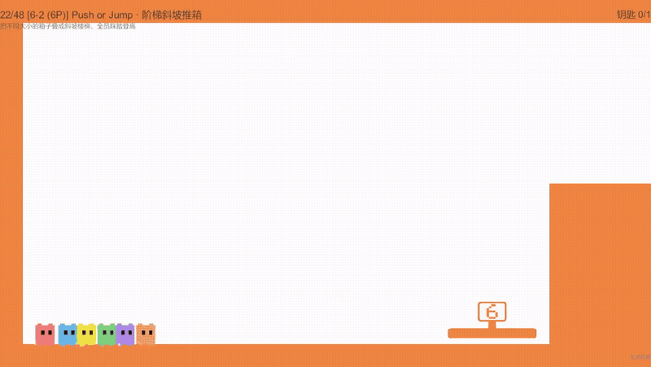
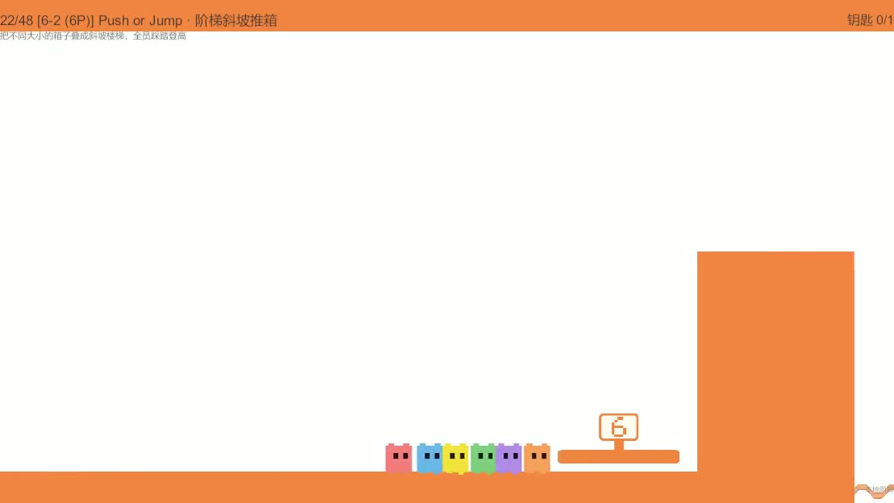
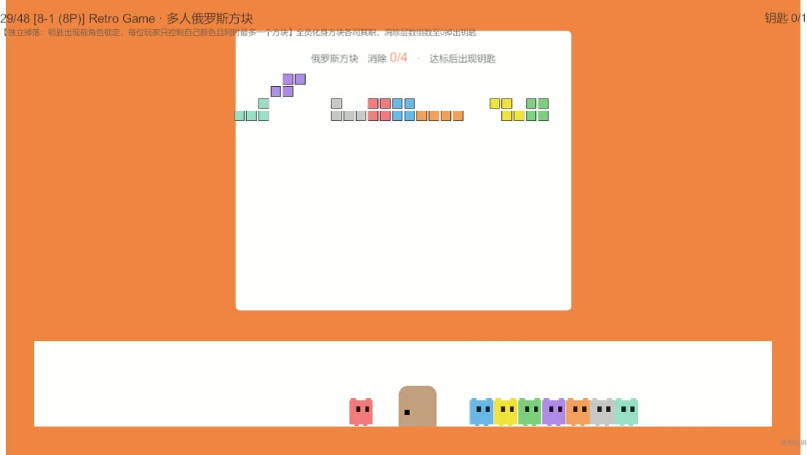
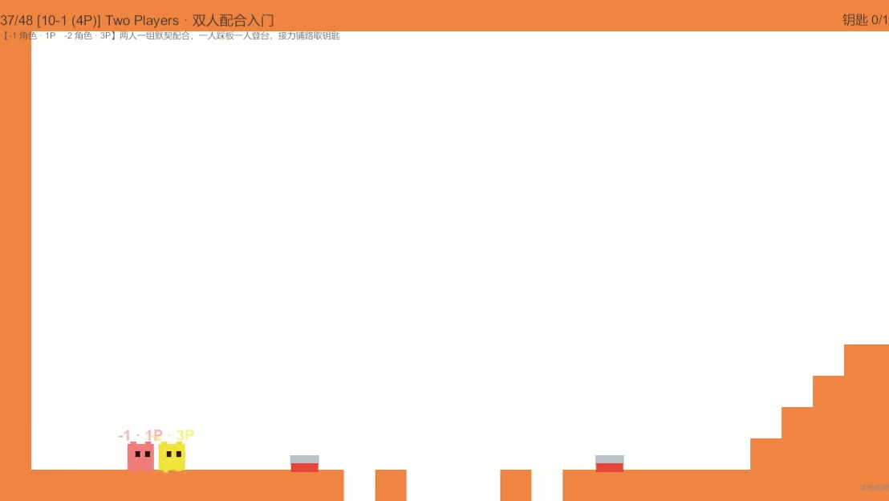

# Pico Park Reproduce

使用团结引擎制作的多人协作闯关原型。队友一起踩按钮、推数字箱、操作载人平台，找到钥匙后一起入门。这个项目用于练习关卡设计、角色控制与多人同步。

**[下载安装包](https://github.com/xiaolizi0v0/pico-park-reproduce/releases)** · **[查看实机录像](docs/media/gameplay.mp4)**



## 玩法

- **48 个关卡，12 个主题世界。** 每关有 2P–8P 的专用地图。联机按房间实际人数选择版本。
- **轮流操作 2.0。** 3–8 人分两组，分别控制两个角色。角色进入交接区域后，由组内下一位玩家接管。关卡编辑器可把此玩法叠加到其他主规则上。
- **合作机关。** 队友需要协调推箱、载人电梯与绳索，也会遇到俄罗斯方块、黑夜探索和吸力器等玩法。

## 实机截图

| 6 人协作 | 8 人俄罗斯方块 | 双角色接力 |
| --- | --- | --- |
|  |  |  |

画面录自本项目的团结编辑器 Play Mode。

## 游玩

- **Windows x64** · 运行 Releases 中的 `PicoPark-Reproduce-Windows-x64-Setup.exe`，安装后从开始菜单启动。
- **macOS** · 打开 Releases 中的 `PicoPark-Reproduce-macOS.dmg`，把应用拖入 Applications。此预览版使用临时签名，Apple Gatekeeper 可能提示需要手动确认。
- **本地模式** · 从主菜单选择本地同屏。1P 使用 A/D 移动、W 跳跃、S 向下、左 Shift 动作。2P 使用方向键和右 Shift。
- **Steam 联机测试** · Windows 版在 Steam 客户端运行时可创建和加入测试房间。当前配置使用 Steamworks 测试 App ID。macOS 版提供本地模式。

## 从源码运行

先安装 Git LFS，再克隆仓库。用 **团结引擎 1.8.5（2022.3.62t7）** 打开工程，在 `Assets/Scenes/Main.unity` 进入 Play Mode。

```sh
git lfs install
git clone https://github.com/xiaolizi0v0/pico-park-reproduce.git
cd pico-park-reproduce
git lfs pull
```

主要实现位于 `Assets/PicoPark/Scripts`。关卡变体、出生点和机关配置位于 Main 场景的 `[Levels]` 节点。安装包的生成与发布流程见 [发布说明](docs/release.md)。
