# PICO PARK 全关卡拆解补充册（48关 · 2P～8P）

> 版本为2026年11月21日的本地主场景，覆盖48关、336个人数版本。每关配一张2P开局实机画面，长地图配图显示开局视野。人数表来自对应场景配置，合作过程与难点为分析推演，尚未逐一实测336个版本的完整通关。

本册与[游戏拆解书](PICO%20PARK%20游戏拆解书.md)配套，按章节逐关展开。普通关的共同终点为处理钥匙或出口机关后全部角色进门，特殊规则还需先达成本关目标。

表中“跑速／跳高”分别以格/秒、格计，采用出生点覆盖参数。地砖比较包含位置、类型与高度，机关数量和控制形式另列。箱子与平台的一组人数数值按世界横坐标从左到右排列。平台上的玩家按1人计，数字箱按箱内人数计。多人推箱要求同侧连续接触，严格人数箱按配置足额判断。

## 人数变化对玩法的影响

| 内容 | 变化方式 | 对合作的影响 |
| --- | --- | --- |
| 踏板、箱子和平台 | 人数阈值、机关数量、箱子归属或辅助物改变 | 更多玩家既能分担任务，也会增加集合与通行压力 |
| 收集限时关 | 金币固定，时间采用分段配置 | 需要按人数调整收集区域和回门安排 |
| 共同操纵与接力 | 一只或两只角色对应多位操作者 | 按键一致和控制交接成为主要任务 |
| 时钟与能力 | 时钟任务扩展，共享能力消耗随实际移动人数增加 | 先分责任与行动窗口，再决定是否全员同时移动 |
| 方块与弹球 | 棋盘尺寸可能扩展，砖球数量多保持固定 | 同时处理输入增多与有限空间的关系 |

## 章节目录

- [第1章 hello pico park](#chapter-1)
- [第2章 go together](#chapter-2)
- [第3章 time limit](#chapter-3)
- [第4章 gimmick gimmick](#chapter-4)
- [第5章 all for one（仅单人）](#chapter-5)
- [第6章 push or jump](#chapter-6)
- [第7章 move and stop](#chapter-7)
- [第8章 retro game](#chapter-8)
- [第9章 ball park](#chapter-9)
- [第10章 two players](#chapter-10)
- [第11章 hand gimmick](#chapter-11)
- [第12章 last park](#chapter-12)
- [物体与机关拆解（43类，附图标）](#object-analysis)
- [物体与机关拆解（43类，附图标）](#object-analysis)

## 第1章 hello pico park

### 1-1　踏板搭桥

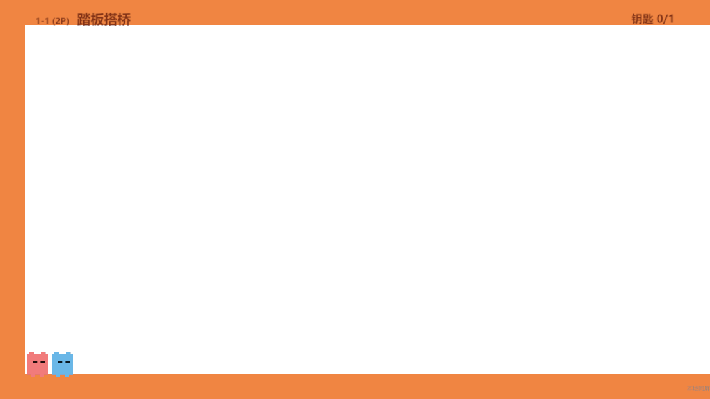

*图1　1-1「踏板搭桥」，2P开局。*

**关卡目标**　先让队伍通过机关控制的路径，再利用载人平台接近钥匙和出口。 取得场内钥匙并送达出口，让所有需要通关的角色进入。

**场景结构**　主规则为普通闯关。2P场景包含1个按钮、1个闸门、1个载人平台。

**合作过程**　观察压板与闸门的响应，先保持触发让队友通过，再重新集合达到平台人数要求。最后确认压板操作者也能撤离并进门。

**难点与设计作用**　持续压板与全员乘台构成两次集合。人数增加后，平台阈值同步增加，容易出现少一人、提前离台或挡住上台位置的情况。

**2P～8P版本分析**

| 人数 | 场上角色与配合分工 | 本版机关与数值 | 跑速／跳高 | 地砖布局 |
| --- | --- | --- | --- | --- |
| 2P | 2角色；压板通过后全队集合乘台 | 平台启动 2人 | 7.4／2.475 | 2P基准 |
| 3P | 3角色；压板通过后全队集合乘台 | 平台启动 3人 | 4／1.2 | 与2P一致 |
| 4P | 4角色；压板通过后全队集合乘台 | 平台启动 4人 | 4／1.2 | 与2P一致 |
| 5P | 5角色；压板通过后全队集合乘台 | 平台启动 5人 | 4／1.2 | 相对2P调整 |
| 6P | 6角色；压板通过后全队集合乘台 | 平台启动 6人 | 4／1.2 | 相对2P调整 |
| 7P | 7角色；压板通过后全队集合乘台 | 平台启动 7人 | 4／1.2 | 相对2P调整 |
| 8P | 8角色；压板通过后全队集合乘台 | 平台启动 8人 | 4／1.2 | 相对2P调整 |

**人数适配分析**　七个版本存在地砖布局差异，表中以2P为比较基准。即使机关数量相同，落脚点与站位空间也需要按所选版本重新观察。

### 1-2　数字箱取钥

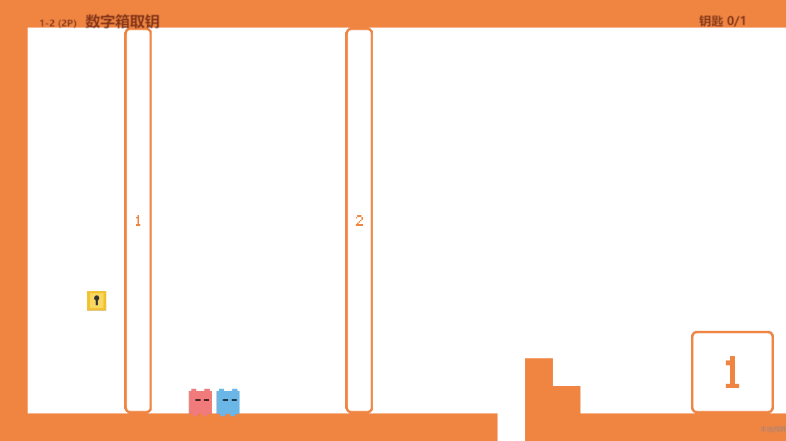

*图2　1-2「数字箱取钥」，2P开局。*

**关卡目标**　处理三块不同推力要求的数字箱，建立能够接近钥匙与出口的路径。 取得场内钥匙并送达出口，让所有需要通关的角色进入。

**场景结构**　主规则为普通闯关。2P场景包含3个箱子。

**合作过程**　按空间顺序处理左、中、右三箱，先为所需人数最多的箱子组织连续推队，再把剩余角色安排到取钥和出口路线。

**难点与设计作用**　中箱的需求随总人数增长。推力链必须同侧连续接触，双方对推和队列留空隙都会影响移动。

**2P～8P版本分析**

| 人数 | 场上角色与配合分工 | 本版机关与数值 | 跑速／跳高 | 地砖布局 |
| --- | --- | --- | --- | --- |
| 2P | 2角色；按箱要求组成连续推队 | 左→右箱需求 1／2／1人；第1箱严格人数 | 7.4／2.475 | 2P基准 |
| 3P | 3角色；按箱要求组成连续推队 | 左→右箱需求 2／3／2人；第1箱严格人数 | 4／1.2 | 相对2P调整 |
| 4P | 4角色；按箱要求组成连续推队 | 左→右箱需求 2／4／2人；第1箱严格人数 | 4／1.2 | 相对2P调整 |
| 5P | 5角色；按箱要求组成连续推队 | 左→右箱需求 2／5／3人；第1箱严格人数 | 4／1.2 | 相对2P调整 |
| 6P | 6角色；按箱要求组成连续推队 | 左→右箱需求 3／6／3人；第1箱严格人数 | 4／1.2 | 相对2P调整 |
| 7P | 7角色；按箱要求组成连续推队 | 左→右箱需求 3／7／4人；第1箱严格人数 | 4／1.2 | 相对2P调整 |
| 8P | 8角色；按箱要求组成连续推队 | 左→右箱需求 3／8／4人；第1箱严格人数 | 4／1.2 | 相对2P调整 |

**人数适配分析**　中间数字箱始终要求全队人数，其余箱子按分段需求增加。2P地砖与其余版本也有差异，推队长度和可用落脚空间需要一起安排。

### 1-3　踏板连锁

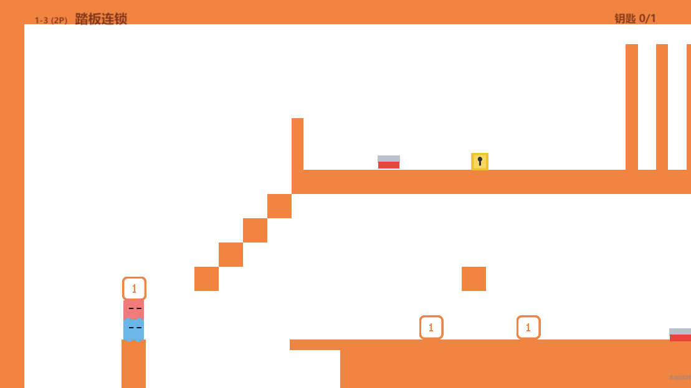

*图3　1-3「踏板连锁」，2P开局。*

**关卡目标**　通过多块按钮控制多道闸门，逐步打开通向钥匙和门的路线。 取得场内钥匙并送达出口，让所有需要通关的角色进入。

**场景结构**　主规则为普通闯关。2P场景包含5个按钮、3个箱子、6个闸门。

**合作过程**　先区分自锁按钮与持续压住的按钮，再决定哪些位置能留给箱子、哪些需要玩家保持；队伍随前段打开而向后段交接。

**难点与设计作用**　多人版增加按钮和闸门并减少箱子，参与者需要承担更多站位任务。按钮数增加并不自动代表能同时完成所有门段。

**2P～8P版本分析**

| 人数 | 场上角色与配合分工 | 本版机关与数值 | 跑速／跳高 | 地砖布局 |
| --- | --- | --- | --- | --- |
| 2P | 2角色；分管持续压板和推进取钥 | 5按钮／6闸门／3箱；自锁1块 | 7.4／2.475 | 2P基准 |
| 3P | 3角色；分管持续压板和推进取钥 | 6按钮／7闸门／2箱；自锁1块 | 4／1.2 | 与2P一致 |
| 4P | 4角色；分管持续压板和推进取钥 | 6按钮／7闸门／2箱；自锁1块 | 4／1.2 | 相对2P调整 |
| 5P | 5角色；分管持续压板和推进取钥 | 7按钮／10闸门／1箱；自锁1块 | 4／1.2 | 相对2P调整 |
| 6P | 6角色；分管持续压板和推进取钥 | 8按钮／10闸门／1箱；自锁1块 | 4／1.2 | 相对2P调整 |
| 7P | 7角色；分管持续压板和推进取钥 | 9按钮／10闸门／1箱；自锁1块 | 4／1.2 | 相对2P调整 |
| 8P | 8角色；分管持续压板和推进取钥 | 9按钮／10闸门／1箱；自锁1块 | 4／1.2 | 相对2P调整 |

**人数适配分析**　按钮从5块增加到9块，闸门从6道增加到10道，箱子从3块减少到1块。多人承担更多持续站位，箱子替代玩家的空间减少。

### 1-4　搭台越障

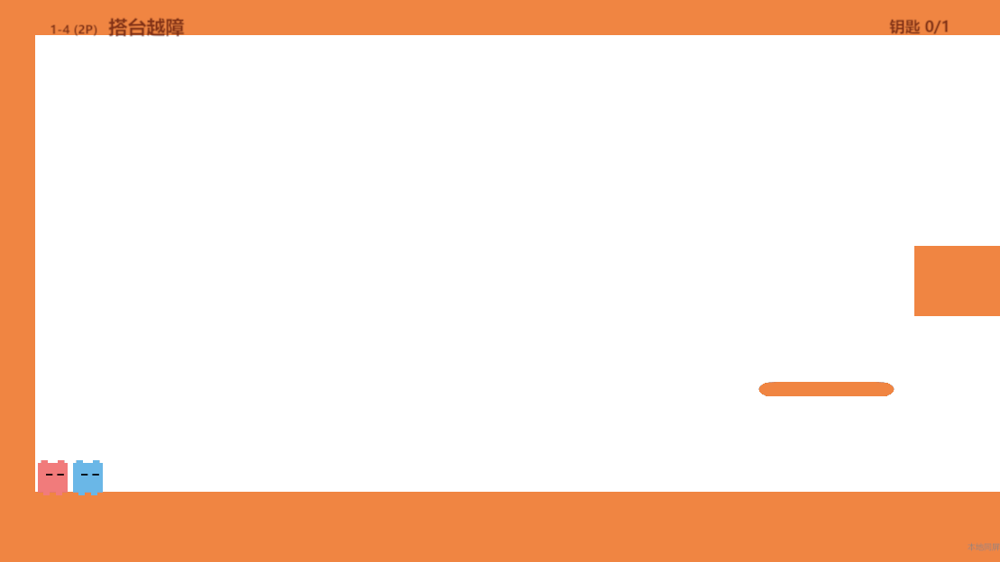

*图4　1-4「搭台越障」，2P开局。*

**关卡目标**　借助两座载人平台及移动障碍抵达高处出口。 取得场内钥匙并送达出口，让所有需要通关的角色进入。

**场景结构**　主规则为普通闯关。2P场景包含2个移动障碍、2个载人平台。

**合作过程**　先观察移动物的行程，在安全位置集合足够乘员，再把队伍转移到下一段平台；已到岸者为后续角色留出落点。

**难点与设计作用**　两座平台的人数要求增长方式不同。第一座需要更多人到齐，第二座仍可由较小小组启动，适合形成分批转移。

**2P～8P版本分析**

| 人数 | 场上角色与配合分工 | 本版机关与数值 | 跑速／跳高 | 地砖布局 |
| --- | --- | --- | --- | --- |
| 2P | 2角色；首台集合，再安排末台分批 | 两台启动需求 2／2人；移动障碍2个 | 7.4／2.475 | 2P基准 |
| 3P | 3角色；首台集合，再安排末台分批 | 两台启动需求 3／2人；移动障碍2个 | 4／1.2 | 与2P一致 |
| 4P | 4角色；首台集合，再安排末台分批 | 两台启动需求 3／2人；移动障碍2个 | 4／1.2 | 与2P一致 |
| 5P | 5角色；首台集合，再安排末台分批 | 两台启动需求 4／2人；移动障碍2个 | 4／1.2 | 与2P一致 |
| 6P | 6角色；首台集合，再安排末台分批 | 两台启动需求 5／2人；移动障碍2个 | 4／1.2 | 与2P一致 |
| 7P | 7角色；首台集合，再安排末台分批 | 两台启动需求 5／2人；移动障碍2个 | 4／1.2 | 与2P一致 |
| 8P | 8角色；首台集合，再安排末台分批 | 两台启动需求 6／2人；移动障碍2个 | 4／1.2 | 与2P一致 |

**人数适配分析**　七个版本的地砖布局和主要机关数量一致。人数变化主要体现在出生点、操作责任和表中参数，队伍扩大后需要重新安排间距、等候与通过顺序。

## 第2章 go together

### 2-1　同绳跳台

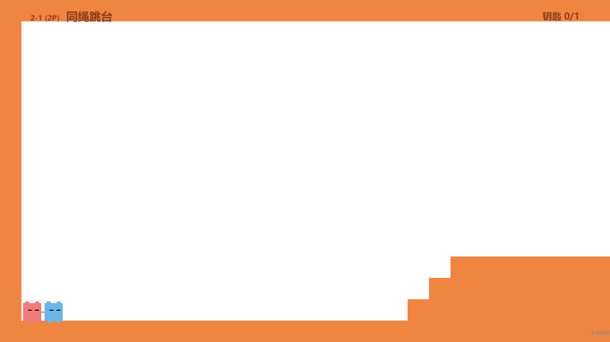

*图5　2-1「同绳跳台」，2P开局。*

**关卡目标**　用绳索保持连接，协同越过跳台并送钥匙进门。 取得场内钥匙并送达出口，让所有需要通关的角色进入。

**场景结构**　主规则为绳索。2P以绳索连接2名角色，实体地形构成连续跳台，绳长3.6格。

**合作过程**　前方玩家先确定下一落点，中间玩家保持连接余量，最后一人确认队尾离开后再统一推进。

**难点与设计作用**　同样绳长下人数增加使队伍链条变长。抢跑会牵动尚未起跳或仍在落地的队员，落后者也会拖住前方。

**2P～8P版本分析**

| 人数 | 场上角色与配合分工 | 本版机关与数值 | 跑速／跳高 | 地砖布局 |
| --- | --- | --- | --- | --- |
| 2P | 2角色；两人统一起跳口令 | 绳长3.6格 | 7.4／2.475 | 2P基准 |
| 3P | 3角色；1领跳、1中继、1收尾 | 绳长3.6格 | 4／1.2 | 与2P一致 |
| 4P | 4角色；1领跳、2中继、1收尾 | 绳长3.6格 | 4／1.2 | 与2P一致 |
| 5P | 5角色；1领跳、3中继、1收尾 | 绳长3.6格 | 4／1.2 | 与2P一致 |
| 6P | 6角色；1领跳、4中继、1收尾 | 绳长3.6格 | 4／1.2 | 与2P一致 |
| 7P | 7角色；1领跳、5中继、1收尾 | 绳长3.6格 | 4／1.2 | 与2P一致 |
| 8P | 8角色；1领跳、6中继、1收尾 | 绳长3.6格 | 4／1.2 | 与2P一致 |

**人数适配分析**　七个版本的地砖布局和主要机关数量一致。人数变化主要体现在出生点、操作责任和表中参数，队伍扩大后需要重新安排间距、等候与通过顺序。

### 2-2　玻璃窄桥

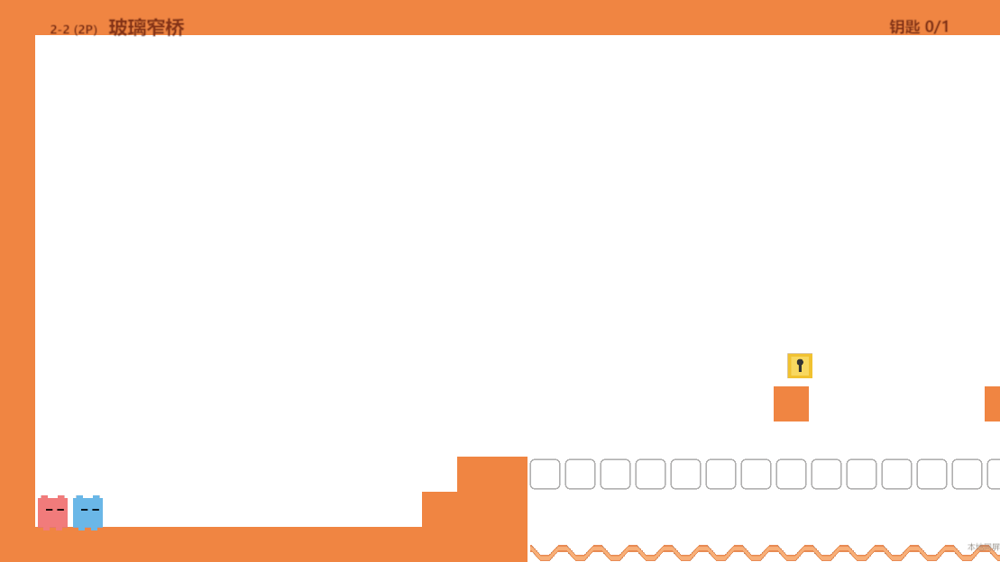

*图6　2-2「玻璃窄桥」，2P开局。*

**关卡目标**　通过会破碎的玻璃窄桥，避开激光并接近钥匙。 取得场内钥匙并送达出口，让所有需要通关的角色进入。

**场景结构**　主规则为普通闯关。2P场景包含19个玻璃、1个激光。

**合作过程**　先看清玻璃连续段和可停留实体平台，再约定通过顺序；避免队尾走到前方已经踩碎的支撑面。

**难点与设计作用**　破碎延迟限制停留，队伍越长越难共享同一组落脚点。该关主规则为普通闯关，合作约束主要来自玻璃与危险区。

**2P～8P版本分析**

| 人数 | 场上角色与配合分工 | 本版机关与数值 | 跑速／跳高 | 地砖布局 |
| --- | --- | --- | --- | --- |
| 2P | 2角色；约定过桥顺序，避免破碎段拥堵 | 玻璃19段；激光1道 | 7.4／2.475 | 2P基准 |
| 3P | 3角色；约定过桥顺序，避免破碎段拥堵 | 玻璃19段；激光1道 | 4／1.2 | 相对2P调整 |
| 4P | 4角色；约定过桥顺序，避免破碎段拥堵 | 玻璃19段；激光1道 | 4／1.2 | 相对2P调整 |
| 5P | 5角色；约定过桥顺序，避免破碎段拥堵 | 玻璃19段；激光1道 | 4／1.2 | 相对2P调整 |
| 6P | 6角色；约定过桥顺序，避免破碎段拥堵 | 玻璃19段；激光1道 | 4／1.2 | 相对2P调整 |
| 7P | 7角色；约定过桥顺序，避免破碎段拥堵 | 玻璃19段；激光1道 | 4／1.2 | 相对2P调整 |
| 8P | 8角色；约定过桥顺序，避免破碎段拥堵 | 玻璃19段；激光1道 | 4／1.2 | 相对2P调整 |

**人数适配分析**　七个版本存在地砖布局差异，表中以2P为比较基准。即使机关数量相同，落脚点与站位空间也需要按所选版本重新观察。

### 2-3　绳索越光

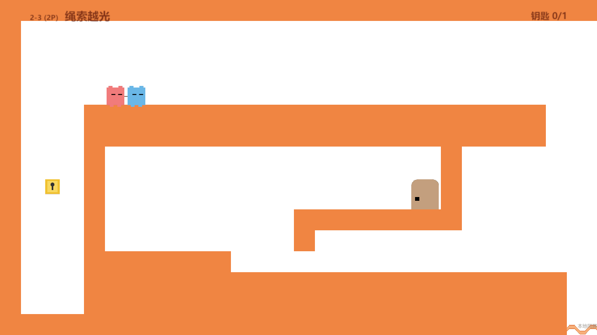

*图7　2-3「绳索越光」，2P开局。*

**关卡目标**　在绳索牵引下通过有激光的高低路线。 取得场内钥匙并送达出口，让所有需要通关的角色进入。

**场景结构**　主规则为绳索。2P场景包含1个激光。

**合作过程**　先确定激光的安全通过高度，把岸上与低处角色的行动安排成连续步骤；取钥时保留能接回队友的位置。

**难点与设计作用**　本关绳长大于2-1，允许更大分离距离，但队伍需要同时判断高度差和牵引方向，避免把队友拉进光束。

**2P～8P版本分析**

| 人数 | 场上角色与配合分工 | 本版机关与数值 | 跑速／跳高 | 地砖布局 |
| --- | --- | --- | --- | --- |
| 2P | 2角色；两人统一起跳口令 | 绳长4.8格；激光1道 | 7.4／2.475 | 2P基准 |
| 3P | 3角色；1领跳、1中继、1收尾 | 绳长4.8格；激光1道 | 4／1.2 | 与2P一致 |
| 4P | 4角色；1领跳、2中继、1收尾 | 绳长4.8格；激光1道 | 4／1.2 | 与2P一致 |
| 5P | 5角色；1领跳、3中继、1收尾 | 绳长4.8格；激光1道 | 4／1.2 | 与2P一致 |
| 6P | 6角色；1领跳、4中继、1收尾 | 绳长4.8格；激光1道 | 4／1.2 | 与2P一致 |
| 7P | 7角色；1领跳、5中继、1收尾 | 绳长4.8格；激光1道 | 4／1.2 | 与2P一致 |
| 8P | 8角色；1领跳、6中继、1收尾 | 绳长4.8格；激光1道 | 4／1.2 | 与2P一致 |

**人数适配分析**　七个版本的地砖布局和主要机关数量一致。人数变化主要体现在出生点、操作责任和表中参数，队伍扩大后需要重新安排间距、等候与通过顺序。

### 2-4　玻璃桥与弹簧

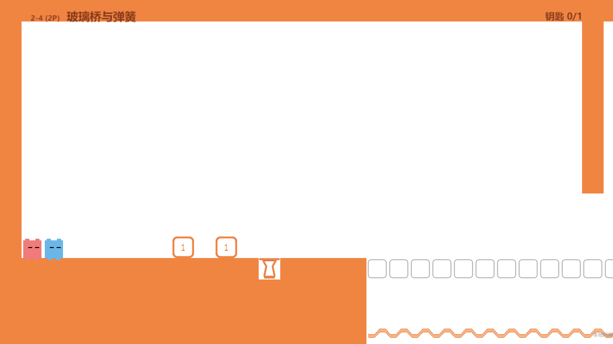

*图8　2-4「玻璃桥与弹簧」，2P开局。*

**关卡目标**　利用可用角色和箱子的有效重量启动平台，穿过玻璃与激光区域。 取得场内钥匙并送达出口，让所有需要通关的角色进入。

**场景结构**　主规则为普通闯关。2P场景包含1个弹簧、2个箱子、1个载人平台、19个玻璃、1个激光。

**合作过程**　先核对平台要求，人数不足的版本需要把数字箱带到平台补足有效人数；过桥时再安排离台与接应顺序。

**难点与设计作用**　2P至4P版有箱子辅助，5P至8P版取消箱子并采用全员阈值。低人数版的准备步骤与高人数版的集合压力不同。

**2P～8P版本分析**

| 人数 | 场上角色与配合分工 | 本版机关与数值 | 跑速／跳高 | 地砖布局 |
| --- | --- | --- | --- | --- |
| 2P | 2角色；约定过桥顺序，避免破碎段拥堵 | 平台4人；箱2；弹簧1 | 7.4／2.475 | 2P基准 |
| 3P | 3角色；约定过桥顺序，避免破碎段拥堵 | 平台4人；箱1；弹簧1 | 4／1.2 | 与2P一致 |
| 4P | 4角色；约定过桥顺序，避免破碎段拥堵 | 平台5人；箱1；弹簧1 | 4／1.2 | 与2P一致 |
| 5P | 5角色；约定过桥顺序，避免破碎段拥堵 | 平台5人；箱0；弹簧0 | 4／1.2 | 相对2P调整 |
| 6P | 6角色；约定过桥顺序，避免破碎段拥堵 | 平台6人；箱0；弹簧0 | 4／1.2 | 相对2P调整 |
| 7P | 7角色；约定过桥顺序，避免破碎段拥堵 | 平台7人；箱0；弹簧0 | 4／1.2 | 相对2P调整 |
| 8P | 8角色；约定过桥顺序，避免破碎段拥堵 | 平台8人；箱0；弹簧0 | 4／1.2 | 相对2P调整 |

**人数适配分析**　2P要求4人有效重量、3P要求4人、4P要求5人，靠箱子补足；5P以后取消箱子与弹簧，平台阈值等于人数。关卡名保留弹簧语义，但高人数版本的实际任务已偏向全员集合。

平台采用有效重量判定，2P版的两个1人数字箱与两名玩家可凑足4人要求。3P与4P版各保留一个箱子，5P以后由玩家本身满足人数要求。

## 第3章 time limit

### 3-1　限时搜金币

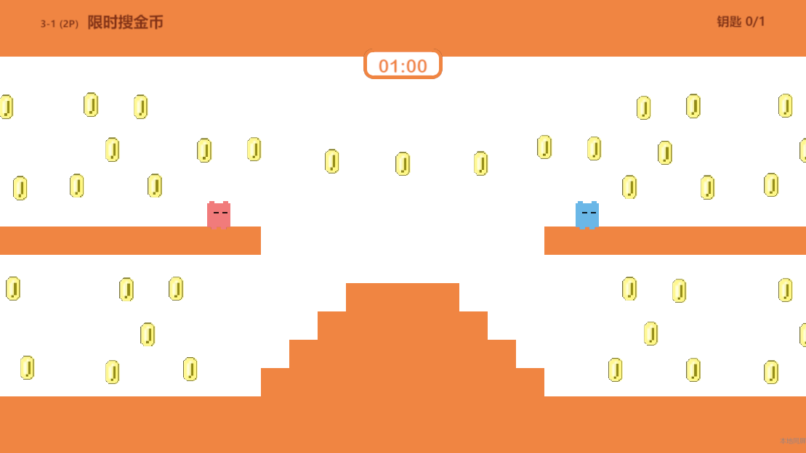

*图9　3-1「限时搜金币」，2P开局。*

**关卡目标**　在限定时间内清理金币，使钥匙出现并完成出口流程。 收齐47枚金币使钥匙出现，在时间耗尽前取钥并全员进门。

**场景结构**　主规则为限时。2P场景包含47个金币。

**合作过程**　按出生区和相邻平台划分收集范围，优先减少往返与重复覆盖；接近清空时集中确认遗漏区域并准备回门。

**难点与设计作用**　47枚金币不随人数增加，时间却采用分段配置。多人有并行优势，也会发生同路收集、遗漏角落和最后一人回程过长。

**2P～8P版本分析**

| 人数 | 场上角色与配合分工 | 本版机关与数值 | 跑速／跳高 | 地砖布局 |
| --- | --- | --- | --- | --- |
| 2P | 2角色；按位置分2个搜集责任区 | 60秒；金币47枚 | 7.4／2.475 | 2P基准 |
| 3P | 3角色；按位置分3个搜集责任区 | 53秒；金币47枚 | 4／1.2 | 与2P一致 |
| 4P | 4角色；按位置分4个搜集责任区 | 45秒；金币47枚 | 4／1.2 | 与2P一致 |
| 5P | 5角色；按位置分5个搜集责任区 | 49秒；金币47枚 | 4／1.2 | 与2P一致 |
| 6P | 6角色；按位置分6个搜集责任区 | 53秒；金币47枚 | 4／1.2 | 与2P一致 |
| 7P | 7角色；按位置分7个搜集责任区 | 56秒；金币47枚 | 4／1.2 | 与2P一致 |
| 8P | 8角色；按位置分8个搜集责任区 | 60秒；金币47枚 | 4／1.2 | 与2P一致 |

**人数适配分析**　时间配置呈分段变化，4P的限时最短，之后随人数回升。人数带来的收集并行优势，需要与出生位置、动作参数及回门距离一起看。

### 3-2　抢时踩踏板

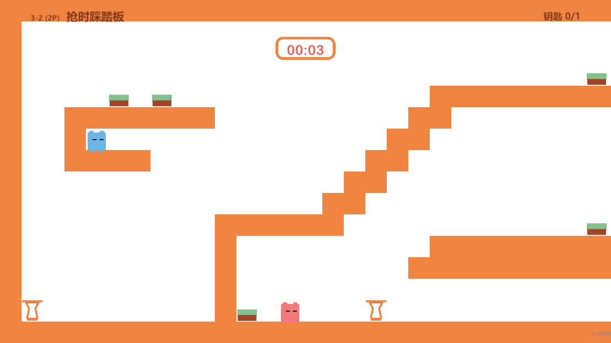

*图10　3-2「抢时踩踏板」，2P开局。*

**关卡目标**　用沿途加时按钮维持时间，在起始3秒的压力下完成前进与取钥。 取得场内钥匙并送达出口，让所有需要通关的角色进入。

**场景结构**　主规则为限时。2P场景包含7个按钮、2个弹簧。

**合作过程**　开局先到达最近的加时点，之后由各位置玩家接续触发；利用弹簧转移时同步确认下一段剩余时间。

**难点与设计作用**　当前按钮均为时间控制，加时节奏是主要任务。初始时间短，反复讨论再起步会直接损失生存窗口。

**2P～8P版本分析**

| 人数 | 场上角色与配合分工 | 本版机关与数值 | 跑速／跳高 | 地砖布局 |
| --- | --- | --- | --- | --- |
| 2P | 2角色；加时任务与赶路交错进行 | 起始3秒；加时7块、合计+7秒；箱0 | 7.4／2.475 | 2P基准 |
| 3P | 3角色；加时任务与赶路交错进行 | 起始3秒；加时9块、合计+9秒；箱0 | 4／1.2 | 与2P一致 |
| 4P | 4角色；加时任务与赶路交错进行 | 起始3秒；加时9块、合计+9秒；箱0 | 4／1.2 | 与2P一致 |
| 5P | 5角色；加时任务与赶路交错进行 | 起始3秒；加时9块、合计+9秒；箱0 | 4／1.2 | 与2P一致 |
| 6P | 6角色；加时任务与赶路交错进行 | 起始3秒；加时9块、合计+9秒；箱0 | 4／1.2 | 与2P一致 |
| 7P | 7角色；加时任务与赶路交错进行 | 起始3秒；加时9块、合计+9秒；箱0 | 4／1.2 | 与2P一致 |
| 8P | 8角色；加时任务与赶路交错进行 | 起始3秒；加时9块、合计+9秒；箱0 | 4／1.2 | 与2P一致 |

**人数适配分析**　全部版本起始时间均为3秒，2P有7块加时按钮，3P以后有9块。按钮各提供一次1秒补给，实际可用余量取决于能否按时踩到。

### 3-3　弹簧抢金币

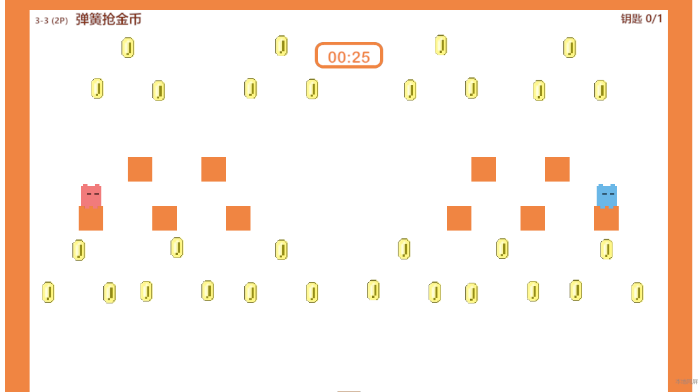

*图11　3-3「弹簧抢金币」，2P开局。*

**关卡目标**　借弹簧改变高度，在限时内收集分布于空中的金币。 收齐30枚金币使钥匙出现，在时间耗尽前取钥并全员进门。

**场景结构**　主规则为限时。2P场景包含30个金币、24个弹簧。

**合作过程**　队员分区清理，上下层收集与回程配合进行；发现只剩少量金币后，先报出位置再安排最近角色补收。

**难点与设计作用**　弹簧承担反复纵向运动，横向修正和落点决定覆盖效率。更多玩家减少单人工作量，也会争抢同一个弹跳位置。

**2P～8P版本分析**

| 人数 | 场上角色与配合分工 | 本版机关与数值 | 跑速／跳高 | 地砖布局 |
| --- | --- | --- | --- | --- |
| 2P | 2角色；按位置分2个搜集责任区 | 25秒；30金币／24弹簧 | 7.4／2.475 | 2P基准 |
| 3P | 3角色；按位置分3个搜集责任区 | 20秒；30金币／24弹簧 | 4／1.2 | 与2P一致 |
| 4P | 4角色；按位置分4个搜集责任区 | 15秒；30金币／24弹簧 | 4／1.2 | 与2P一致 |
| 5P | 5角色；按位置分5个搜集责任区 | 18秒；30金币／24弹簧 | 4／1.2 | 与2P一致 |
| 6P | 6角色；按位置分6个搜集责任区 | 20秒；30金币／24弹簧 | 4／1.2 | 与2P一致 |
| 7P | 7角色；按位置分7个搜集责任区 | 23秒；30金币／24弹簧 | 4／1.2 | 与2P一致 |
| 8P | 8角色；按位置分8个搜集责任区 | 25秒；30金币／24弹簧 | 4／1.2 | 与2P一致 |

**人数适配分析**　时间配置呈分段变化，4P的限时最短，之后随人数回升。人数带来的收集并行优势，需要与出生位置、动作参数及回门距离一起看。

### 3-4　推箱踩双板

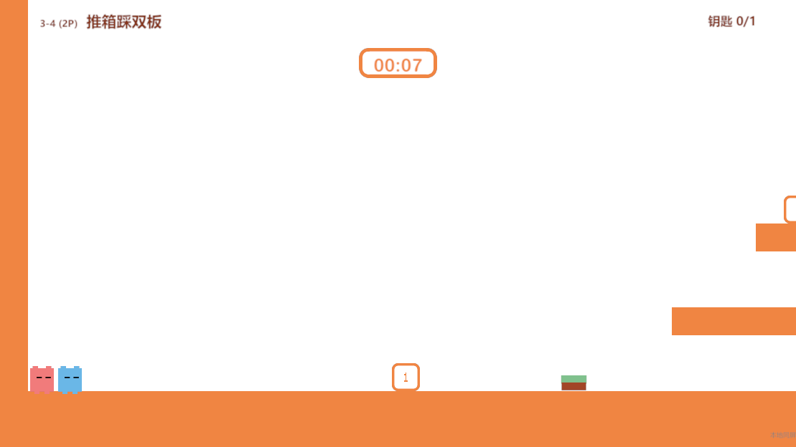

*图12　3-4「推箱踩双板」，2P开局。*

**关卡目标**　在7秒起始时间下借箱子登高、触发加时并接近出口。 取得场内钥匙并送达出口，让所有需要通关的角色进入。

**场景结构**　主规则为限时。2P场景包含2个按钮、3个箱子。

**合作过程**　把推箱和前往加时点安排为交错任务，避免所有人只顾推进同一块箱子；每次加时后再组织下一段登高。

**难点与设计作用**　3P与4P版增加加时按钮并减少箱子，5P以后恢复三箱两按钮结构，人数变化并非逐项递增。

**2P～8P版本分析**

| 人数 | 场上角色与配合分工 | 本版机关与数值 | 跑速／跳高 | 地砖布局 |
| --- | --- | --- | --- | --- |
| 2P | 2角色；加时任务与赶路交错进行 | 起始7秒；加时2块、合计+4秒；箱3 | 7.4／2.475 | 2P基准 |
| 3P | 3角色；加时任务与赶路交错进行 | 起始7秒；加时6块、合计+12秒；箱1 | 4／1.2 | 与2P一致 |
| 4P | 4角色；加时任务与赶路交错进行 | 起始7秒；加时6块、合计+12秒；箱1 | 4／1.2 | 与2P一致 |
| 5P | 5角色；加时任务与赶路交错进行 | 起始7秒；加时2块、合计+4秒；箱3 | 4／1.2 | 与2P一致 |
| 6P | 6角色；加时任务与赶路交错进行 | 起始7秒；加时2块、合计+4秒；箱3 | 4／1.2 | 与2P一致 |
| 7P | 7角色；加时任务与赶路交错进行 | 起始7秒；加时2块、合计+4秒；箱3 | 4／1.2 | 与2P一致 |
| 8P | 8角色；加时任务与赶路交错进行 | 起始7秒；加时2块、合计+4秒；箱3 | 4／1.2 | 与2P一致 |

**人数适配分析**　3P与4P采用6块加时按钮、1箱，其余版本为2块加时按钮、3箱。全部按钮每块一次增加2秒，机制侧重随人数分档切换。

## 第4章 gimmick gimmick

### 4-1　举盾挡激光

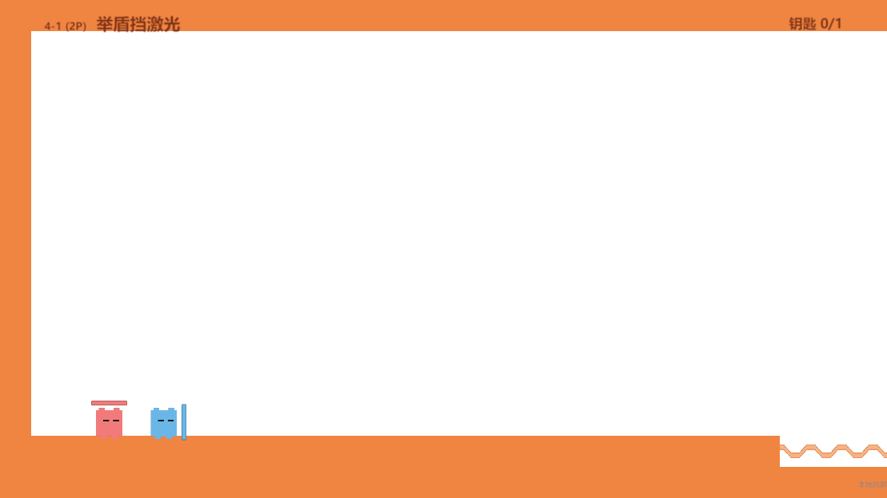

*图13　4-1「举盾挡激光」，2P开局。*

**关卡目标**　利用护盾方向穿过横向和竖向激光区域。 取得场内钥匙并送达出口，让所有需要通关的角色进入。

**场景结构**　主规则为护盾。2P场景包含16个激光。

**合作过程**　先匹配盾朝向与光束方向，由能遮挡该方向的角色到前方或上方，其他队友在保护范围内跟随。

**难点与设计作用**　盾牌只能保护对应方向，队员站位和朝向需要一起协调。队伍扩大后，同一保护区内的容纳与跟随误差更明显。

**2P～8P版本分析**

| 人数 | 场上角色与配合分工 | 本版机关与数值 | 跑速／跳高 | 地砖布局 |
| --- | --- | --- | --- | --- |
| 2P | 2角色；按盾向掩护与换位 | 盾向 上1、前1；16道激光 | 7.4／2.475 | 2P基准 |
| 3P | 3角色；按盾向掩护与换位 | 盾向 上1、下1、前1；16道激光 | 4／1.2 | 与2P一致 |
| 4P | 4角色；按盾向掩护与换位 | 盾向 上1、下2、前1；16道激光 | 4／1.2 | 与2P一致 |
| 5P | 5角色；按盾向掩护与换位 | 盾向 上2、下2、前1；16道激光 | 4／1.2 | 与2P一致 |
| 6P | 6角色；按盾向掩护与换位 | 盾向 上2、下3、前1；16道激光 | 4／1.2 | 与2P一致 |
| 7P | 7角色；按盾向掩护与换位 | 盾向 上2、下4、前1；16道激光 | 4／1.2 | 与2P一致 |
| 8P | 8角色；按盾向掩护与换位 | 盾向 上2、下5、前1；16道激光 | 4／1.2 | 与2P一致 |

**人数适配分析**　七个版本的地砖布局和主要机关数量一致。人数变化主要体现在出生点、操作责任和表中参数，队伍扩大后需要重新安排间距、等候与通过顺序。

### 4-2　飞机穿障

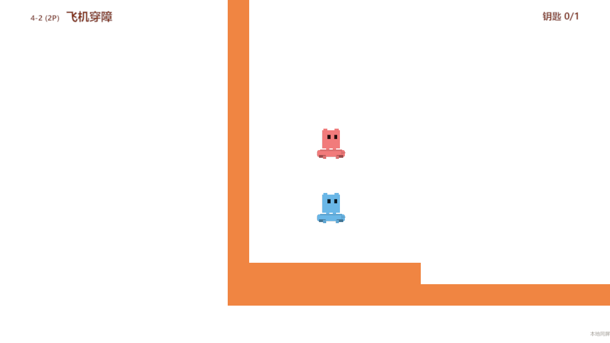

*图14　4-2「飞机穿障」，2P开局。*

**关卡目标**　在自动前进的飞机模式中调整飞行位置，穿过地刺障碍并取钥。 取得场内钥匙并送达出口，让所有需要通关的角色进入。

**场景结构**　主规则为飞机。2P场景包含1个箱子。

**合作过程**　提前观察下一个缺口，队伍按各自纵向位置避障；需要接触数字箱的路线先确认推力人数与安全空间。

**难点与设计作用**　每个角色都要完成避障，自动前进压缩了犹豫时间。场景含全员需求数字箱，如何利用需结合实际路线判断。

**2P～8P版本分析**

| 人数 | 场上角色与配合分工 | 本版机关与数值 | 跑速／跳高 | 地砖布局 |
| --- | --- | --- | --- | --- |
| 2P | 2角色；各自避障，队伍共享通道信息 | 自动前进7格/秒；箱需2人 | 7.4／2.475 | 2P基准 |
| 3P | 3角色；各自避障，队伍共享通道信息 | 自动前进7格/秒；箱需3人 | 4／1.2 | 与2P一致 |
| 4P | 4角色；各自避障，队伍共享通道信息 | 自动前进7格/秒；箱需4人 | 4／1.2 | 与2P一致 |
| 5P | 5角色；各自避障，队伍共享通道信息 | 自动前进7格/秒；箱需5人 | 4／1.2 | 与2P一致 |
| 6P | 6角色；各自避障，队伍共享通道信息 | 自动前进7格/秒；箱需6人 | 4／1.2 | 与2P一致 |
| 7P | 7角色；各自避障，队伍共享通道信息 | 自动前进7格/秒；箱需7人 | 4／1.2 | 与2P一致 |
| 8P | 8角色；各自避障，队伍共享通道信息 | 自动前进7格/秒；箱需8人 | 4／1.2 | 与2P一致 |

**人数适配分析**　七个版本的地砖布局和主要机关数量一致。人数变化主要体现在出生点、操作责任和表中参数，队伍扩大后需要重新安排间距、等候与通过顺序。

### 4-3　双钟卡点

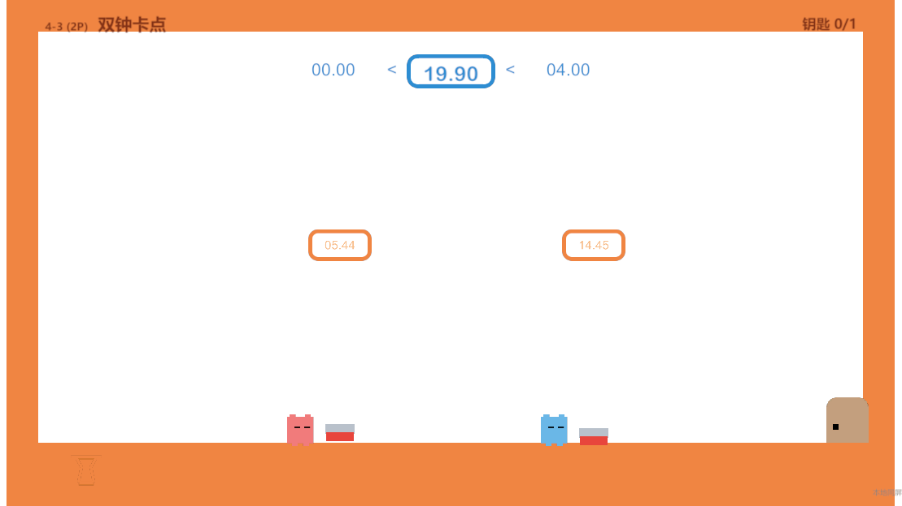

*图15　4-3「双钟卡点」，2P开局。*

**关卡目标**　分别停下场内时钟，使总剩余时间进入目标区间，再完成取钥与出门。 全部时钟停止且总剩余时间落在本关区间内，钥匙出现后完成出口流程。

**场景结构**　主规则为区间停钟。2P场景包含2个按钮、1个弹簧、2个时钟。

**合作过程**　先分配每只钟的责任人，根据各钟起始时长约定停钟顺序；按钮为单次自锁，踩下前应确认目标余量。

**难点与设计作用**　多人版增加时钟并压缩总余量窗口。8P版有9钟，至少一位玩家要承担多钟任务，职责无法简单按每人一钟分配。

**2P～8P版本分析**

| 人数 | 场上角色与配合分工 | 本版机关与数值 | 跑速／跳高 | 地砖布局 |
| --- | --- | --- | --- | --- |
| 2P | 2角色；每人负责1钟并确认余时 | 2钟（6秒×1、15秒×1）；总余时[0,4]秒 | 7.4／2.475 | 2P基准 |
| 3P | 3角色；每人负责1钟并确认余时 | 3钟（6秒×2、15秒×1）；总余时[0,1.2]秒 | 4／1.2 | 与2P一致 |
| 4P | 4角色；每人负责1钟并确认余时 | 4钟（6秒×2、15秒×2）；总余时[0,1.6]秒 | 4／1.2 | 与2P一致 |
| 5P | 5角色；每人负责1钟并确认余时 | 5钟（6秒×3、15秒×2）；总余时[0,2]秒 | 4／1.2 | 与2P一致 |
| 6P | 6角色；每人负责1钟并确认余时 | 6钟（6秒×3、15秒×3）；总余时[0,2.4]秒 | 4／1.2 | 与2P一致 |
| 7P | 7角色；每人负责1钟并确认余时 | 7钟（6秒×4、15秒×3）；总余时[0,2.8]秒 | 4／1.2 | 与2P一致 |
| 8P | 8角色；9钟分给8人，至少1人管多钟 | 9钟（6秒×4、15秒×5）；总余时[0,3.15]秒 | 4／1.2 | 与2P一致 |

**人数适配分析**　2P为2钟、总余时上限4秒。3P至7P按人数增加时钟，上限依次为1.2、1.6、2、2.4、2.8秒；8P为9钟、上限3.15秒，需安排一人承担额外停钟。总余时为零仍触发耗尽失败。

2P的两只钟初始分别为6秒和15秒，停钟按钮为单次自锁。停下全部时钟后的总剩余时间需要大于零并处于目标区间；一次过早停钟可能让后续玩家失去补救空间。

### 4-4　变身钻窄道

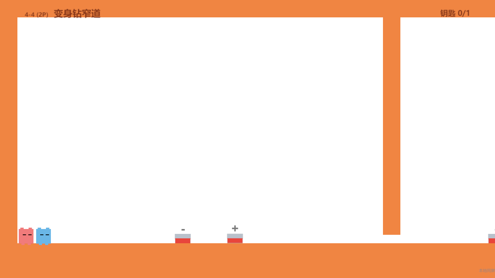

*图16　4-4「变身钻窄道」，2P开局。*

**关卡目标**　改变体型通过不同高度的通道，同时处理箱子与闸门。 取得场内钥匙并送达出口，让所有需要通关的角色进入。

**场景结构**　主规则为体型变化。2P场景包含5个按钮、1个箱子、1个闸门。

**合作过程**　先确定缩小后的通行路线和变大后的支撑位置，再让对应玩家持续踩住体型按钮达到需要的尺寸。

**难点与设计作用**　离开体型按钮后保持当前尺寸。变小便于通过，变大影响站位与碰撞，推箱所需人数也随版本增加。

**2P～8P版本分析**

| 人数 | 场上角色与配合分工 | 本版机关与数值 | 跑速／跳高 | 地砖布局 |
| --- | --- | --- | --- | --- |
| 2P | 2角色；体型处理和合推箱分工 | 体型按钮4块；箱需1人 | 7.4／2.475 | 2P基准 |
| 3P | 3角色；体型处理和合推箱分工 | 体型按钮4块；箱需2人 | 4／1.2 | 与2P一致 |
| 4P | 4角色；体型处理和合推箱分工 | 体型按钮4块；箱需3人 | 4／1.2 | 与2P一致 |
| 5P | 5角色；体型处理和合推箱分工 | 体型按钮4块；箱需4人 | 4／1.2 | 与2P一致 |
| 6P | 6角色；体型处理和合推箱分工 | 体型按钮4块；箱需5人 | 4／1.2 | 与2P一致 |
| 7P | 7角色；体型处理和合推箱分工 | 体型按钮4块；箱需6人 | 4／1.2 | 与2P一致 |
| 8P | 8角色；体型处理和合推箱分工 | 体型按钮4块；箱需7人 | 4／1.2 | 与2P一致 |

**人数适配分析**　七个版本的地砖布局和主要机关数量一致。人数变化主要体现在出生点、操作责任和表中参数，队伍扩大后需要重新安排间距、等候与通过顺序。

## 第5章 all for one（仅单人）

### 5-1　同键过障

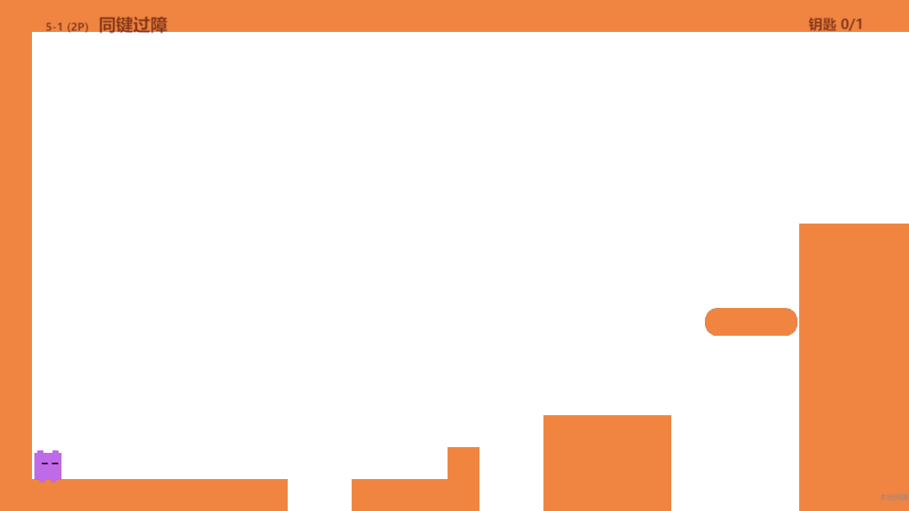

*图17　5-1「同键过障」，2P开局。*

**关卡目标**　所有参与者共同输入，操纵一只角色通过移动障碍并取钥。 取得场内钥匙并送达出口，让所有需要通关的角色进入。

**场景结构**　主规则为共同操纵。2P场景包含1个移动障碍。

**合作过程**　约定统一的方向和起跳口令，完成一个落点后先确认大家都已松键，再输入下一步。

**难点与设计作用**　按键取交集，任何一人漏按都可能中断动作。人数越多，对起按与松开的一致性要求越高。

**2P～8P版本分析**

| 人数 | 场上角色与配合分工 | 本版机关与数值 | 跑速／跳高 | 地砖布局 |
| --- | --- | --- | --- | --- |
| 2P | 1角色；2人同步按键与松键 | 共同输入；移动障碍1个 | 7.4／2.475 | 2P基准 |
| 3P | 1角色；3人同步按键与松键 | 共同输入；移动障碍1个 | 4／1.2 | 与2P一致 |
| 4P | 1角色；4人同步按键与松键 | 共同输入；移动障碍1个 | 4／1.2 | 与2P一致 |
| 5P | 1角色；5人同步按键与松键 | 共同输入；移动障碍1个 | 4／1.2 | 与2P一致 |
| 6P | 1角色；6人同步按键与松键 | 共同输入；移动障碍1个 | 4／1.2 | 与2P一致 |
| 7P | 1角色；7人同步按键与松键 | 共同输入；移动障碍1个 | 4／1.2 | 与2P一致 |
| 8P | 1角色；8人同步按键与松键 | 共同输入；移动障碍1个 | 4／1.2 | 与2P一致 |

**人数适配分析**　七个版本的地砖布局和主要机关数量一致。人数变化主要体现在出生点、操作责任和表中参数，队伍扩大后需要重新安排间距、等候与通过顺序。

### 5-2　跳台接力

*图18　5-2「跳台接力」，2P开局。*

**关卡目标**　通过交接触发点轮换同一角色的操作者，接续完成平台跳跃。 取得场内钥匙并送达出口，让所有需要通关的角色进入。

**场景结构**　主规则为单角色接力。2P场景包含10个交接点。

**合作过程**　当前操作者提前描述下一落点，接管者在进入触发点前准备按键；交接后先确认角色仍在运动还是已经落地。

**难点与设计作用**　10个交接点让操作责任多次变化。人数增加扩展了候选操作者，等待者也需持续观察当前路线。

**2P～8P版本分析**

| 人数 | 场上角色与配合分工 | 本版机关与数值 | 跑速／跳高 | 地砖布局 |
| --- | --- | --- | --- | --- |
| 2P | 1角色；2人轮换，接管者预判下一落点 | 交接点10个 | 7.4／2.475 | 2P基准 |
| 3P | 1角色；3人轮换，接管者预判下一落点 | 交接点10个 | 4／1.2 | 与2P一致 |
| 4P | 1角色；4人轮换，接管者预判下一落点 | 交接点10个 | 4／1.2 | 与2P一致 |
| 5P | 1角色；5人轮换，接管者预判下一落点 | 交接点10个 | 4／1.2 | 与2P一致 |
| 6P | 1角色；6人轮换，接管者预判下一落点 | 交接点10个 | 4／1.2 | 与2P一致 |
| 7P | 1角色；7人轮换，接管者预判下一落点 | 交接点10个 | 4／1.2 | 与2P一致 |
| 8P | 1角色；8人轮换，接管者预判下一落点 | 交接点10个 | 4／1.2 | 与2P一致 |

**人数适配分析**　七个版本的地砖布局和主要机关数量一致。人数变化主要体现在出生点、操作责任和表中参数，队伍扩大后需要重新安排间距、等候与通过顺序。

### 5-3　同键躲激光

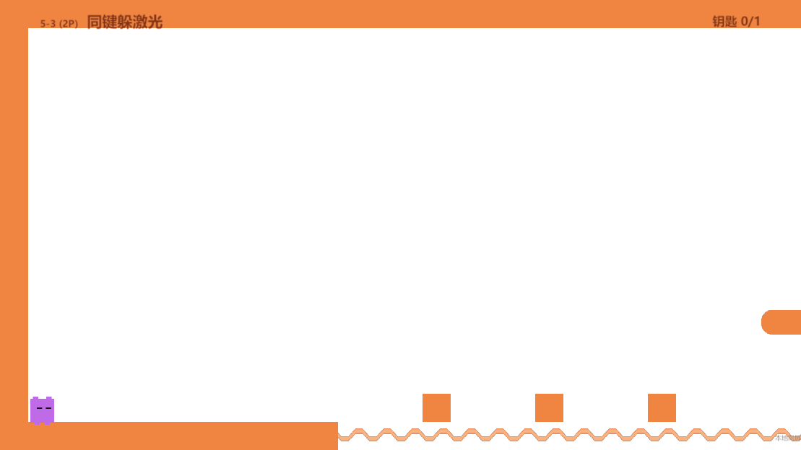

*图19　5-3「同键躲激光」，2P开局。*

**关卡目标**　共同操纵一只角色，通过移动障碍和激光组合。 取得场内钥匙并送达出口，让所有需要通关的角色进入。

**场景结构**　主规则为共同操纵。2P场景包含2个移动障碍、1个激光。

**合作过程**　全队先同步等待障碍让路，再按同一口令起跳；移动与停止都要共同确认。

**难点与设计作用**　共同按键增加输入同步约束，光束和移动障碍又限制动作窗口，错误可能来自输入不一致或时机判断。

**2P～8P版本分析**

| 人数 | 场上角色与配合分工 | 本版机关与数值 | 跑速／跳高 | 地砖布局 |
| --- | --- | --- | --- | --- |
| 2P | 1角色；2人同步按键与松键 | 共同输入；移动障碍2个／激光1道 | 7.4／2.475 | 2P基准 |
| 3P | 1角色；3人同步按键与松键 | 共同输入；移动障碍2个／激光1道 | 4／1.2 | 与2P一致 |
| 4P | 1角色；4人同步按键与松键 | 共同输入；移动障碍2个／激光1道 | 4／1.2 | 与2P一致 |
| 5P | 1角色；5人同步按键与松键 | 共同输入；移动障碍2个／激光1道 | 4／1.2 | 与2P一致 |
| 6P | 1角色；6人同步按键与松键 | 共同输入；移动障碍2个／激光1道 | 4／1.2 | 与2P一致 |
| 7P | 1角色；7人同步按键与松键 | 共同输入；移动障碍2个／激光1道 | 4／1.2 | 与2P一致 |
| 8P | 1角色；8人同步按键与松键 | 共同输入；移动障碍2个／激光1道 | 4／1.2 | 与2P一致 |

**人数适配分析**　七个版本的地砖布局和主要机关数量一致。人数变化主要体现在出生点、操作责任和表中参数，队伍扩大后需要重新安排间距、等候与通过顺序。

### 5-4　接力穿光阵

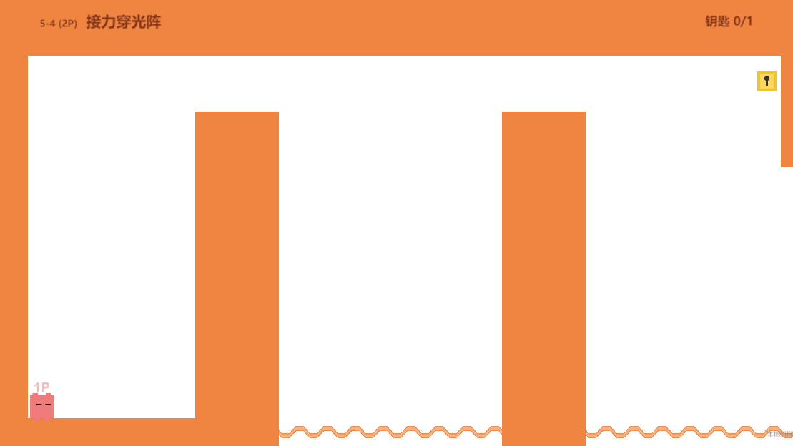

*图20　5-4「接力穿光阵」，2P开局。*

**关卡目标**　轮流接管角色，通过多处交接点和三道激光。 取得场内钥匙并送达出口，让所有需要通关的角色进入。

**场景结构**　主规则为单角色接力。2P场景包含3个激光、14个交接点。

**合作过程**　把交接点与安全落脚点对应起来，接管者先识别当前运动方向，再接续完成跨柱和过光束动作。

**难点与设计作用**　14个交接点提高换手频率。若接管发生在空中，反应迟疑或沿用上一人的错误方向更易造成全队失败。

**2P～8P版本分析**

| 人数 | 场上角色与配合分工 | 本版机关与数值 | 跑速／跳高 | 地砖布局 |
| --- | --- | --- | --- | --- |
| 2P | 1角色；2人轮换，接管者预判下一落点 | 交接点14个／激光3道 | 7.4／2.475 | 2P基准 |
| 3P | 1角色；3人轮换，接管者预判下一落点 | 交接点14个／激光3道 | 4／1.2 | 与2P一致 |
| 4P | 1角色；4人轮换，接管者预判下一落点 | 交接点14个／激光3道 | 4／1.2 | 与2P一致 |
| 5P | 1角色；5人轮换，接管者预判下一落点 | 交接点14个／激光3道 | 4／1.2 | 与2P一致 |
| 6P | 1角色；6人轮换，接管者预判下一落点 | 交接点14个／激光3道 | 4／1.2 | 与2P一致 |
| 7P | 1角色；7人轮换，接管者预判下一落点 | 交接点14个／激光3道 | 4／1.2 | 与2P一致 |
| 8P | 1角色；8人轮换，接管者预判下一落点 | 交接点14个／激光3道 | 4／1.2 | 与2P一致 |

**人数适配分析**　七个版本的地砖布局和主要机关数量一致。人数变化主要体现在出生点、操作责任和表中参数，队伍扩大后需要重新安排间距、等候与通过顺序。

## 第6章 push or jump

### 6-1　同色箱搭梯

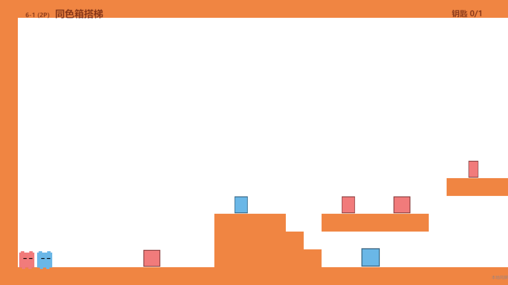

*图21　6-1「同色箱搭梯」，2P开局。*

**关卡目标**　由对应颜色玩家处理受限箱，摆出登高路线后取钥。 取得场内钥匙并送达出口，让所有需要通关的角色进入。

**场景结构**　主规则为普通闯关。2P场景包含8个箱子。

**合作过程**　先确认每位玩家负责的箱子，再按需要形成的高度安排推落与堆叠顺序；已完成任务者给搬箱者让位。

**难点与设计作用**　八箱总量固定，归属随人数分配。低人数玩家需承担多箱搬运，高人数版更强调个人任务完成后的集合。

**2P～8P版本分析**

| 人数 | 场上角色与配合分工 | 本版机关与数值 | 跑速／跳高 | 地砖布局 |
| --- | --- | --- | --- | --- |
| 2P | 2角色；按箱色归属搬运，完成后让路 | 1P 6箱、2P 2箱 | 4／1.2 | 2P基准 |
| 3P | 3角色；按箱色归属搬运，完成后让路 | 1P 3箱、2P 3箱、3P 2箱 | 4／1.2 | 与2P一致 |
| 4P | 4角色；按箱色归属搬运，完成后让路 | 1P 2箱、2P 2箱、3P 3箱、4P 1箱 | 4／1.2 | 与2P一致 |
| 5P | 5角色；按箱色归属搬运，完成后让路 | 1P 2箱、2P 2箱、3P 2箱、4P 1箱、5P 1箱 | 4／1.2 | 与2P一致 |
| 6P | 6角色；按箱色归属搬运，完成后让路 | 1P 2箱、2P 2箱、3P 1箱、4P 1箱、5P 1箱、6P 1箱 | 4／1.2 | 与2P一致 |
| 7P | 7角色；按箱色归属搬运，完成后让路 | 1P 2箱、2P 1箱、3P 1箱、4P 1箱、5P 1箱、6P 1箱、7P 1箱 | 4／1.2 | 与2P一致 |
| 8P | 8角色；按箱色归属搬运，完成后让路 | 1P 1箱、2P 1箱、3P 1箱、4P 1箱、5P 1箱、6P 1箱、7P 1箱、8P 1箱 | 4／1.2 | 与2P一致 |

**人数适配分析**　固定八箱按席位重新分配。2P需要每人多次搬箱，8P时每人负责一箱；中间人数的负担并不总是完全平均，具体归属见表。

### 6-2　箱梯与激光

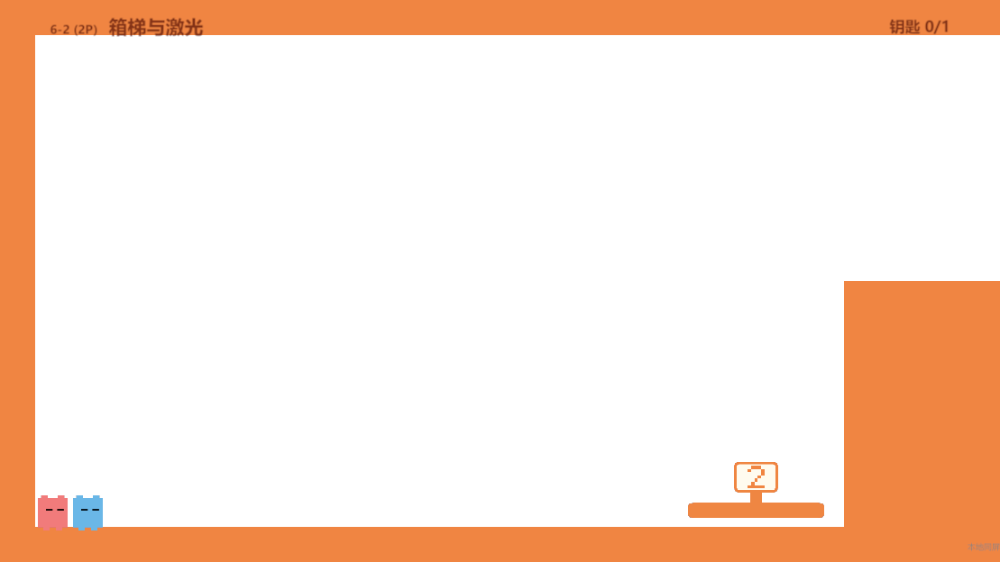

*图22　6-2「箱梯与激光」，2P开局。*

**关卡目标**　结合受限箱、激光和载人平台，组织可连续通过的登高路线。 取得场内钥匙并送达出口，让所有需要通关的角色进入。

**场景结构**　主规则为普通闯关。2P场景包含1个载人平台、1个激光、8个箱子。

**合作过程**　对应玩家先处理箱子，再在激光安全位置集合；达到平台阈值后分段转移，避免把后排队员留在不可回收的位置。

**难点与设计作用**　颜色分工和全员平台叠加，任何一位箱子责任人迟到都可能拖慢下一段。多人减少单人箱数，但增加通路占用。

**2P～8P版本分析**

| 人数 | 场上角色与配合分工 | 本版机关与数值 | 跑速／跳高 | 地砖布局 |
| --- | --- | --- | --- | --- |
| 2P | 2角色；按箱色归属搬运，完成后让路 | 1P 4箱、2P 4箱；平台2人 | 4／1.2 | 2P基准 |
| 3P | 3角色；按箱色归属搬运，完成后让路 | 1P 3箱、2P 3箱、3P 2箱；平台3人 | 4／1.2 | 与2P一致 |
| 4P | 4角色；按箱色归属搬运，完成后让路 | 1P 2箱、2P 2箱、3P 2箱、4P 2箱；平台4人 | 4／1.2 | 与2P一致 |
| 5P | 5角色；按箱色归属搬运，完成后让路 | 1P 2箱、2P 2箱、3P 2箱、4P 1箱、5P 1箱；平台5人 | 4／1.2 | 与2P一致 |
| 6P | 6角色；按箱色归属搬运，完成后让路 | 1P 2箱、2P 2箱、3P 1箱、4P 1箱、5P 1箱、6P 1箱；平台6人 | 4／1.2 | 与2P一致 |
| 7P | 7角色；按箱色归属搬运，完成后让路 | 1P 2箱、2P 1箱、3P 1箱、4P 1箱、5P 1箱、6P 1箱、7P 1箱；平台7人 | 4／1.2 | 与2P一致 |
| 8P | 8角色；按箱色归属搬运，完成后让路 | 1P 1箱、2P 1箱、3P 1箱、4P 1箱、5P 1箱、6P 1箱、7P 1箱、8P 1箱；平台8人 | 4／1.2 | 与2P一致 |

**人数适配分析**　固定八箱按席位重新分配。2P需要每人多次搬箱，8P时每人负责一箱；中间人数的负担并不总是完全平均，具体归属见表。

### 6-3　全员搭电梯

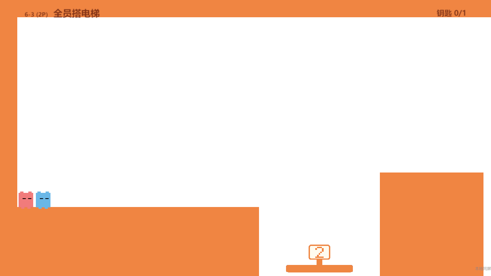

*图23　6-3「全员搭电梯」，2P开局。*

**关卡目标**　连续使用三座载人平台完成全队转移。 取得场内钥匙并送达出口，让所有需要通关的角色进入。

**场景结构**　主规则为普通闯关。2P场景包含3个载人平台。

**合作过程**　每段先确认所有需要的角色到台，再统一安排起飞和离台；前方到岸者等待后方落稳后再启动下一段。

**难点与设计作用**　三个平台均按房间人数设置阈值。全员到齐的条件会重复出现，队伍越大越需要避免提前跳走导致平台返航。

**2P～8P版本分析**

| 人数 | 场上角色与配合分工 | 本版机关与数值 | 跑速／跳高 | 地砖布局 |
| --- | --- | --- | --- | --- |
| 2P | 2角色；每台到齐后统一离台 | 三台启动需求 2／2／2人 | 4／1.2 | 2P基准 |
| 3P | 3角色；每台到齐后统一离台 | 三台启动需求 3／3／3人 | 4／1.2 | 与2P一致 |
| 4P | 4角色；每台到齐后统一离台 | 三台启动需求 4／4／4人 | 4／1.2 | 与2P一致 |
| 5P | 5角色；每台到齐后统一离台 | 三台启动需求 5／5／5人 | 4／1.2 | 与2P一致 |
| 6P | 6角色；每台到齐后统一离台 | 三台启动需求 6／6／6人 | 4／1.2 | 与2P一致 |
| 7P | 7角色；每台到齐后统一离台 | 三台启动需求 7／7／7人 | 4／1.2 | 与2P一致 |
| 8P | 8角色；每台到齐后统一离台 | 三台启动需求 8／8／8人 | 4／1.2 | 与2P一致 |

**人数适配分析**　七个版本的地砖布局和主要机关数量一致。人数变化主要体现在出生点、操作责任和表中参数，队伍扩大后需要重新安排间距、等候与通过顺序。

### 6-4　别踩危险踏板

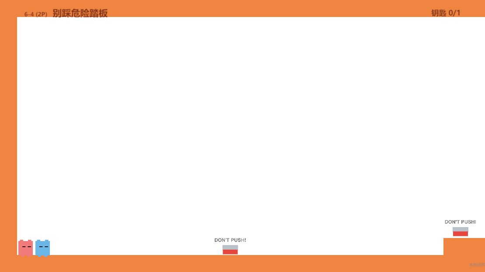

*图24　6-4「别踩危险踏板」，2P开局。*

**关卡目标**　避开危险踏板，通过安全落脚区域取钥出门。 取得场内钥匙并送达出口，让所有需要通关的角色进入。

**场景结构**　主规则为普通闯关。2P场景包含7个按钮。

**合作过程**　先辨认踏板边界，把落脚位置与队友站位分开；需要借队友起跳时，由底座先站稳在安全区。

**难点与设计作用**　七块危险踏板均会触发失败。更多角色提供踩头条件，也使狭小安全区更拥挤。

**2P～8P版本分析**

| 人数 | 场上角色与配合分工 | 本版机关与数值 | 跑速／跳高 | 地砖布局 |
| --- | --- | --- | --- | --- |
| 2P | 2角色；队列逐段落脚，底座站安全区 | 危险踏板7块 | 7.4／2.475 | 2P基准 |
| 3P | 3角色；队列逐段落脚，底座站安全区 | 危险踏板7块 | 4／1.2 | 与2P一致 |
| 4P | 4角色；队列逐段落脚，底座站安全区 | 危险踏板7块 | 4／1.2 | 与2P一致 |
| 5P | 5角色；队列逐段落脚，底座站安全区 | 危险踏板7块 | 4／1.2 | 与2P一致 |
| 6P | 6角色；队列逐段落脚，底座站安全区 | 危险踏板7块 | 4／1.2 | 与2P一致 |
| 7P | 7角色；队列逐段落脚，底座站安全区 | 危险踏板7块 | 4／1.2 | 与2P一致 |
| 8P | 8角色；队列逐段落脚，底座站安全区 | 危险踏板7块 | 4／1.2 | 与2P一致 |

**人数适配分析**　七个版本的地砖布局和主要机关数量一致。人数变化主要体现在出生点、操作责任和表中参数，队伍扩大后需要重新安排间距、等候与通过顺序。

## 第7章 move and stop

### 7-1　别吵醒云怪

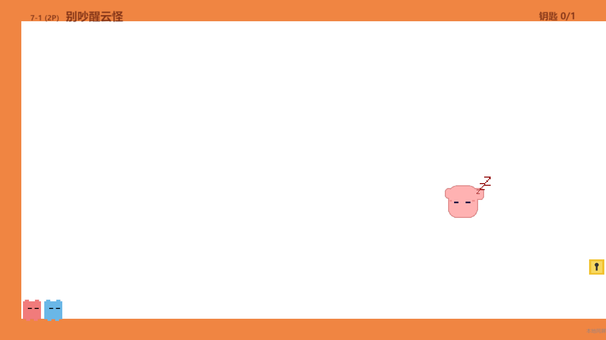

*图25　7-1「别吵醒云怪」，2P开局。*

**关卡目标**　根据云怪的警戒变化安排行动，安全抵达钥匙与出口。 取得场内钥匙并送达出口，让所有需要通关的角色进入。

**场景结构**　主规则为普通闯关。2P场景包含1个警戒云怪。

**合作过程**　每名角色把赶路拆成低于唤醒距离的短段，停住超过容忍时间后再继续。队员可以报点提醒，避免有人为追上前排而连续移动过远。

**难点与设计作用**　本关按每名角色的连续移动距离累计唤醒风险，停步能够清零累计值。人数增加后，队伍需要兼顾各自的移动段长与集合，残余速度可能使停止计时无法开始。

**2P～8P版本分析**

| 人数 | 场上角色与配合分工 | 本版机关与数值 | 跑速／跳高 | 地砖布局 |
| --- | --- | --- | --- | --- |
| 2P | 2角色；统一报状态并停步 | 连续移动2格唤醒；停住0.15秒重置距离 | 7.4／2.475 | 2P基准 |
| 3P | 3角色；统一报状态并停步 | 连续移动2格唤醒；停住0.15秒重置距离 | 4／1.2 | 与2P一致 |
| 4P | 4角色；统一报状态并停步 | 连续移动2格唤醒；停住0.15秒重置距离 | 4／1.2 | 与2P一致 |
| 5P | 5角色；统一报状态并停步 | 连续移动2格唤醒；停住0.15秒重置距离 | 4／1.2 | 与2P一致 |
| 6P | 6角色；统一报状态并停步 | 连续移动2格唤醒；停住0.15秒重置距离 | 4／1.2 | 与2P一致 |
| 7P | 7角色；统一报状态并停步 | 连续移动2格唤醒；停住0.15秒重置距离 | 4／1.2 | 与2P一致 |
| 8P | 8角色；统一报状态并停步 | 连续移动2格唤醒；停住0.15秒重置距离 | 4／1.2 | 与2P一致 |

**人数适配分析**　七个版本的地砖布局和主要机关数量一致。人数变化主要体现在出生点、操作责任和表中参数，队伍扩大后需要重新安排间距、等候与通过顺序。

### 7-2　一二三木头人

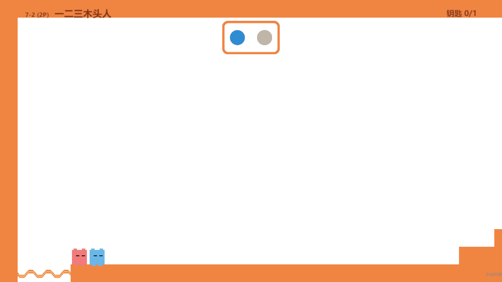

*图26　7-2「一二三木头人」，2P开局。*

**关卡目标**　在灯允许行动时推进，切换为停步阶段前落稳并控制速度。 取得场内钥匙并送达出口，让所有需要通关的角色进入。

**场景结构**　主规则为红绿灯。2P场景包含2个激光、17个弹簧、2个箱子。

**合作过程**　先利用长行动窗口通过弹簧与光束区域，接近切换预告时选实体落脚点等待；合推数字箱时统一松开输入。

**难点与设计作用**　红灯检测实际横纵速度，空中角色无法只靠松开横向键立即静止。全员推箱也会把队伍集中到同一危险时间窗口。

**2P～8P版本分析**

| 人数 | 场上角色与配合分工 | 本版机关与数值 | 跑速／跳高 | 地砖布局 |
| --- | --- | --- | --- | --- |
| 2P | 2角色；起跳与停步共用口令 | 行动10秒／停步7秒；箱需2／1人 | 4／1.2 | 2P基准 |
| 3P | 3角色；起跳与停步共用口令 | 行动10秒／停步7秒；箱需3／1人 | 4／1.2 | 与2P一致 |
| 4P | 4角色；起跳与停步共用口令 | 行动10秒／停步7秒；箱需4／1人 | 4／1.2 | 与2P一致 |
| 5P | 5角色；起跳与停步共用口令 | 行动10秒／停步7秒；箱需5／1人 | 4／1.2 | 与2P一致 |
| 6P | 6角色；起跳与停步共用口令 | 行动10秒／停步7秒；箱需6／1人 | 4／1.2 | 与2P一致 |
| 7P | 7角色；起跳与停步共用口令 | 行动10秒／停步7秒；箱需7／1人 | 4／1.2 | 与2P一致 |
| 8P | 8角色；起跳与停步共用口令 | 行动10秒／停步7秒；箱需8／1人 | 4／1.2 | 与2P一致 |

**人数适配分析**　七个版本的地砖布局和主要机关数量一致。人数变化主要体现在出生点、操作责任和表中参数，队伍扩大后需要重新安排间距、等候与通过顺序。

### 7-3　回头定幽灵

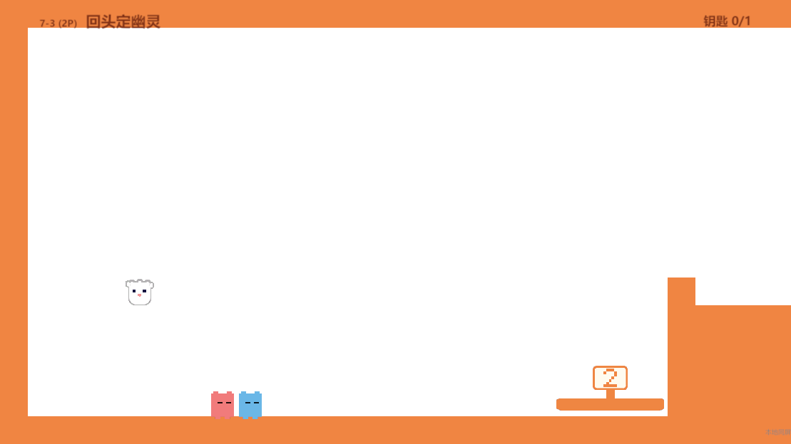

*图27　7-3「回头定幽灵」，2P开局。*

**关卡目标**　通过朝向和注视人数控制幽灵追击，再搭载人平台前进。 取得场内钥匙并送达出口，让所有需要通关的角色进入。

**场景结构**　主规则为注视幽灵。2P场景包含1个注视幽灵、1个载人平台。

**合作过程**　分配满足注视阈值的观察者，其他角色先转移；在需要集合乘台时交接注视责任，避免幽灵突然靠近队尾。

**难点与设计作用**　注视要求固定为1人，平台阈值随人数增加。观察者既承担掩护，也必须跟上队伍，任务交接决定是否会有人被留在后方。

**2P～8P版本分析**

| 人数 | 场上角色与配合分工 | 本版机关与数值 | 跑速／跳高 | 地砖布局 |
| --- | --- | --- | --- | --- |
| 2P | 2角色；1人注视，其余1人先移位再换岗 | 注视需1人；平台2人 | 4／1.2 | 2P基准 |
| 3P | 3角色；1人注视，其余2人先移位再换岗 | 注视需1人；平台3人 | 4／1.2 | 与2P一致 |
| 4P | 4角色；1人注视，其余3人先移位再换岗 | 注视需1人；平台4人 | 4／1.2 | 与2P一致 |
| 5P | 5角色；1人注视，其余4人先移位再换岗 | 注视需1人；平台5人 | 4／1.2 | 与2P一致 |
| 6P | 6角色；1人注视，其余5人先移位再换岗 | 注视需1人；平台6人 | 4／1.2 | 与2P一致 |
| 7P | 7角色；1人注视，其余6人先移位再换岗 | 注视需1人；平台7人 | 4／1.2 | 与2P一致 |
| 8P | 8角色；1人注视，其余7人先移位再换岗 | 注视需1人；平台8人 | 4／1.2 | 与2P一致 |

**人数适配分析**　注视要求在七个版本中均为1人，载人平台阈值从2人增加到8人。观察者需要从掩护岗位回到全员集合，容易成为队伍节奏的制约点。

### 7-4　停步蓄力

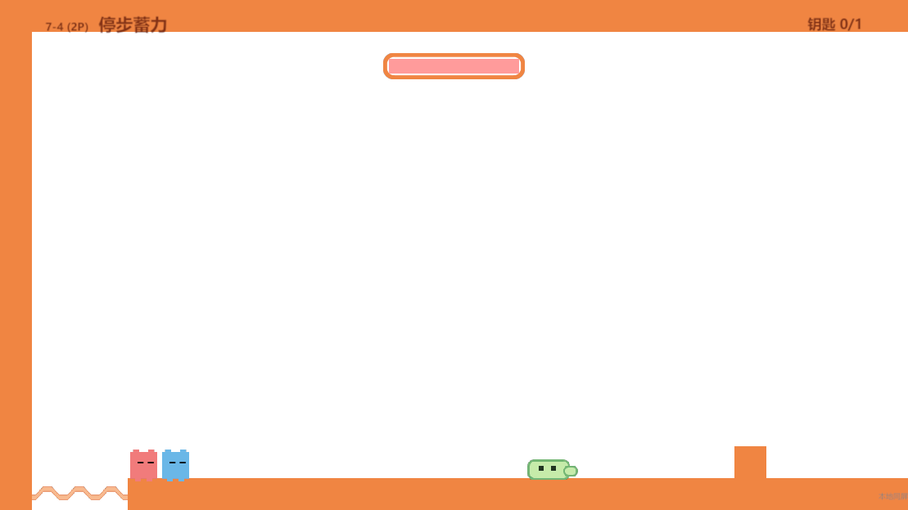

*图28　7-4「停步蓄力」，2P开局。*

**关卡目标**　分段移动并恢复共享能力，穿过毛毛虫、光束和箱子路段。 取得场内钥匙并送达出口，让所有需要通关的角色进入。

**场景结构**　主规则为共享能力。2P场景包含3个毛毛虫、1个激光、1个弹簧、1个箱子。

**合作过程**　把安全停留点作为恢复站，全员确认静止后再恢复；单人可完成的动作错峰进行，全员推箱前预留资源。

**难点与设计作用**　能力上限与回复速度固定，消耗按实际移动人数相加。人数越多，全员同时走的可持续时间越短。

**2P～8P版本分析**

| 人数 | 场上角色与配合分工 | 本版机关与数值 | 跑速／跳高 | 地砖布局 |
| --- | --- | --- | --- | --- |
| 2P | 2角色；错峰小段移动，推箱前全队恢复 | 能力10；耗4/人秒、回4/秒；全员动约1.25秒 | 4／1.2 | 2P基准 |
| 3P | 3角色；错峰小段移动，推箱前全队恢复 | 能力10；耗4/人秒、回4/秒；全员动约0.833秒 | 4／1.2 | 与2P一致 |
| 4P | 4角色；错峰小段移动，推箱前全队恢复 | 能力10；耗4/人秒、回4/秒；全员动约0.625秒 | 4／1.2 | 与2P一致 |
| 5P | 5角色；错峰小段移动，推箱前全队恢复 | 能力10；耗4/人秒、回4/秒；全员动约0.5秒 | 4／1.2 | 与2P一致 |
| 6P | 6角色；错峰小段移动，推箱前全队恢复 | 能力10；耗4/人秒、回4/秒；全员动约0.417秒 | 4／1.2 | 与2P一致 |
| 7P | 7角色；错峰小段移动，推箱前全队恢复 | 能力10；耗4/人秒、回4/秒；全员动约0.357秒 | 4／1.2 | 与2P一致 |
| 8P | 8角色；错峰小段移动，推箱前全队恢复 | 能力10；耗4/人秒、回4/秒；全员动约0.312秒 | 4／1.2 | 与2P一致 |

**人数适配分析**　所有版本能力均为10，每名实际位移角色每秒消耗4，全员静止每秒恢复4。表中全员连续移动时间按10÷(4×人数)估算，平台搬运和碰撞修正引起的实际位移也可能计入。

在全员同时移动的理想条件下，2P约1.25秒、4P约0.625秒、8P约0.313秒耗尽能力。这是资源公式估算，起始采样、途中静止与碰撞会使实际过程变化。

## 第8章 retro game

### 8-1　多人拼方块

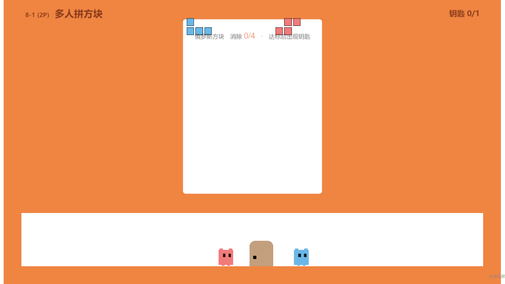

*图29　8-1「多人拼方块」，2P开局。*

**关卡目标**　多人分别操纵自己的方块，共同消除目标行数后取钥。 共同消除4行，钥匙出现后送达出口，让所有需要进门的角色进入。

**场景结构**　主规则为方块消行。2P共享15列×20行棋盘，消行目标4行。

**合作过程**　先约定棋盘分区与补洞责任，观察队友下一落点后再落块，避免封住低层缺口。

**难点与设计作用**　达到4行目标后进入钥匙阶段。人数上升使落块来源增加，棋盘也在部分版本加宽，协同重点转为共享空隙管理。

**2P～8P版本分析**

| 人数 | 场上角色与配合分工 | 本版机关与数值 | 跑速／跳高 | 地砖布局 |
| --- | --- | --- | --- | --- |
| 2P | 2角色；方块阶段每人管自身颜色，统一补洞 | 棋盘20行×15列；目标4行；每人出块间隔2.5秒 | 4／1.2 | 2P基准 |
| 3P | 3角色；方块阶段每人管自身颜色，统一补洞 | 棋盘20行×15列；目标4行；每人出块间隔2.5秒 | 4／1.2 | 相对2P调整 |
| 4P | 4角色；方块阶段每人管自身颜色，统一补洞 | 棋盘20行×15列；目标4行；每人出块间隔2.5秒 | 4／1.2 | 相对2P调整 |
| 5P | 5角色；方块阶段每人管自身颜色，统一补洞 | 棋盘20行×16列；目标4行；每人出块间隔2.5秒 | 4／1.2 | 与2P一致 |
| 6P | 6角色；方块阶段每人管自身颜色，统一补洞 | 棋盘20行×21列；目标4行；每人出块间隔2.5秒 | 4／1.2 | 与2P一致 |
| 7P | 7角色；方块阶段每人管自身颜色，统一补洞 | 棋盘20行×25列；目标4行；每人出块间隔2.5秒 | 4／1.2 | 与2P一致 |
| 8P | 8角色；方块阶段每人管自身颜色，统一补洞 | 棋盘20行×28列；目标4行；每人出块间隔2.5秒 | 4／1.2 | 与2P一致 |

**人数适配分析**　目标固定4行，5P以后逐步加宽棋盘。方块阶段每名玩家各有独立出块来源，宽度扩展与参与者增多共同影响棋盘压力。

### 8-2　弹球破砖

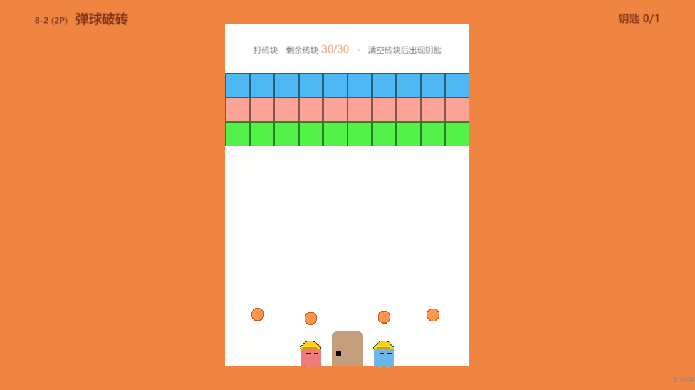

*图30　8-2「弹球破砖」，2P开局。*

**关卡目标**　分区接球并打碎整片砖块，使钥匙出现。 清理目标砖块后取钥，全员进门。

**场景结构**　主规则为打砖块。2P场景包含30个砖块、4个弹球。

**合作过程**　左右两侧先覆盖可能的下落区，其他人补中间空隙；顶球后根据弹道更新各自站位。

**难点与设计作用**　四球同时存在时需要覆盖多个轨迹。人数增加提供更多接应点，也可能因为多人追同一球而留下空区。

**2P～8P版本分析**

| 人数 | 场上角色与配合分工 | 本版机关与数值 | 跑速／跳高 | 地砖布局 |
| --- | --- | --- | --- | --- |
| 2P | 2角色；左右分守接球 | 30砖／4球；清砖出钥匙 | 4／1.2 | 2P基准 |
| 3P | 3角色；2人守边，1人分区补位 | 30砖／4球；清砖出钥匙 | 4／1.2 | 与2P一致 |
| 4P | 4角色；2人守边，2人分区补位 | 30砖／4球；清砖出钥匙 | 4／1.2 | 与2P一致 |
| 5P | 5角色；2人守边，3人分区补位 | 30砖／4球；清砖出钥匙 | 4／1.2 | 与2P一致 |
| 6P | 6角色；2人守边，4人分区补位 | 30砖／4球；清砖出钥匙 | 4／1.2 | 与2P一致 |
| 7P | 7角色；2人守边，5人分区补位 | 30砖／4球；清砖出钥匙 | 4／1.2 | 与2P一致 |
| 8P | 8角色；2人守边，6人分区补位 | 30砖／4球；清砖出钥匙 | 4／1.2 | 与2P一致 |

**人数适配分析**　七个版本的地砖布局和主要机关数量一致。人数变化主要体现在出生点、操作责任和表中参数，队伍扩大后需要重新安排间距、等候与通过顺序。

### 8-3　十行消除

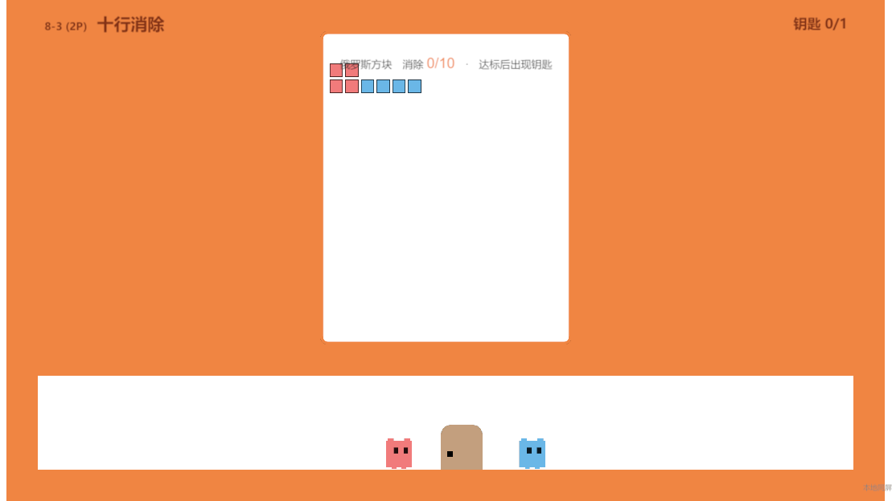

*图31　8-3「十行消除」，2P开局。*

**关卡目标**　在共享棋盘中完成10行消除，再取钥并全员进门。 共同消除10行，钥匙出现后送达出口，让所有需要进门的角色进入。

**场景结构**　主规则为方块消行。2P共享15列×20行棋盘，消行目标10行。

**合作过程**　长期维护可补齐的空隙，避免为了抢落块把缺口封死；接近10行时同时安排钥匙出现后的移动。

**难点与设计作用**　相比4行关，持续规划时间更长。更多玩家增加出块来源，棋盘宽度随版本调整但仍需要明确占位责任。

**2P～8P版本分析**

| 人数 | 场上角色与配合分工 | 本版机关与数值 | 跑速／跳高 | 地砖布局 |
| --- | --- | --- | --- | --- |
| 2P | 2角色；方块阶段每人管自身颜色，统一补洞 | 棋盘20行×15列；目标10行；每人出块间隔2.5秒 | 4／1.2 | 2P基准 |
| 3P | 3角色；方块阶段每人管自身颜色，统一补洞 | 棋盘20行×15列；目标10行；每人出块间隔2.5秒 | 4／1.2 | 相对2P调整 |
| 4P | 4角色；方块阶段每人管自身颜色，统一补洞 | 棋盘20行×15列；目标10行；每人出块间隔2.5秒 | 4／1.2 | 相对2P调整 |
| 5P | 5角色；方块阶段每人管自身颜色，统一补洞 | 棋盘20行×18列；目标10行；每人出块间隔2.5秒 | 4／1.2 | 与2P一致 |
| 6P | 6角色；方块阶段每人管自身颜色，统一补洞 | 棋盘20行×21列；目标10行；每人出块间隔2.5秒 | 4／1.2 | 与2P一致 |
| 7P | 7角色；方块阶段每人管自身颜色，统一补洞 | 棋盘20行×24列；目标10行；每人出块间隔2.5秒 | 4／1.2 | 与2P一致 |
| 8P | 8角色；方块阶段每人管自身颜色，统一补洞 | 棋盘20行×27列；目标10行；每人出块间隔2.5秒 | 4／1.2 | 与2P一致 |

**人数适配分析**　目标固定10行，5P以后扩展到18、21、24、27列。相比4行关，缺口管理需要持续更久，队伍应避免只追求当前一块能否放下。

### 8-4　接球清砖墙

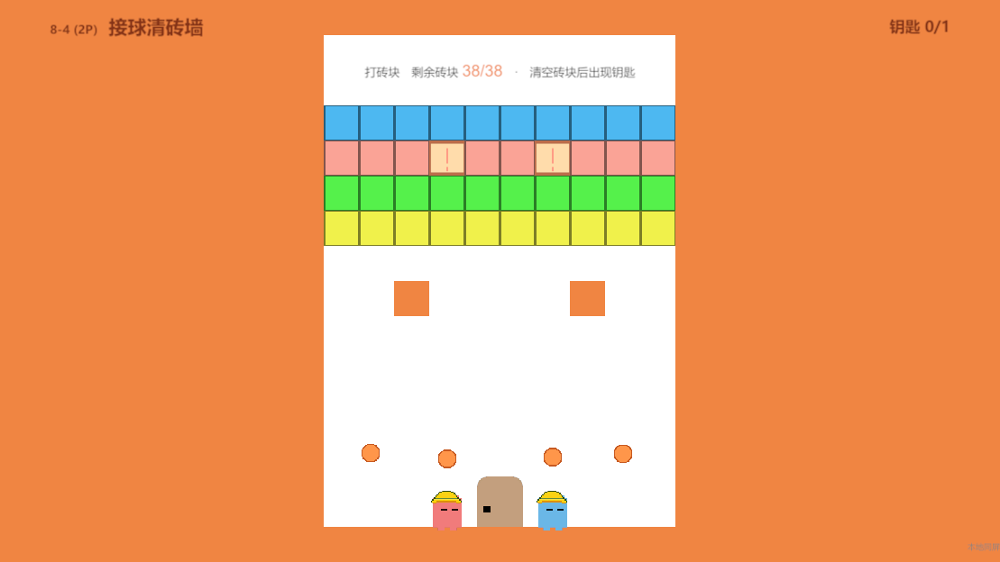

*图32　8-4「接球清砖墙」，2P开局。*

**关卡目标**　在加入障碍的砖墙布局中连续顶球清砖。 清理目标砖块后取钥，全员进门。

**场景结构**　主规则为打砖块。2P场景包含40个砖块、4个弹球。

**合作过程**　除划分接球区域外，还要观察中段实体障碍如何改变反弹路径，及时接回从异常方向返回的球。

**难点与设计作用**　40块砖与4球构成较长清理过程，中段障碍提高轨迹判断难度，队伍覆盖必须随残砖位置调整。

**2P～8P版本分析**

| 人数 | 场上角色与配合分工 | 本版机关与数值 | 跑速／跳高 | 地砖布局 |
| --- | --- | --- | --- | --- |
| 2P | 2角色；左右分守接球 | 40砖／4球；清砖出钥匙 | 4／1.2 | 2P基准 |
| 3P | 3角色；2人守边，1人分区补位 | 40砖／4球；清砖出钥匙 | 4／1.2 | 与2P一致 |
| 4P | 4角色；2人守边，2人分区补位 | 40砖／4球；清砖出钥匙 | 4／1.2 | 与2P一致 |
| 5P | 5角色；2人守边，3人分区补位 | 40砖／4球；清砖出钥匙 | 4／1.2 | 与2P一致 |
| 6P | 6角色；2人守边，4人分区补位 | 40砖／4球；清砖出钥匙 | 4／1.2 | 与2P一致 |
| 7P | 7角色；2人守边，5人分区补位 | 40砖／4球；清砖出钥匙 | 4／1.2 | 与2P一致 |
| 8P | 8角色；2人守边，6人分区补位 | 40砖／4球；清砖出钥匙 | 4／1.2 | 与2P一致 |

**人数适配分析**　七个版本的地砖布局和主要机关数量一致。人数变化主要体现在出生点、操作责任和表中参数，队伍扩大后需要重新安排间距、等候与通过顺序。

## 第9章 ball park

### 9-1　借炮破钥匙瓶

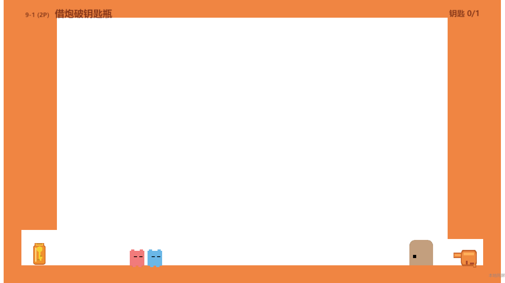

*图33　9-1「借炮破钥匙瓶」，2P开局。*

**关卡目标**　利用炮台发射的球击碎钥匙瓶，取得钥匙并到门口集合。 击碎钥匙瓶，回收其中的钥匙并送到出口，随后全员进入。

**场景结构**　主规则为普通闯关。2P场景包含1个钥匙瓶、1个炮台。

**合作过程**　先看清炮台到瓶子的运动路径，避让会打断球路的位置；确认瓶子碎裂后由近处角色取钥。

**难点与设计作用**　钥匙瓶需要多次命中，单次顶球成功不代表任务结束。队伍人数越多，越要防止无意阻挡已经稳定的弹道。

**2P～8P版本分析**

| 人数 | 场上角色与配合分工 | 本版机关与数值 | 跑速／跳高 | 地砖布局 |
| --- | --- | --- | --- | --- |
| 2P | 2角色；分开守球路、破瓶与回收钥匙 | 瓶需3次命中；炮台每2秒发射 | 4／1.2 | 2P基准 |
| 3P | 3角色；分开守球路、破瓶与回收钥匙 | 瓶需3次命中；炮台每2秒发射 | 4／1.2 | 与2P一致 |
| 4P | 4角色；分开守球路、破瓶与回收钥匙 | 瓶需3次命中；炮台每2秒发射 | 4／1.2 | 与2P一致 |
| 5P | 5角色；分开守球路、破瓶与回收钥匙 | 瓶需3次命中；炮台每2秒发射 | 4／1.2 | 与2P一致 |
| 6P | 6角色；分开守球路、破瓶与回收钥匙 | 瓶需3次命中；炮台每2秒发射 | 4／1.2 | 与2P一致 |
| 7P | 7角色；分开守球路、破瓶与回收钥匙 | 瓶需3次命中；炮台每2秒发射 | 4／1.2 | 与2P一致 |
| 8P | 8角色；分开守球路、破瓶与回收钥匙 | 瓶需3次命中；炮台每2秒发射 | 4／1.2 | 与2P一致 |

**人数适配分析**　七个版本的地砖布局和主要机关数量一致。人数变化主要体现在出生点、操作责任和表中参数，队伍扩大后需要重新安排间距、等候与通过顺序。

### 9-2　配重送弹珠

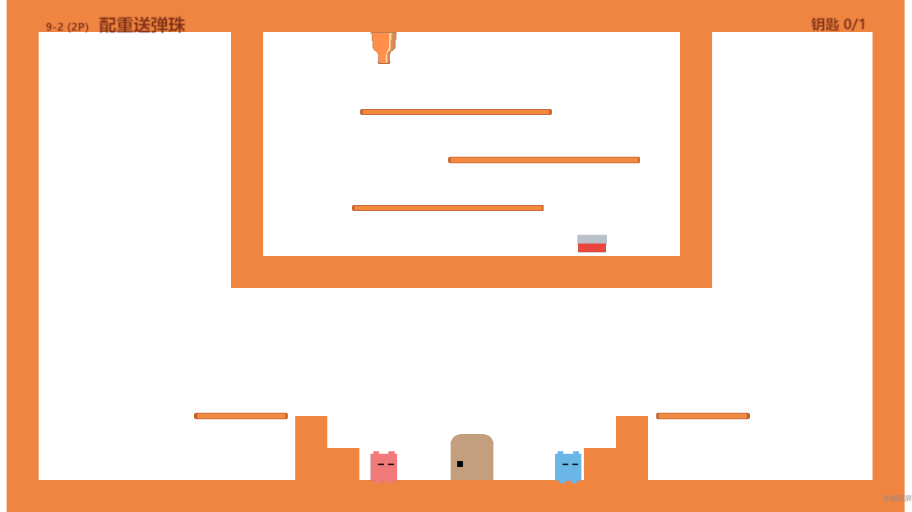

*图34　9-2「配重送弹珠」，2P开局。*

**关卡目标**　通过天秤、跷跷板和弹珠，把路线接到控制钥匙的按钮处。 取得场内钥匙并送达出口，让所有需要通关的角色进入。

**场景结构**　主规则为普通闯关。2P场景包含1个天秤、3个跷跷板、1个弹珠发射器、1个按钮。

**合作过程**　按球前进顺序调整站位和平台倾斜，先稳定当前落点，再让下一段准备接球；由合适角色触发钥匙控制。

**难点与设计作用**　平台对站立者与球的重量响应，队员盲目追球可能反向改变倾斜。多人有更多配重点，也有更强的扰动。

**2P～8P版本分析**

| 人数 | 场上角色与配合分工 | 本版机关与数值 | 跑速／跳高 | 地砖布局 |
| --- | --- | --- | --- | --- |
| 2P | 2角色；配重与下一段接球分工 | 天秤1／跷跷板3／发射器1；钥匙按钮1块 | 4／1.2 | 2P基准 |
| 3P | 3角色；配重与下一段接球分工 | 天秤1／跷跷板3／发射器1；钥匙按钮1块 | 4／1.2 | 与2P一致 |
| 4P | 4角色；配重与下一段接球分工 | 天秤1／跷跷板3／发射器1；钥匙按钮1块 | 4／1.2 | 与2P一致 |
| 5P | 5角色；配重与下一段接球分工 | 天秤1／跷跷板3／发射器1；钥匙按钮1块 | 4／1.2 | 与2P一致 |
| 6P | 6角色；配重与下一段接球分工 | 天秤1／跷跷板3／发射器1；钥匙按钮1块 | 4／1.2 | 与2P一致 |
| 7P | 7角色；配重与下一段接球分工 | 天秤1／跷跷板3／发射器1；钥匙按钮1块 | 4／1.2 | 与2P一致 |
| 8P | 8角色；配重与下一段接球分工 | 天秤1／跷跷板3／发射器1；钥匙按钮1块 | 4／1.2 | 与2P一致 |

**人数适配分析**　七个版本的地砖布局和主要机关数量一致。人数变化主要体现在出生点、操作责任和表中参数，队伍扩大后需要重新安排间距、等候与通过顺序。

### 9-3　弹球攻砖阵

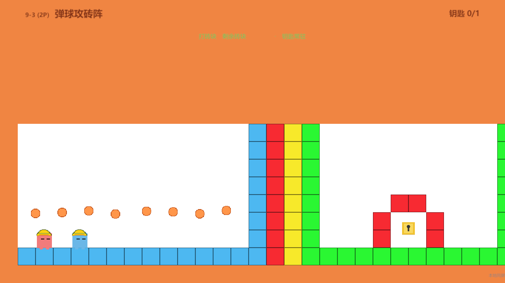

*图35　9-3「弹球攻砖阵」，2P开局。*

**关卡目标**　面对大量砖块与多球，组织持续接应和清理。 利用场内常驻钥匙完成出口流程，同时防止弹球全部丢失。

**场景结构**　主规则为打砖块。2P场景包含88个砖块、8个弹球。

**合作过程**　按左右和中部划分责任，优先接住即将落地的球，再关注剩余砖块集中在哪一侧并调整站位。

**难点与设计作用**　88块砖和8球带来持续注意力压力。更多队友可覆盖轨迹，但局部拥挤与同时抢球也更容易出现。

**2P～8P版本分析**

| 人数 | 场上角色与配合分工 | 本版机关与数值 | 跑速／跳高 | 地砖布局 |
| --- | --- | --- | --- | --- |
| 2P | 2角色；左右分守接球 | 88砖／8球；钥匙常驻 | 4／1.2 | 2P基准 |
| 3P | 3角色；2人守边，1人分区补位 | 88砖／8球；钥匙常驻 | 4／1.2 | 与2P一致 |
| 4P | 4角色；2人守边，2人分区补位 | 88砖／8球；钥匙常驻 | 4／1.2 | 与2P一致 |
| 5P | 5角色；2人守边，3人分区补位 | 88砖／8球；钥匙常驻 | 4／1.2 | 与2P一致 |
| 6P | 6角色；2人守边，4人分区补位 | 88砖／8球；钥匙常驻 | 4／1.2 | 与2P一致 |
| 7P | 7角色；2人守边，5人分区补位 | 88砖／8球；钥匙常驻 | 4／1.2 | 与2P一致 |
| 8P | 8角色；2人守边，6人分区补位 | 88砖／8球；钥匙常驻 | 4／1.2 | 与2P一致 |

**人数适配分析**　七个版本的地砖布局和主要机关数量一致。人数变化主要体现在出生点、操作责任和表中参数，队伍扩大后需要重新安排间距、等候与通过顺序。

### 9-4　弹珠破钥匙瓶

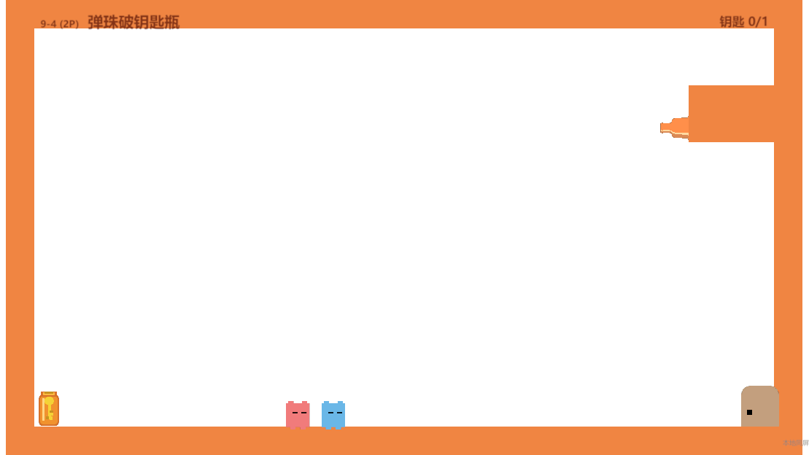

*图36　9-4「弹珠破钥匙瓶」，2P开局。*

**关卡目标**　利用弹珠发射器把球送到钥匙瓶，破瓶后回收钥匙。 击碎钥匙瓶，回收其中的钥匙并送到出口，随后全员进入。

**场景结构**　主规则为普通闯关。2P场景包含1个弹珠发射器、1个钥匙瓶。

**合作过程**　先观察发射后的初始球路和瓶子位置，调整身体接应点；瓶子打开后将任务从球路控制切换为钥匙回收。

**难点与设计作用**　弹珠与角色可能继续相互影响。取得阶段成果后仍需考虑钥匙落点和出口，避免全队继续无目的追球。

**2P～8P版本分析**

| 人数 | 场上角色与配合分工 | 本版机关与数值 | 跑速／跳高 | 地砖布局 |
| --- | --- | --- | --- | --- |
| 2P | 2角色；分开守球路、破瓶与回收钥匙 | 瓶需3次命中；弹珠每5秒发射 | 7.4／2.475 | 2P基准 |
| 3P | 3角色；分开守球路、破瓶与回收钥匙 | 瓶需3次命中；弹珠每5秒发射 | 4／1.2 | 与2P一致 |
| 4P | 4角色；分开守球路、破瓶与回收钥匙 | 瓶需3次命中；弹珠每5秒发射 | 4／1.2 | 与2P一致 |
| 5P | 5角色；分开守球路、破瓶与回收钥匙 | 瓶需3次命中；弹珠每5秒发射 | 4／1.2 | 与2P一致 |
| 6P | 6角色；分开守球路、破瓶与回收钥匙 | 瓶需3次命中；弹珠每5秒发射 | 4／1.2 | 与2P一致 |
| 7P | 7角色；分开守球路、破瓶与回收钥匙 | 瓶需3次命中；弹珠每5秒发射 | 4／1.2 | 与2P一致 |
| 8P | 8角色；分开守球路、破瓶与回收钥匙 | 瓶需3次命中；弹珠每5秒发射 | 4／1.2 | 与2P一致 |

**人数适配分析**　七个版本的地砖布局和主要机关数量一致。人数变化主要体现在出生点、操作责任和表中参数，队伍扩大后需要重新安排间距、等候与通过顺序。

## 第10章 two players

### 10-1　双人开闸

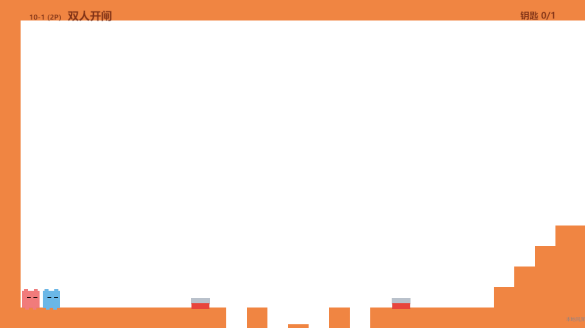

*图37　10-1「双人开闸」，2P开局。*

**关卡目标**　用两角色配合闸门、体型按钮与玻璃路段，打开取钥路线。 取得场内钥匙并送达出口，让所有需要通关的角色进入。

**场景结构**　主规则为普通闯关。2P场景包含13个按钮、11个闸门、1个激光、3个玻璃。

**合作过程**　先明确谁保持按钮、谁通过闸门，遇到体型变化时再安排落脚和窄道通行；多人版组内完成换手后再继续。

**难点与设计作用**　机关数量多，前后段可能互相依赖。接力版增加控制交接，但场上仍是两只角色，站位职责不能按总人数直接扩张。

**2P～8P版本分析**

| 人数 | 场上角色与配合分工 | 本版机关与数值 | 跑速／跳高 | 地砖布局 |
| --- | --- | --- | --- | --- |
| 2P | 2角色；压板者与过门者交接 | 13按钮／11闸门；交接点0个 | 4／1.2 | 2P基准 |
| 3P | 2角色；A组1P–2P，B组3P–3P，组内轮换 | 13按钮／11闸门；交接点3个 | 4／1.2 | 与2P一致 |
| 4P | 2角色；A组1P–2P，B组3P–4P，组内轮换 | 13按钮／11闸门；交接点3个 | 4／1.2 | 与2P一致 |
| 5P | 2角色；A组1P–3P，B组4P–5P，组内轮换 | 13按钮／11闸门；交接点4个 | 4／1.2 | 与2P一致 |
| 6P | 2角色；A组1P–3P，B组4P–6P，组内轮换 | 13按钮／11闸门；交接点4个 | 4／1.2 | 与2P一致 |
| 7P | 2角色；A组1P–4P，B组5P–7P，组内轮换 | 13按钮／11闸门；交接点4个 | 4／1.2 | 与2P一致 |
| 8P | 2角色；A组1P–4P，B组5P–8P，组内轮换 | 13按钮／11闸门；交接点4个 | 4／1.2 | 与2P一致 |

**人数适配分析**　2P为两角色独立控制，3P以后分为两组轮流操纵两个角色。3P、4P有3个交接点，5P以后有4个。人数增加扩展了操作者序列，场上角色数仍为2。

分组接力中的A、B表示两只实际角色。组内共享一只角色的位置与操作责任，交接后的操作者继续处理现有速度、落点和机关状态。

### 10-2　滚动平台接力

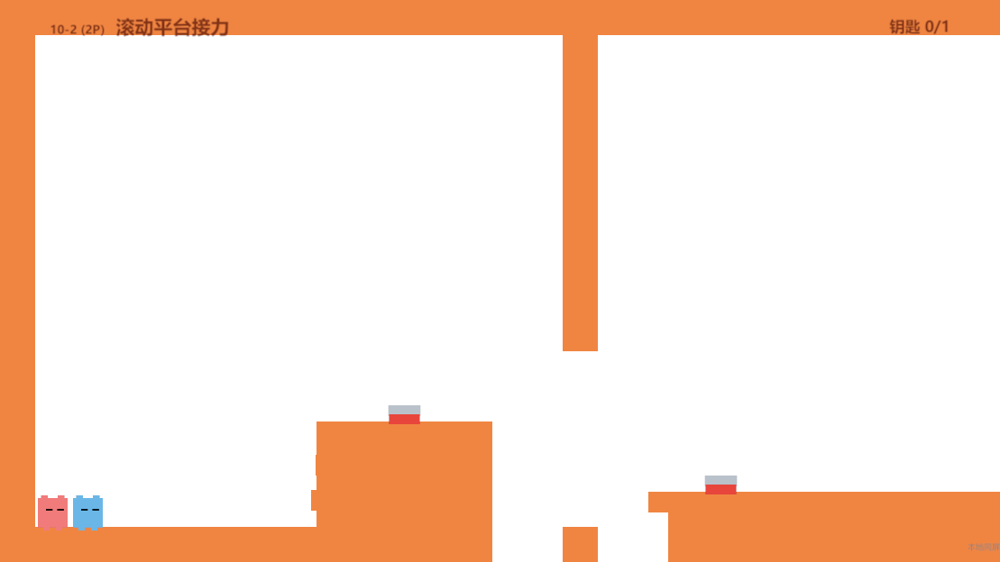

*图38　10-2「滚动平台接力」，2P开局。*

**关卡目标**　通过滚动平台、闸门和弹簧完成两角色的接力转移。 取得场内钥匙并送达出口，让所有需要通关的角色进入。

**场景结构**　主规则为普通闯关。2P场景包含3个按钮、1个弹簧、4个闸门、2个滚动平台。

**合作过程**　一名角色先确认平台与门的响应，另一名在可接应处准备；平台转动过程中留意站位变化，接力版先确认当前操作者。

**难点与设计作用**　滚动平台改变脚下支撑，压板与过门还要求角色分开。多人版的困难集中在换手是否衔接当前运动。

**2P～8P版本分析**

| 人数 | 场上角色与配合分工 | 本版机关与数值 | 跑速／跳高 | 地砖布局 |
| --- | --- | --- | --- | --- |
| 2P | 2角色；分管滚动平台和开门 | 滚动平台2／按钮3；交接点0个 | 4／1.2 | 2P基准 |
| 3P | 2角色；A组1P–2P，B组3P–3P，组内轮换 | 滚动平台2／按钮3；交接点3个 | 4／1.2 | 与2P一致 |
| 4P | 2角色；A组1P–2P，B组3P–4P，组内轮换 | 滚动平台2／按钮3；交接点3个 | 4／1.2 | 与2P一致 |
| 5P | 2角色；A组1P–3P，B组4P–5P，组内轮换 | 滚动平台2／按钮3；交接点4个 | 4／1.2 | 与2P一致 |
| 6P | 2角色；A组1P–3P，B组4P–6P，组内轮换 | 滚动平台2／按钮3；交接点4个 | 4／1.2 | 与2P一致 |
| 7P | 2角色；A组1P–4P，B组5P–7P，组内轮换 | 滚动平台2／按钮3；交接点4个 | 4／1.2 | 与2P一致 |
| 8P | 2角色；A组1P–4P，B组5P–8P，组内轮换 | 滚动平台2／按钮3；交接点4个 | 4／1.2 | 与2P一致 |

**人数适配分析**　2P为两角色独立控制，3P以后分为两组轮流操纵两个角色。3P、4P有3个交接点，5P以后有4个。人数增加扩展了操作者序列，场上角色数仍为2。

分组接力中的A、B表示两只实际角色。组内共享一只角色的位置与操作责任，交接后的操作者继续处理现有速度、落点和机关状态。

### 10-3　摸黑寻路

*图39　10-3「摸黑寻路」，2P开局。*

**关卡目标**　在黑暗中揭示路线，利用箱子、弹簧和平台共同取钥。 取得场内钥匙并送达出口，让所有需要通关的角色进入。

**场景结构**　主规则为黑夜。2P场景包含1个弹簧、1个载人平台、1个箱子、2个揭示区。

**合作过程**　先由一只角色触发揭示并报出可见落点，另一只在可回收的位置接应；接力版把下一落点信息一起交给接管者。

**难点与设计作用**　信息不足与控制交接同时存在。多玩家并未产生更多探路角色，两组需要共享观察结果。

**2P～8P版本分析**

| 人数 | 场上角色与配合分工 | 本版机关与数值 | 跑速／跳高 | 地砖布局 |
| --- | --- | --- | --- | --- |
| 2P | 2角色；一人探路、一人接应 | 揭示区2；平台2人；箱需2人；交接点0 | 4／1.2 | 2P基准 |
| 3P | 2角色；A组1P–2P，B组3P–3P，组内轮换 | 揭示区2；平台2人；箱需2人；交接点3 | 4／1.2 | 与2P一致 |
| 4P | 2角色；A组1P–2P，B组3P–4P，组内轮换 | 揭示区2；平台2人；箱需2人；交接点3 | 4／1.2 | 与2P一致 |
| 5P | 2角色；A组1P–3P，B组4P–5P，组内轮换 | 揭示区2；平台2人；箱需2人；交接点4 | 4／1.2 | 与2P一致 |
| 6P | 2角色；A组1P–3P，B组4P–6P，组内轮换 | 揭示区2；平台2人；箱需2人；交接点4 | 4／1.2 | 与2P一致 |
| 7P | 2角色；A组1P–4P，B组5P–7P，组内轮换 | 揭示区2；平台2人；箱需2人；交接点4 | 4／1.2 | 与2P一致 |
| 8P | 2角色；A组1P–4P，B组5P–8P，组内轮换 | 揭示区2；平台2人；箱需2人；交接点4 | 4／1.2 | 与2P一致 |

**人数适配分析**　2P为两角色独立控制，3P以后分为两组轮流操纵两个角色。3P、4P有3个交接点，5P以后有4个。人数增加扩展了操作者序列，场上角色数仍为2。

分组接力中的A、B表示两只实际角色。组内共享一只角色的位置与操作责任，交接后的操作者继续处理现有速度、落点和机关状态。

### 10-4　摸黑搭平台

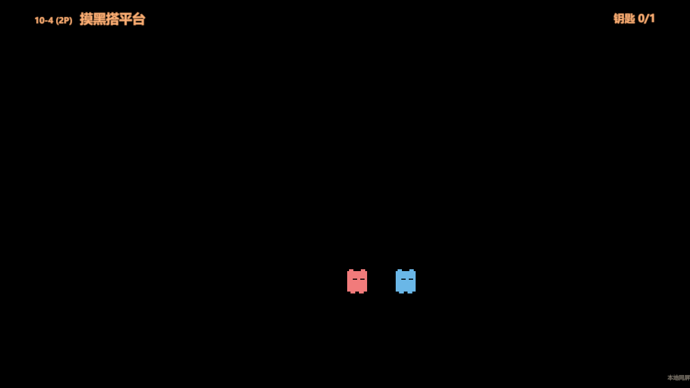

*图40　10-4「摸黑搭平台」，2P开局。*

**关卡目标**　在黑暗里串联两座载人平台，逐步揭示并通过路线。 取得场内钥匙并送达出口，让所有需要通关的角色进入。

**场景结构**　主规则为黑夜。2P场景包含1个弹簧、2个载人平台、1个箱子、2个揭示区。

**合作过程**　先确认第一段安全支撑再搭台，保留接应角色，第二个平台的通过顺序取决于前段是否已腾出落脚点。

**难点与设计作用**　3P与4P场上是多人独立角色，5P以后转成两角色接力。两种模式的集合方式不同，不能照搬同一人数口令。

**2P～8P版本分析**

| 人数 | 场上角色与配合分工 | 本版机关与数值 | 跑速／跳高 | 地砖布局 |
| --- | --- | --- | --- | --- |
| 2P | 2角色；两台各保留接应者 | 揭示区2；两台均需2人；交接点0个 | 7.4／2.475 | 2P基准 |
| 3P | 3角色；两台各保留接应者 | 揭示区2；两台均需2人；交接点4个 | 4／1.2 | 与2P一致 |
| 4P | 4角色；两台各保留接应者 | 揭示区2；两台均需2人；交接点4个 | 4／1.2 | 与2P一致 |
| 5P | 2角色；A组1P–3P，B组4P–5P，组内轮换 | 揭示区2；两台均需2人；交接点4个 | 4／1.2 | 与2P一致 |
| 6P | 2角色；A组1P–3P，B组4P–6P，组内轮换 | 揭示区2；两台均需2人；交接点4个 | 4／1.2 | 与2P一致 |
| 7P | 2角色；A组1P–4P，B组5P–7P，组内轮换 | 揭示区2；两台均需2人；交接点4个 | 4／1.2 | 与2P一致 |
| 8P | 2角色；A组1P–4P，B组5P–8P，组内轮换 | 揭示区2；两台均需2人；交接点4个 | 4／1.2 | 与2P一致 |

**人数适配分析**　2P至4P按实际人数生成独立角色，5P以后改为两角色分组接力。3P、4P虽已有交接标记，但没有开启双角色分组开关，不能仅凭交接点数量判断控制形式。

分组接力中的A、B表示两只实际角色。组内共享一只角色的位置与操作责任，交接后的操作者继续处理现有速度、落点和机关状态。

## 第11章 hand gimmick

### 11-1　吸人枪渡口

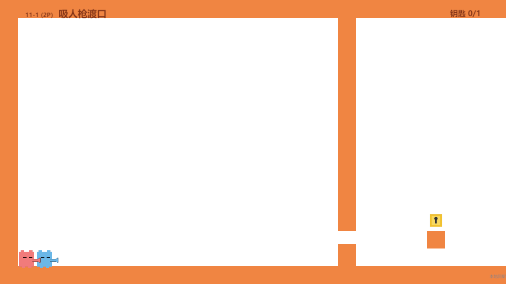

*图41　11-1「吸人枪渡口」，2P开局。*

**关卡目标**　用吸人枪吸入和发射队友，穿越普通移动难以直接通过的落差。 取得场内钥匙并送达出口，让所有需要通关的角色进入。

**场景结构**　主规则为吸人枪。2P有2名可互相吸取与发射的角色，运输路线由实体地形构成。

**合作过程**　先确定接收落点和发射方向，再进行吸取；被发射者准备落地后的动作，之后安排其余队员通过。

**难点与设计作用**　枪中存在目标时的动作与空枪不同，误按会改变运送顺序。多人需要清楚知道谁被吸入、谁已到达。

**2P～8P版本分析**

| 人数 | 场上角色与配合分工 | 本版机关与数值 | 跑速／跳高 | 地砖布局 |
| --- | --- | --- | --- | --- |
| 2P | 2角色；吸取者与接收者对接 | 吸人枪；队员可被吸入和发射 | 4／1.5 | 2P基准 |
| 3P | 3角色；明确运送顺序，分批接应2名伙伴 | 吸人枪；队员可被吸入和发射 | 4／1.5 | 与2P一致 |
| 4P | 4角色；明确运送顺序，分批接应3名伙伴 | 吸人枪；队员可被吸入和发射 | 4／1.5 | 与2P一致 |
| 5P | 5角色；明确运送顺序，分批接应4名伙伴 | 吸人枪；队员可被吸入和发射 | 4／1.5 | 与2P一致 |
| 6P | 6角色；明确运送顺序，分批接应5名伙伴 | 吸人枪；队员可被吸入和发射 | 4／1.5 | 与2P一致 |
| 7P | 7角色；明确运送顺序，分批接应6名伙伴 | 吸人枪；队员可被吸入和发射 | 4／1.5 | 与2P一致 |
| 8P | 8角色；明确运送顺序，分批接应7名伙伴 | 吸人枪；队员可被吸入和发射 | 4／1.5 | 与2P一致 |

**人数适配分析**　七个版本的地砖布局和主要机关数量一致。人数变化主要体现在出生点、操作责任和表中参数，队伍扩大后需要重新安排间距、等候与通过顺序。

### 11-2　吸盘运队友

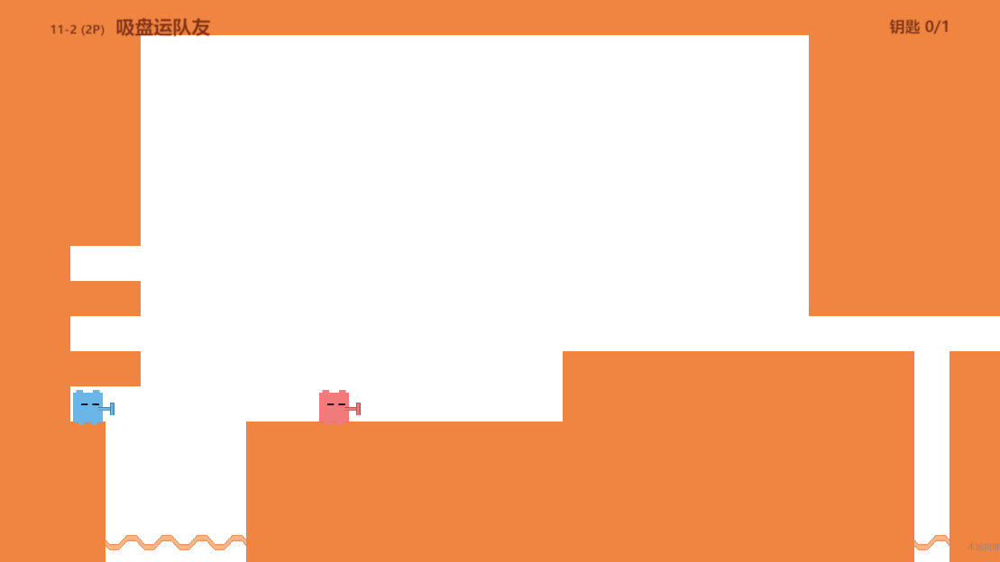

*图42　11-2「吸盘运队友」，2P开局。*

**关卡目标**　在短距离吸盘牵引下运送伙伴，跨越激光区域。 取得场内钥匙并送达出口，让所有需要通关的角色进入。

**场景结构**　主规则为吸盘。2P场景包含2个激光。

**合作过程**　先对齐持器者与目标的高度和方向，在有效距离内吸附，再决定何时移动和松开让伙伴落地。

**难点与设计作用**　本关吸盘有效距离被压到3格，接近与对齐本身就是任务。更多玩家容易抢占吸附位置，需要按批次接近。

**2P～8P版本分析**

| 人数 | 场上角色与配合分工 | 本版机关与数值 | 跑速／跳高 | 地砖布局 |
| --- | --- | --- | --- | --- |
| 2P | 2角色；吸取者与接收者对接 | 吸距3格；牵引4格/秒；激光2道 | 4／1.2 | 2P基准 |
| 3P | 3角色；明确运送顺序，分批接应2名伙伴 | 吸距3格；牵引4格/秒；激光2道 | 4／1.2 | 与2P一致 |
| 4P | 4角色；明确运送顺序，分批接应3名伙伴 | 吸距3格；牵引4格/秒；激光2道 | 4／1.2 | 与2P一致 |
| 5P | 5角色；明确运送顺序，分批接应4名伙伴 | 吸距3格；牵引4格/秒；激光2道 | 4／1.2 | 与2P一致 |
| 6P | 6角色；明确运送顺序，分批接应5名伙伴 | 吸距3格；牵引4格/秒；激光2道 | 4／1.2 | 与2P一致 |
| 7P | 7角色；明确运送顺序，分批接应6名伙伴 | 吸距3格；牵引4格/秒；激光2道 | 4／1.2 | 与2P一致 |
| 8P | 8角色；明确运送顺序，分批接应7名伙伴 | 吸距3格；牵引4格/秒；激光2道 | 4／1.2 | 与2P一致 |

**人数适配分析**　七个版本的地砖布局和主要机关数量一致。人数变化主要体现在出生点、操作责任和表中参数，队伍扩大后需要重新安排间距、等候与通过顺序。

### 11-3　吸取过窄道

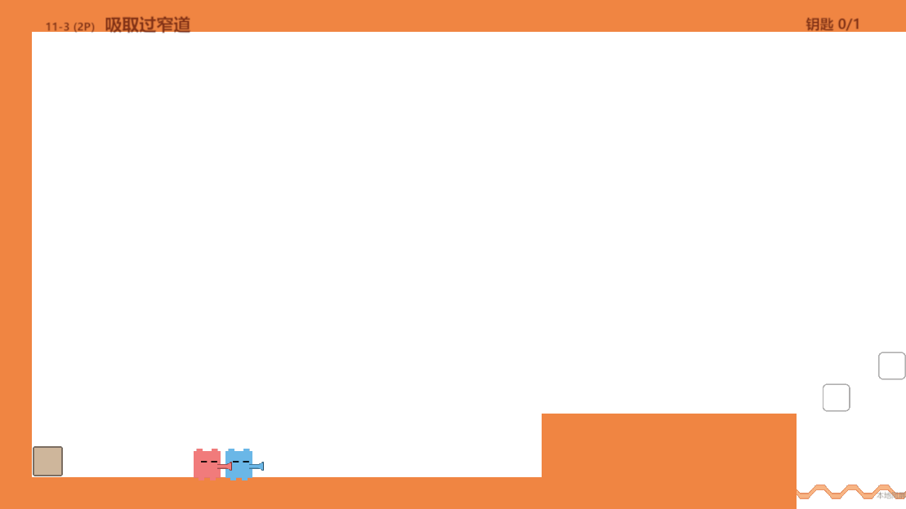

*图43　11-3「吸取过窄道」，2P开局。*

**关卡目标**　用吸人枪处理伙伴和可吸箱，穿过窄道、玻璃与激光。 取得场内钥匙并送达出口，让所有需要通关的角色进入。

**场景结构**　主规则为吸人枪。2P场景包含1个可吸箱、3个玻璃、1个激光。

**合作过程**　先决定需要携带的目标和释放顺序，利用窄道减少队伍占用空间；过玻璃后再为释放的队员预留落脚处。

**难点与设计作用**　运送对象包含箱子与角色，错误释放顺序会阻塞通路。玻璃破碎又缩短了中途停顿的安全时间。

**2P～8P版本分析**

| 人数 | 场上角色与配合分工 | 本版机关与数值 | 跑速／跳高 | 地砖布局 |
| --- | --- | --- | --- | --- |
| 2P | 2角色；吸取者与接收者对接 | 可吸箱1／玻璃3／激光1 | 4／1.2 | 2P基准 |
| 3P | 3角色；明确运送顺序，分批接应2名伙伴 | 可吸箱1／玻璃3／激光1 | 4／1.2 | 与2P一致 |
| 4P | 4角色；明确运送顺序，分批接应3名伙伴 | 可吸箱1／玻璃3／激光1 | 4／1.2 | 与2P一致 |
| 5P | 5角色；明确运送顺序，分批接应4名伙伴 | 可吸箱1／玻璃3／激光1 | 4／1.2 | 与2P一致 |
| 6P | 6角色；明确运送顺序，分批接应5名伙伴 | 可吸箱1／玻璃3／激光1 | 4／1.2 | 与2P一致 |
| 7P | 7角色；明确运送顺序，分批接应6名伙伴 | 可吸箱1／玻璃3／激光1 | 4／1.2 | 与2P一致 |
| 8P | 8角色；明确运送顺序，分批接应7名伙伴 | 可吸箱1／玻璃3／激光1 | 4／1.2 | 与2P一致 |

**人数适配分析**　七个版本的地砖布局和主要机关数量一致。人数变化主要体现在出生点、操作责任和表中参数，队伍扩大后需要重新安排间距、等候与通过顺序。

### 11-4　吸盘穿光阵

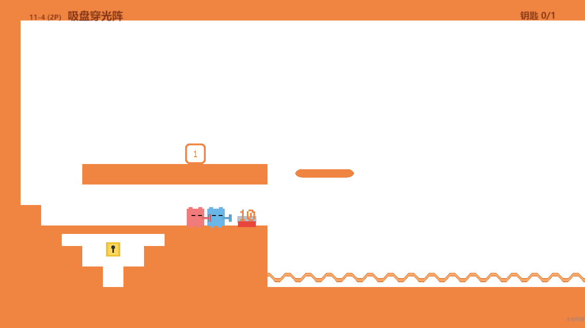

*图44　11-4「吸盘穿光阵」，2P开局。*

**关卡目标**　利用吸盘、定时机关和移动承载面穿过连续光束。 取得场内钥匙并送达出口，让所有需要通关的角色进入。

**场景结构**　主规则为吸盘。2P场景包含2个按钮、1个闸门、1个箱子、1个移动障碍、2个激光。

**合作过程**　先准备可吸箱和等待位置，触发延时按钮后安排登上承载面；抵达后段时处理单次自锁按钮，再接走其余角色。

**难点与设计作用**　10秒延时与单次按钮带来时序要求。牵引时的相对高度、光束位置和移动平台行程需要一起判断。

**2P～8P版本分析**

| 人数 | 场上角色与配合分工 | 本版机关与数值 | 跑速／跳高 | 地砖布局 |
| --- | --- | --- | --- | --- |
| 2P | 2角色；吸取者与接收者对接 | 延时按钮10秒／自锁按钮1；吸距12格 | 4／1.2 | 2P基准 |
| 3P | 3角色；明确运送顺序，分批接应2名伙伴 | 延时按钮10秒／自锁按钮1；吸距12格 | 4／1.2 | 与2P一致 |
| 4P | 4角色；明确运送顺序，分批接应3名伙伴 | 延时按钮10秒／自锁按钮1；吸距12格 | 4／1.2 | 与2P一致 |
| 5P | 5角色；明确运送顺序，分批接应4名伙伴 | 延时按钮10秒／自锁按钮1；吸距12格 | 4／1.2 | 与2P一致 |
| 6P | 6角色；明确运送顺序，分批接应5名伙伴 | 延时按钮10秒／自锁按钮1；吸距12格 | 4／1.2 | 与2P一致 |
| 7P | 7角色；明确运送顺序，分批接应6名伙伴 | 延时按钮10秒／自锁按钮1；吸距12格 | 4／1.2 | 与2P一致 |
| 8P | 8角色；明确运送顺序，分批接应7名伙伴 | 延时按钮10秒／自锁按钮1；吸距12格 | 4／1.2 | 与2P一致 |

**人数适配分析**　七个版本的地砖布局和主要机关数量一致。人数变化主要体现在出生点、操作责任和表中参数，队伍扩大后需要重新安排间距、等候与通过顺序。

## 第12章 last park

### 12-1　推箱举盾

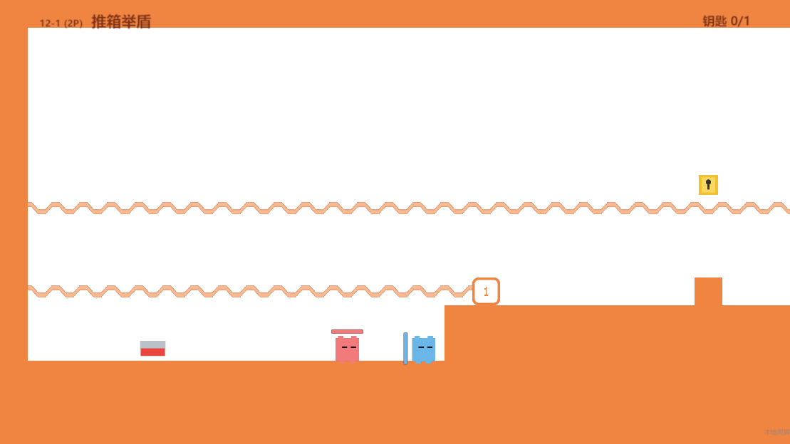

*图45　12-1「推箱举盾」，2P开局。*

**关卡目标**　把护盾站位、推箱与按钮结合，穿过两道激光取钥。 取得场内钥匙并送达出口，让所有需要通关的角色进入。

**场景结构**　主规则为护盾。2P场景包含1个按钮、2个激光、1个箱子。

**合作过程**　先由能挡住来向光束的角色占位，其他人处理箱子或按钮；更换高度或方向前确认伙伴仍在保护范围内。

**难点与设计作用**　盾朝向、角色高度和受控目标形成叠加条件。多人增加可接替掩护者，也增加通过同一保护区的时间。

**2P～8P版本分析**

| 人数 | 场上角色与配合分工 | 本版机关与数值 | 跑速／跳高 | 地砖布局 |
| --- | --- | --- | --- | --- |
| 2P | 2角色；按盾向掩护与换位 | 盾向 上1、后1；箱需1人 | 4／1.2 | 2P基准 |
| 3P | 3角色；按盾向掩护与换位 | 盾向 上2、后1；箱需1人 | 4／1.2 | 与2P一致 |
| 4P | 4角色；按盾向掩护与换位 | 盾向 上3、后1；箱需1人 | 4／1.2 | 与2P一致 |
| 5P | 5角色；按盾向掩护与换位 | 盾向 上4、后1；箱需1人 | 4／1.2 | 与2P一致 |
| 6P | 6角色；按盾向掩护与换位 | 盾向 上5、后1；箱需1人 | 4／1.2 | 与2P一致 |
| 7P | 7角色；按盾向掩护与换位 | 盾向 上6、后1；箱需1人 | 4／1.2 | 与2P一致 |
| 8P | 8角色；按盾向掩护与换位 | 盾向 上7、后1；箱需1人 | 4／1.2 | 与2P一致 |

**人数适配分析**　七个版本的地砖布局和主要机关数量一致。人数变化主要体现在出生点、操作责任和表中参数，队伍扩大后需要重新安排间距、等候与通过顺序。

### 12-2　借风飞跃

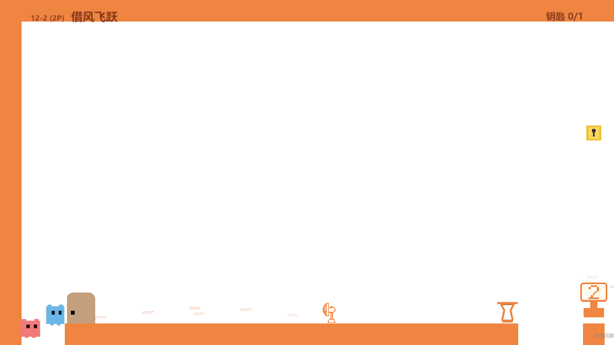

*图46　12-2「借风飞跃」，2P开局。*

**关卡目标**　利用两股风、弹簧和移动障碍完成跨越。 取得场内钥匙并送达出口，让所有需要通关的角色进入。

**场景结构**　主规则为普通闯关。2P场景包含1个弹簧、2个风扇、1个载人平台、1个移动障碍。

**合作过程**　先识别气流方向和能停留的位置，再把弹簧起跳与风力修正连成一段；有载人平台的版本先完成集合。

**难点与设计作用**　2P至4P有载人平台，5P以后取消该组件。风的推力与跳跃叠加，角色需要控制进入气流时的位置。

**2P～8P版本分析**

| 人数 | 场上角色与配合分工 | 本版机关与数值 | 跑速／跳高 | 地砖布局 |
| --- | --- | --- | --- | --- |
| 2P | 2角色；分批借风，确认伙伴落点 | 风扇2／弹簧1；载人平台1个，需2人 | 4／1.2 | 2P基准 |
| 3P | 3角色；分批借风，确认伙伴落点 | 风扇2／弹簧1；载人平台1个，需3人 | 4／1.2 | 与2P一致 |
| 4P | 4角色；分批借风，确认伙伴落点 | 风扇2／弹簧1；载人平台1个，需4人 | 4／1.2 | 与2P一致 |
| 5P | 5角色；分批借风，确认伙伴落点 | 风扇2／弹簧1；载人平台0个 | 4／1.2 | 与2P一致 |
| 6P | 6角色；分批借风，确认伙伴落点 | 风扇2／弹簧1；载人平台0个 | 4／1.2 | 与2P一致 |
| 7P | 7角色；分批借风，确认伙伴落点 | 风扇2／弹簧1；载人平台0个 | 4／1.2 | 与2P一致 |
| 8P | 8角色；分批借风，确认伙伴落点 | 风扇2／弹簧1；载人平台0个 | 4／1.2 | 与2P一致 |

**人数适配分析**　2P至4P配置1座按人数要求启动的载人平台，5P至8P取消该组件。地砖布局相同，多人版的通过组织由气流和其他移动物承担更多作用。

### 12-3　飞行冲刺

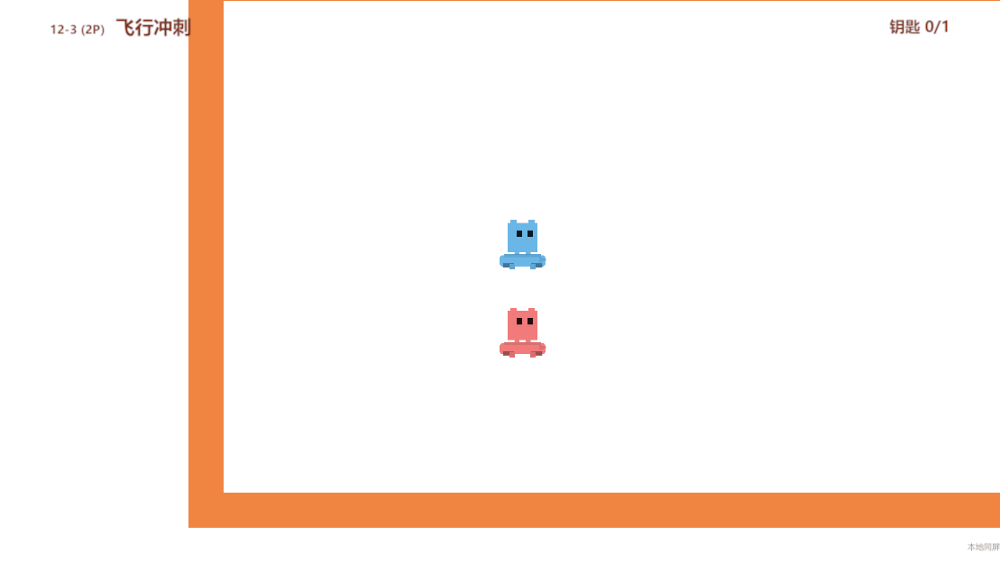

*图47　12-3「飞行冲刺」，2P开局。*

**关卡目标**　在飞机模式持续前进中穿过密集危险地形，送钥匙到出口。 取得场内钥匙并送达出口，让所有需要通关的角色进入。

**场景结构**　主规则为飞机。2P有2名飞行角色，场景以637格危险地砖围出飞行通道。

**合作过程**　为各角色留出观察与调整的空间，提前对齐下一个通道；最后阶段确认每个人都能抵达出口。

**难点与设计作用**　长距离地刺把安全修正空间压小。更多玩家仍各自承担避障，队伍不能只依靠一名熟练者完成全部任务。

**2P～8P版本分析**

| 人数 | 场上角色与配合分工 | 本版机关与数值 | 跑速／跳高 | 地砖布局 |
| --- | --- | --- | --- | --- |
| 2P | 2角色；各自避障，队伍共享通道信息 | 自动前进3.8格/秒；地刺格637 | 7.4／2.475 | 2P基准 |
| 3P | 3角色；各自避障，队伍共享通道信息 | 自动前进3.8格/秒；地刺格637 | 4／1.2 | 与2P一致 |
| 4P | 4角色；各自避障，队伍共享通道信息 | 自动前进3.8格/秒；地刺格637 | 4／1.2 | 与2P一致 |
| 5P | 5角色；各自避障，队伍共享通道信息 | 自动前进3.8格/秒；地刺格637 | 4／1.2 | 与2P一致 |
| 6P | 6角色；各自避障，队伍共享通道信息 | 自动前进3.8格/秒；地刺格637 | 4／1.2 | 与2P一致 |
| 7P | 7角色；各自避障，队伍共享通道信息 | 自动前进3.8格/秒；地刺格637 | 4／1.2 | 与2P一致 |
| 8P | 8角色；各自避障，队伍共享通道信息 | 自动前进3.8格/秒；地刺格637 | 4／1.2 | 与2P一致 |

**人数适配分析**　七个版本的地砖布局和主要机关数量一致。人数变化主要体现在出生点、操作责任和表中参数，队伍扩大后需要重新安排间距、等候与通过顺序。

### 12-4　激光与虫阵

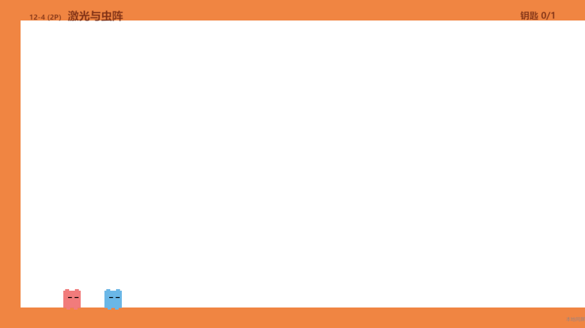

*图48　12-4「激光与虫阵」，2P开局。*

**关卡目标**　综合处理激光、开关、弹簧、毛毛虫和危险按钮，完成终关。 取得场内钥匙并送达出口，让所有需要通关的角色进入。

**场景结构**　主规则为普通闯关。2P场景包含3个激光、1个闸门、2个按钮、1个弹簧、2个毛毛虫。

**合作过程**　按路段分解任务，先打开可用支撑，再跨过动态危险，最后避开危险踏板并组织钥匙回收与进门。

**难点与设计作用**　两个按钮分别承担正常机关与危险触发，外形接近时需要区分。路线长，全队复位会放大后段失误的代价。

**2P～8P版本分析**

| 人数 | 场上角色与配合分工 | 本版机关与数值 | 跑速／跳高 | 地砖布局 |
| --- | --- | --- | --- | --- |
| 2P | 2角色；逐段开路与接应，危险按钮前报点 | 激光3／毛毛虫2；正常按钮1／危险按钮1 | 4／1.2 | 2P基准 |
| 3P | 3角色；逐段开路与接应，危险按钮前报点 | 激光3／毛毛虫2；正常按钮1／危险按钮1 | 4／1.2 | 与2P一致 |
| 4P | 4角色；逐段开路与接应，危险按钮前报点 | 激光3／毛毛虫2；正常按钮1／危险按钮1 | 4／1.2 | 与2P一致 |
| 5P | 5角色；逐段开路与接应，危险按钮前报点 | 激光3／毛毛虫2；正常按钮1／危险按钮1 | 4／1.2 | 与2P一致 |
| 6P | 6角色；逐段开路与接应，危险按钮前报点 | 激光3／毛毛虫2；正常按钮1／危险按钮1 | 4／1.2 | 与2P一致 |
| 7P | 7角色；逐段开路与接应，危险按钮前报点 | 激光3／毛毛虫2；正常按钮1／危险按钮1 | 4／1.2 | 与2P一致 |
| 8P | 8角色；逐段开路与接应，危险按钮前报点 | 激光3／毛毛虫2；正常按钮1／危险按钮1 | 4／1.2 | 与2P一致 |

**人数适配分析**　七个版本的地砖布局和主要机关数量一致。人数变化主要体现在出生点、操作责任和表中参数，队伍扩大后需要重新安排间距、等候与通过顺序。

## 物体与机关拆解

本部分以当前项目的交互行为为准，覆盖角色、地形、箱子、目标物、按钮、平台、装备、敌人、球体与逻辑区域。图标取自项目实际精灵；数字箱、载人平台、轮转平台及带标牌按钮采用原精灵组合，数字和配色为示例。透明触发区域与下落方块使用单独标注的示意图。图标统一为独立识别图，尺寸不代表游戏中的比例。

物体是否能压板、能否被吸取、是否计入平台人数，以及碰撞与视觉是否同时启用，都需按各自规则判断。下文的关卡链接可返回对应实机画面和2P～8P参数表。分析中的合作作用是对当前规则的设计解读。

### 物体索引

| 类别 | 物体 |
| --- | --- |
| 角色与地形 | [01 玩家角色](#object-01)、[02 实体地形与固定落脚点](#object-02)、[03 地刺危险区](#object-03)、[04 易碎玻璃](#object-04)、[05 连接绳索](#object-05) |
| 箱子与搬运 | [06 普通箱与重箱](#object-06)、[07 数字人数箱](#object-07)、[08 归属色箱](#object-08)、[09 可吸取箱](#object-09) |
| 目标与收集 | [10 钥匙](#object-10)、[11 金币](#object-11)、[12 出口门](#object-12) |
| 按钮与联动 | [13 普通压板与自锁按钮](#object-13)、[14 加时按钮](#object-14)、[15 延时按钮](#object-15)、[16 体型按钮](#object-16)、[17 钥匙显现按钮](#object-17)、[18 危险按钮](#object-18)、[19 伸缩闸门与浮桥](#object-19) |
| 平台与位移 | [20 移动平台与移动障碍](#object-20)、[21 载人阈值平台](#object-21)、[22 顶撞轮转平台](#object-22)、[23 弹簧](#object-23)、[24 风扇与风场](#object-24) |
| 危险与装备 | [25 激光](#object-25)、[26 定向盾牌](#object-26)、[27 飞行载具](#object-27)、[28 吸人枪](#object-28)、[29 吸盘牵引装置](#object-29) |
| 敌人与追逐 | [30 沉睡追击者](#object-30)、[31 注视幽灵](#object-31)、[32 巡逻毛毛虫](#object-32) |
| 球体与物理解谜 | [33 炮台与炮弹](#object-33)、[34 钥匙罐](#object-34)、[35 弹珠发射器与弹珠](#object-35)、[36 双盘天秤](#object-36)、[37 联动跷跷板](#object-37) |
| 复古玩法 | [38 打砖球与接球头盔](#object-38)、[39 普通砖与保护层砖](#object-39)、[40 多人下落方块](#object-40) |
| 时间与逻辑区域 | [41 停走时钟](#object-41)、[42 控制权交接区域](#object-42)、[43 隐藏显现区域](#object-43) |

### 角色与地形

#### 01　玩家角色

*角色颜色示例。*

| 项目 | 拆解 |
| --- | --- |
| 外观与识别 | 像素方形角色，颜色用于区分操作者；身体既是移动单位，也可成为队友的落脚点。图示为一名角色的独立精灵。 |
| 交互与状态 | 移动、跳跃、踩头、推箱与携带钥匙构成基础交互；不同主规则会增加牵引、飞行、吸取或共享控制等约束。 |
| 关键数值与条件 | 常规身体宽高约0.8格，大小按钮会改变尺度。出生点可覆盖跑速、跳高和盾牌方向，具体数值见各关人数表。 |
| 合作作用 | 同一角色可以先提供支撑，再等待队友接应；第5章共享角色、第10章双角色规则中，操作者人数与场上角色数需要分别理解。 |
| 失误与复位 | 站位错误会挡路、推歪箱子或踩中危险物；进门判定检查场上需要通关的角色，取得钥匙后仍须完成集合。 |
| 代表关卡 | [1-2 数字箱取钥](#level-1-2)、[5-1 同键过障](#level-5-1)、[10-1 双人开闸](#level-10-1) |

#### 02　实体地形与固定落脚点

*橙色实体地砖。*

| 项目 | 拆解 |
| --- | --- |
| 外观与识别 | 大面积橙色块面构成地板、墙面和台阶，连续色块先传达空间边界。 |
| 交互与状态 | 角色可站在上表面，侧面和底面阻挡移动；箱子和弹珠也受其碰撞约束。 |
| 关键数值与条件 | 按格组织空间，但每格高度和场景轮廓可调整。48关的336个版本中未配置单向地砖，不能把所有薄平台都解释为单向穿透。 |
| 合作作用 | 高差决定是否需要踩头、垫箱或等平台；窄道把个人跳跃转成队伍通行顺序问题。 |
| 失误与复位 | 盲目挤向同一落脚点会阻塞后续队员；稳定地面通常是观察、交接和重新集合的位置。 |
| 代表关卡 | [1-2 数字箱取钥](#level-1-2)、[6-1 同色箱搭梯](#level-6-1)、[12-1 推箱举盾](#level-12-1) |

#### 03　地刺危险区

*危险地砖精灵。*

| 项目 | 拆解 |
| --- | --- |
| 外观与识别 | 项目中的危险地砖采用红色块面表现，图标保留实际精灵形状；不能仅按名称想象成三角尖刺。 |
| 交互与状态 | 进入危险接触范围触发死亡或本关失败处理，不能当作普通落脚面。 |
| 关键数值与条件 | 危险区按地砖铺设，可形成地面、墙面与顶棚包围；12-3的2P～8P版本均有637格危险地砖。 |
| 合作作用 | 它限定安全通道与空中修正空间，飞行关中需要共享前方路况并保持间距。 |
| 失误与复位 | 碰撞风险随人数和占用空间增加；护盾针对激光的遮挡作用不能直接等同于免疫地刺。 |
| 代表关卡 | [12-3 飞行冲刺](#level-12-3) |

#### 04　易碎玻璃

*完整玻璃。*

| 项目 | 拆解 |
| --- | --- |
| 外观与识别 | 白色内部、灰色细框，与橙色永久地形区分；破碎过程反馈支撑即将消失。 |
| 交互与状态 | 从上方踩到后开始计时，达到延迟后失去碰撞；离开不会把已经启动的破碎过程取消。 |
| 关键数值与条件 | 2-2为1×1格玻璃，破碎延迟0.2秒，配置为本次尝试内不再生成；其他玻璃按各自配置恢复或保持消失。 |
| 合作作用 | 队首改变队尾的可用路线，要求集中通过、跳过破碎段或另找稳定集合点。 |
| 失误与复位 | 在玻璃上讨论或掉头容易让后续玩家失去支撑；永久消失配置需要重开本关恢复。 |
| 代表关卡 | [2-2 玻璃窄桥](#level-2-2)、[2-4 玻璃桥与弹簧](#level-2-4)、[10-1 双人开闸](#level-10-1)、[11-3 吸取过窄道](#level-11-3) |

#### 05　连接绳索

*绳索精灵，运行中按两端距离拉伸。*

| 项目 | 拆解 |
| --- | --- |
| 外观与识别 | 棕色绳段连接相邻编号角色，接近拉紧时颜色转红，提示可用距离正在耗尽。 |
| 交互与状态 | 相邻角色距离超过绳长时产生位置与速度耦合；岸上玩家可锚定或主动牵引悬空队友，整队形成连续约束链。 |
| 关键数值与条件 | 2-1的2P绳长3.6格，2-3为4.8格。人数增加时连接段数随相邻角色对数增加，不能把单段长度当成整条队伍的总活动范围。 |
| 合作作用 | 约束自由移动，同时提供拉人和救援手段；起跳前要确认队尾位置，落地后再为下一人提供牵引。 |
| 失误与复位 | 领先者持续远走可能把队友拖离落脚点，反向拉扯又会阻止过坎；重开恢复角色位置与绳链。 |
| 代表关卡 | [2-1 同绳跳台](#level-2-1)、[2-3 绳索越光](#level-2-3) |

### 箱子与搬运

#### 06　普通箱与重箱

 

*普通箱；重箱。*

| 项目 | 拆解 |
| --- | --- |
| 外观与识别 | 普通箱为木色分格，重箱为灰色分格；是否显示数字或角色颜色还会改变箱体外观。 |
| 交互与状态 | 从侧面持续接触并施加方向输入可推移；可站上方垫高，也可从下方顶起。是否压按钮由箱体权限决定。 |
| 关键数值与条件 | 宽、高、推箱人数、严格人数和顶撞增益独立配置。非数字箱不会自动给载人平台增加“1人重量”。 |
| 合作作用 | 箱子把临时踩头支撑变为可搬运落脚点，也可代替玩家保持允许其触发的压板。 |
| 失误与复位 | 推过头会改变可跳高度或堵住通道；使用前要看清后续取回路线，重开恢复初始位置。 |
| 代表关卡 | [1-2 数字箱取钥](#level-1-2)、[1-3 踏板连锁](#level-1-3)、[7-2 一二三木头人](#level-7-2) |

#### 07　数字人数箱

*数字箱组合图，数字2为示例。*

| 项目 | 拆解 |
| --- | --- |
| 外观与识别 | 白底橙框，中央橙色数字直接表示所需推箱人数；图示使用项目箱框与数字精灵组合。 |
| 交互与状态 | 同侧连续接触的队员形成推力链。两侧同时推时比较双方推力，持平则不移动。 |
| 关键数值与条件 | 严格人数箱必须足额；宽松配置会以场上模拟角色数限制需求。数字箱在载人平台计重时按箱内数字计，而非按箱子个数计。 |
| 合作作用 | 把“集合”变成明确门槛；同一个箱子既需要多人推动，也能作为平台配重。2-4的2P版本用两只数字1箱补足4人阈值。 |
| 失误与复位 | 队员站在附近不等于参与推箱，接触链断开或两侧对顶会造成“人够却推不动”。重开恢复箱位。 |
| 代表关卡 | [4-2 飞机穿障](#level-4-2)、[2-4 玻璃桥与弹簧](#level-2-4)、[6-2 箱梯与激光](#level-6-2) |

#### 08　归属色箱

*蓝色归属示例。*

| 项目 | 拆解 |
| --- | --- |
| 外观与识别 | 箱体使用对应玩家颜色，归属关系由角色色与箱色配对传达。 |
| 交互与状态 | 只有指定操作者的输入可参与推动该箱，其他角色仍可与箱子产生站立或阻挡关系。 |
| 关键数值与条件 | 归属编号可指定1～8号，0表示不限制。6-1的2P版本同时配置1号与2号归属箱，大小不一。 |
| 合作作用 | 迫使不同玩家轮流开路、搬运自己的箱子并为队友留出站位，不能由一人包办全部推箱工作。 |
| 失误与复位 | 错误玩家接管推箱不会推进；多人围住箱子还可能挡住真正负责的玩家，重开恢复布置。 |
| 代表关卡 | [6-1 同色箱搭梯](#level-6-1) |

#### 09　可吸取箱

*可吸取箱。*

| 项目 | 拆解 |
| --- | --- |
| 外观与识别 | 棕色面、深色边框，与分格木箱和橙框数字箱区分。 |
| 交互与状态 | 可被吸人枪收纳，再作为存储目标发射；普通侧向推动不能代替其吸取搬运方式。 |
| 关键数值与条件 | 11-3为1×1格，允许压按钮，不允许吸盘装置附着。两种吸取装备的作用对象由独立权限判断。 |
| 合作作用 | 提供一个可携带的实体支撑或触发物；需要与队员运输共享吸人枪的释放顺序。 |
| 失误与复位 | 在错误位置发射会堵住窄道或浪费落脚空间；重开恢复初始位置。 |
| 代表关卡 | [11-3 吸取过窄道](#level-11-3) |

### 目标与收集

#### 10　钥匙

*钥匙。*

| 项目 | 拆解 |
| --- | --- |
| 外观与识别 | 黄色方形钥匙图标，是取物和回门目标；部分关卡先隐藏，完成前置任务后才出现。 |
| 交互与状态 | 接触可拾取并随角色携带，动作键可抛出；靠近出口后完成送达。金币、按钮、停钟、消行、清砖等规则可控制其可见与可取状态。 |
| 关键数值与条件 | 投掷初速度为横向9.5格/秒、向上8格/秒，拾取冷却0.35秒。门检查钥匙送达状态，仅“有人拿到”还不等于门已开。 |
| 合作作用 | 把探索目标转成护送与回收任务，允许换人接力，避免所有玩家反复走同一条取钥路线。 |
| 失误与复位 | 投进危险区或门前失误会增加回收成本；本关重开后回到初始出现条件。 |
| 代表关卡 | [1-1 踏板搭桥](#level-1-1)、[3-1 限时搜金币](#level-3-1)、[8-1 多人拼方块](#level-8-1)、[9-2 配重送弹珠](#level-9-2) |

#### 11　金币

*金币。*

| 项目 | 拆解 |
| --- | --- |
| 外观与识别 | 金黄色竖向硬币，与门用钥匙的方形轮廓区分。 |
| 交互与状态 | 角色接触后收集，场景内金币逐个消失；收齐本关全部金币后使受金币条件约束的钥匙出现。 |
| 关键数值与条件 | 3-1与3-3使用金币解锁目标。金币位置和数量按场景配置读取，时间限制与金币条件共同构成压力。 |
| 合作作用 | 可按左右区、上下层分配收集责任，队员回报未收区域，最后再集中回门。 |
| 失误与复位 | 漏掉一枚会阻断钥匙阶段；倒计时耗尽后本次收集进度随重开恢复。 |
| 代表关卡 | [3-1 限时搜金币](#level-3-1)、[3-3 弹簧抢金币](#level-3-3) |

#### 12　出口门

 

*关闭；打开。*

| 项目 | 拆解 |
| --- | --- |
| 外观与识别 | 棕色闭门与黑色开门形成明显状态差，门是最终集合点。 |
| 交互与状态 | 普通出口在钥匙送达条件满足后打开；按钮控制的出口先按机关供电条件处理。打开后还需让全部应通关角色入门。 |
| 关键数值与条件 | 每个人数版本均有1个出口；钥匙条件和机关条件不能统一简化为“碰门就通关”。 |
| 合作作用 | 收束分散任务，检验压板者、运输者和取钥者是否都有撤离路线。 |
| 失误与复位 | 最后一人被留在机关另一侧会让进门流程停住；重开恢复门与钥匙状态。 |
| 代表关卡 | [1-1 踏板搭桥](#level-1-1)、[10-2 滚动平台接力](#level-10-2)、[12-4 激光与虫阵](#level-12-4) |

### 按钮与联动

#### 13　普通压板与自锁按钮

 

*未踩下；踩下。*

| 项目 | 拆解 |
| --- | --- |
| 外观与识别 | 灰色底座搭配红色未触发条、绿色触发条；标牌和受控目标进一步说明用途。 |
| 交互与状态 | 符合条件的角色或物体踩压后向目标输出激活状态。持续压板需保持占用，自锁按钮首次激活后保持；单次使用限制本关重复激活。 |
| 关键数值与条件 | 一个按钮可控制多个目标，一个目标也可按“任意满足”或“全部满足”响应多个按钮。能否由箱子或弹珠代压取决于物体权限。 |
| 合作作用 | 建立留守与通过、开路与撤离的分工；多按钮并联或串联可要求分散站位或同步踩压。 |
| 失误与复位 | 把持续压板误当自锁会过早撤离；不能只看按钮变绿，还要确认目标路径已经可用。重开恢复单次和锁定状态。 |
| 代表关卡 | [1-1 踏板搭桥](#level-1-1)、[1-3 踏板连锁](#level-1-3)、[12-1 推箱举盾](#level-12-1) |

#### 14　加时按钮

*加时标牌组合示例。*

| 项目 | 拆解 |
| --- | --- |
| 外观与识别 | 沿用按钮底座，时间增量通过带秒数的标牌表达；图标中的“+1s”为配置示例。 |
| 交互与状态 | 首次有效踩压把配置增量加到关卡剩余时间，再进入已使用状态；当前加时关采用一次性资源。 |
| 关键数值与条件 | 3-2每块增加1秒，2P有7块、3P～8P有9块；3-4每块增加2秒，3P/4P有6块，其余人数版本有2块。 |
| 合作作用 | 加时点兼具路线节点和团队公共资源作用，适合一人沿线触发、其他人提前处理下一段。 |
| 失误与复位 | 重复踩同一块不能反复刷时间；收集加时的绕路成本也要算进回门时间，重开恢复可用次数。 |
| 代表关卡 | [3-2 抢时踩踏板](#level-3-2)、[3-4 推箱踩双板](#level-3-4) |

#### 15　延时按钮

*10秒倒计时组合示例。*

| 项目 | 拆解 |
| --- | --- |
| 外观与识别 | 按钮上方显示实时倒数数字，用以区分立即触发和等待后触发。 |
| 交互与状态 | 可配置为倒数结束后激活目标，或倒数期间保持供电、归零后断开；两种状态流程会产生不同的出发时机。 |
| 关键数值与条件 | 11-4当前使用前一种：倒数10秒后启动移动目标。不能根据数字跳动就认为平台已开始运行。 |
| 合作作用 | 给队员预站位和交接的窗口，要求操作者与乘台者先确认倒数阶段和目标启动时间。 |
| 失误与复位 | 过早离开安全点可能等不到平台，过晚集合又会错过启动；重开恢复倒数与目标初始位置。 |
| 代表关卡 | [11-4 吸盘穿光阵](#level-11-4) |

#### 16　体型按钮

*加减标牌组合示例。*

| 项目 | 拆解 |
| --- | --- |
| 外观与识别 | 加号与减号标记区分放大、缩小，底座仍采用按钮视觉。 |
| 交互与状态 | 持续改变实际踩中按钮的角色大小，离开后保留当前尺度；不会自动把全队一起放大或缩小。 |
| 关键数值与条件 | 4-4缩小下限0.6倍，放大按钮上限3.5倍，变化速度2倍率/秒；默认上限1.5倍不能代替本关实际配置。 |
| 合作作用 | 让玩家在穿窄道、提供高度与保持通行空间之间切换角色职责。 |
| 失误与复位 | 变大过头会堵住出口或窄缝；在仍可到达的反向按钮上修正，无法返回时需重开。 |
| 代表关卡 | [4-4 变身钻窄道](#level-4-4)、[10-1 双人开闸](#level-10-1) |

#### 17　钥匙显现按钮

*钥匙按钮共用底座。*

| 项目 | 拆解 |
| --- | --- |
| 外观与识别 | 底座与普通按钮相同，功能由联动的钥匙显现结果识别；没有独立钥匙按钮精灵。 |
| 交互与状态 | 有效踩压后执行钥匙控制，使指定隐藏钥匙进入可出现状态，供角色后续拾取。 |
| 关键数值与条件 | 9-2当前以钥匙控制模式连接目标；弹珠能否触发还受发射器的可压按钮配置约束。 |
| 合作作用 | 将天秤和跷跷板的运球结果转为可取的通关目标，负责调路与负责取钥的玩家可以分工。 |
| 失误与复位 | 只把弹珠送到附近而未压中有效范围，钥匙阶段不会推进；重开恢复隐藏状态。 |
| 代表关卡 | [9-2 配重送弹珠](#level-9-2) |

#### 18　危险按钮

*危险标牌组合示例。*

| 项目 | 拆解 |
| --- | --- |
| 外观与识别 | 沿用普通按钮底座，危险文字标牌提示其禁踩属性。相似底座会让惯于见按钮就踩的玩家误判。 |
| 交互与状态 | 满足踩压触发条件时直接进入失败处理，不是普通的开门或加分机关。 |
| 关键数值与条件 | 6-4为密集禁踩路线；12-4同时有正常按钮1块和危险按钮1块，必须按作用区分。 |
| 合作作用 | 把合作重点从“谁去触发”转为“如何让整队都避开”，需要安排排队、起跳与落点。 |
| 失误与复位 | 尾随玩家可能被前方拥堵挤入危险范围；失败后整关重开，已经完成的路段也要重新处理。 |
| 代表关卡 | [6-4 别踩危险踏板](#level-6-4)、[12-4 激光与虫阵](#level-12-4) |

#### 19　伸缩闸门与浮桥

*闸门精灵。*

| 项目 | 拆解 |
| --- | --- |
| 外观与识别 | 可表现为灰色分段闸门，也可使用橙色地形外观形成桥面或墙体；图示为独立闸门精灵。 |
| 交互与状态 | 按供电状态生长或收缩碰撞实体。通电可让墙消失，也可让桥长出，取决于本体配置。 |
| 关键数值与条件 | 控制条件支持多个按钮；目标长度、伸展方向、速度及视觉外观分别配置。 |
| 合作作用 | 把远端玩家的踩压动作转换为当前路段的通行条件，形成留守、通过、接替与撤离链。 |
| 失误与复位 | 只按“通电等于开门”理解会误判桥面方向；撤离压板前应确认队尾已有稳定支撑。 |
| 代表关卡 | [1-1 踏板搭桥](#level-1-1)、[1-3 踏板连锁](#level-1-3)、[10-1 双人开闸](#level-10-1)、[12-4 激光与虫阵](#level-12-4) |

### 平台与位移

#### 20　移动平台与移动障碍

*基础移动平台。*

| 项目 | 拆解 |
| --- | --- |
| 外观与识别 | 横向板面或场景中配置的块体，运动轨迹将相隔的落脚点连接起来。 |
| 交互与状态 | 可自动移动或由按钮启用，支持往返、单程与往返一次等路径方式；非危险实体可提供支撑。 |
| 关键数值与条件 | 方向、距离、速度、循环方式及松开后返回分别配置。1-4的一个2P移动体速度2.5格/秒、距离3.7格；11-4另一目标速度7格/秒、距离47.4格。 |
| 合作作用 | 要求先集合再登台，或把一人操纵、一人乘坐的任务分开；长距离移动放大了漏乘的代价。 |
| 失误与复位 | 相同标记类型可设置危险属性，不能只凭“会移动”就判断可站；重开恢复起点。 |
| 代表关卡 | [1-4 搭台越障](#level-1-4)、[5-3 同键躲激光](#level-5-3)、[11-4 吸盘穿光阵](#level-11-4) |

#### 21　载人阈值平台

*人数2平台组合示例。*

| 项目 | 拆解 |
| --- | --- |
| 外观与识别 | 橙色底板、立柱与数字牌显示集合要求；数字随当前版本和平台配置变化。 |
| 交互与状态 | 累计平台上的有效重量，满足阈值后按控制方式运行；持续检测型与满足后保持型的离台结果不同。 |
| 关键数值与条件 | 玩家按1计，数字箱按箱内人数计，其他普通箱不计。1-1阈值随2P～8P变为2～8；2-4的2P版本阈值为4。 |
| 合作作用 | 让“等齐再走”成为显式条件，同时允许通过数字箱在角色有限时补足人数。 |
| 失误与复位 | 有人未落稳、过早跳离或拿普通箱代替数字箱，都会导致计重不符；重开恢复位置与控制状态。 |
| 代表关卡 | [1-1 踏板搭桥](#level-1-1)、[2-4 玻璃桥与弹簧](#level-2-4)、[6-3 全员搭电梯](#level-6-3) |

#### 22　顶撞轮转平台

 

*箭头状态组合示例；三角状态。*

| 项目 | 拆解 |
| --- | --- |
| 外观与识别 | 下方为移动平台，上方悬挂可顶撞方框；三角与方向箭头轮流出现。 |
| 交互与状态 | 角色从下方顶到方框时读取当前符号：箭头推进平台一个步长，三角不推进；顶撞伴随短暂弹动反馈。 |
| 关键数值与条件 | 10-2的一个2P平台每0.6秒换符号，推进步长1格、速度1格/秒、最大位移4格；顶撞冷却约0.25秒。 |
| 合作作用 | 把起跳时机与运输进度绑定，一人观察符号报时，另一人顶撞或先登台。 |
| 失误与复位 | 连续乱跳可能一直顶到无效状态；累计到目标位置后还要确认另一角色也能转移，重开恢复进度。 |
| 代表关卡 | [10-2 滚动平台接力](#level-10-2) |

#### 23　弹簧

*弹簧。*

| 项目 | 拆解 |
| --- | --- |
| 外观与识别 | 橙色支架状弹跳物，外形与平直地面区分。 |
| 交互与状态 | 角色向下落到弹簧顶部有效区域时被赋予向上的弹射速度，不需要再次按跳跃键才生效。 |
| 关键数值与条件 | 弹力是向上速度，不是直接跳高。2-4的2P弹力22格/秒，3-3为35格/秒，4-3为26格/秒。 |
| 合作作用 | 为队员提供跨大高差的共同路线，也会把排队与空中接应变成节奏任务。 |
| 失误与复位 | 落偏、被队友挡住或在弹起后过度修正方向都会错失落点；可回到弹簧重试，落入危险区则按失败流程复位。 |
| 代表关卡 | [2-4 玻璃桥与弹簧](#level-2-4)、[3-3 弹簧抢金币](#level-3-3)、[4-3 双钟卡点](#level-4-3)、[12-2 借风飞跃](#level-12-2) |

#### 24　风扇与风场

 

*风扇；风场波纹。*

| 项目 | 拆解 |
| --- | --- |
| 外观与识别 | 橙色风扇与波纹表现气流方向，风扇可附着在移动平台上。 |
| 交互与状态 | 角色进入有效风场后受到速度影响；墙体和关闭闸门会截断有效作用范围。 |
| 关键数值与条件 | 12-2的2P配置有两台风扇，风力分别16与14，作用距离约14.29格与5.65格，风场宽度为1格与1.4格。 |
| 合作作用 | 把站位、登台和空中修正连接起来，队友需要确认顺风或逆风段以及风源是否随平台移动。 |
| 失误与复位 | 看见波纹不等于整条方向都可获得推力；脱离风场后要重新按正常重力判断落点。 |
| 代表关卡 | [12-2 借风飞跃](#level-12-2) |

### 危险与装备

#### 25　激光

*波浪光束的一帧。*

| 项目 | 拆解 |
| --- | --- |
| 外观与识别 | 橙色波浪光束是实际危险表现；当前运行画面不绘制发射器图标。 |
| 交互与状态 | 光束沿配置方向延伸，并根据遮挡更新有效长度；无保护的角色接触有效光束会触发危险判定。 |
| 关键数值与条件 | 光束动画频率控制波纹帧变化，不能当作周期通断时间。显示有短暂伸出动画，安全与否仍需看当前有效光束和遮挡。 |
| 合作作用 | 迫使队伍使用盾牌遮挡、错位通过或先操作机关改变安全路线。 |
| 失误与复位 | 把波纹闪动误判为关停会造成失误；盾牌朝向不对或遮挡者提前离开也会让后方失去保护。 |
| 代表关卡 | [4-1 举盾挡激光](#level-4-1)、[11-2 吸盘运队友](#level-11-2)、[12-4 激光与虫阵](#level-12-4) |

#### 26　定向盾牌

*蓝色盾牌方向示例。*

| 项目 | 拆解 |
| --- | --- |
| 外观与识别 | 贴在角色周围的彩色薄板，颜色跟随角色；图示为单独盾牌，实际可能水平或竖直摆放。 |
| 交互与状态 | 按配置方向形成激光遮挡。向上、向下、向前、向后有不同保护侧，前后向还与角色朝向有关。 |
| 关键数值与条件 | 盾牌方向在出生点分别配置。4-1强调不同朝向角色的组合，不能按图示横板推定所有角色都防头顶。 |
| 合作作用 | 一个人的站位可以为另一人遮出通道，队伍需要交接遮挡责任并关注转身。 |
| 失误与复位 | 覆盖侧错误、角色间距过大或保护者先走都会破坏安全区；不具备对所有危险类型的通用免伤效果。 |
| 代表关卡 | [4-1 举盾挡激光](#level-4-1) |

#### 27　飞行载具

*蓝色飞机示例。*

| 项目 | 拆解 |
| --- | --- |
| 外观与识别 | 角色乘坐对应颜色的小飞机，视觉上说明本关采用飞行移动。 |
| 交互与状态 | 持续向右前进，玩家输入提供水平修正与上下移动；每名场上角色各自控制自己的飞行位置。 |
| 关键数值与条件 | 12-3自动前进为3.8格/秒；手动水平与竖向控制参数独立，不能把普通地面跳跃高度直接套入飞行路线。 |
| 合作作用 | 全员共享前方障碍信息，先行者可报告上下缺口，后续玩家维持安全间距。 |
| 失误与复位 | 贴墙飞行、临时抢道或长时间停留错误高度容易碰危险区；失败后从本关初始飞行状态重试。 |
| 代表关卡 | [12-3 飞行冲刺](#level-12-3) |

#### 28　吸人枪

 

*蓝色吸人枪示例；吸取弹。*

| 项目 | 拆解 |
| --- | --- |
| 外观与识别 | 角色前方喇叭形枪口，吸取弹为白色圆环；枪色跟随使用者。 |
| 交互与状态 | 空仓触发动作键或下方向新按下时发出吸取弹，可收纳角色和可吸箱；有存储目标时发射最后收纳的目标。 |
| 关键数值与条件 | 吸取弹与发射目标速度约15格/秒，冷却0.25秒；存储顺序为后进先出。目标被收纳期间从场上活动状态退出。 |
| 合作作用 | 把多人队伍压缩成可携带的运输关系，越过窄道后再按顺序释放伙伴。 |
| 失误与复位 | 最后吸入的目标先射出，装载顺序错误会让出口处没有所需队员或箱子；向危险方向发射会增加重试成本。 |
| 代表关卡 | [11-1 吸人枪渡口](#level-11-1)、[11-3 吸取过窄道](#level-11-3) |

#### 29　吸盘牵引装置

*蓝色吸盘示例。*

| 项目 | 拆解 |
| --- | --- |
| 外观与识别 | 角色前方呈吸盘头形态，与喇叭枪口区分。 |
| 交互与状态 | 按住下方向牵引前方有效目标，拉近并对齐高度；附着后被牵引目标暂停自主移动、跳跃和重力，释放后恢复。 |
| 关键数值与条件 | 11-2当前牵引范围为3格；拉近与高度对齐速度分别配置。箱子是否可附着由独立开关控制。 |
| 合作作用 | 形成牵引者与被牵引者的行动交接，能用单人移动带动另一角色通过部分路径。 |
| 失误与复位 | 距离不足、目标不在有效高度或对象禁止附着都会失败；释放位置不当会使队友直接下落。 |
| 代表关卡 | [11-2 吸盘运队友](#level-11-2) |

### 敌人与追逐

#### 30　沉睡追击者

 

*沉睡；醒来追击。*

| 项目 | 拆解 |
| --- | --- |
| 外观与识别 | 沉睡时闭眼并有睡眠符号，醒后变为红色表情，状态差说明当前追击风险。 |
| 交互与状态 | 按每名玩家连续移动积累的距离监测噪动，达到阈值后延迟醒来并追击；短暂停住可重置尚未触发的移动积累。 |
| 关键数值与条件 | 7-1当前移动距离阈值2格，醒来延迟0.35秒，2P追速7格/秒，接近0.45格触发击杀。并非按固定红绿灯周期循环睡醒。 |
| 合作作用 | 要求全队共同约定移动与停顿，单个成员超出阈值会改变所有人的处境。 |
| 失误与复位 | 队伍末端仍持续移动会破坏停顿计划；已经醒来的追击不能仅靠一次停止就当作解除，失败后重开恢复沉睡。 |
| 代表关卡 | [7-1 别吵醒云怪](#level-7-1) |

#### 31　注视幽灵

 

*受注视状态；活动状态。*

| 项目 | 拆解 |
| --- | --- |
| 外观与识别 | 白色浅灰描边，表情帧变化较小；是否移动比单帧外观更能反映当前状态。 |
| 交互与状态 | 检查有足够角色面向其所在方向注视时停止；不足时向目标角色追赶，接触可造成死亡。 |
| 关键数值与条件 | 7-3的2P～8P配置均需要1名注视者，移动速度4.5格/秒；人数增加不会自动增加此阈值。 |
| 合作作用 | 留出一名观察者维持冻结，其他人先转移，再完成注视责任交接与平台集合。 |
| 失误与复位 | 观察者转身取物或全员同时上台会暴露追击窗口；失败后恢复幽灵和角色初始位置。 |
| 代表关卡 | [7-3 回头定幽灵](#level-7-3) |

#### 32　巡逻毛毛虫

*毛毛虫。*

| 项目 | 拆解 |
| --- | --- |
| 外观与识别 | 绿色长条身体、多点深色面部，横向巡逻。 |
| 交互与状态 | 角色从上方向下踩中可反弹，毛毛虫继续存活；从侧面或下方接触会触发危险。 |
| 关键数值与条件 | 7-4配置3只，12-4配置2只；数量在各自2P～8P版本保持一致。 |
| 合作作用 | 同时充当移动危险与可利用的弹跳对象；队员需要报位置并避免把队友挤向侧面。 |
| 失误与复位 | 把踩踏误当成消灭敌人，会使后续队员仍撞上巡逻体；重开恢复巡逻起点与状态。 |
| 代表关卡 | [7-4 停步蓄力](#level-7-4)、[12-4 激光与虫阵](#level-12-4) |

### 球体与物理解谜

#### 33　炮台与炮弹

*炮台与炮弹组合图。*

| 项目 | 拆解 |
| --- | --- |
| 外观与识别 | 橙色炮身、突出炮管与同色圆形炮弹，直线运动易于追踪。 |
| 交互与状态 | 炮台按间隔发射。炮弹碰墙或角色后消失；当前实现中命中角色不造成伤害，也不由角色反射。命中钥匙罐则消耗炮弹并累计罐体受击。 |
| 关键数值与条件 | 9-1每2秒发射一次，炮弹速度4格/秒、半径0.3格。 |
| 合作作用 | 玩家需要让出有效射线，维持炮台到罐体之间的可达路径，避免无意中替罐子挡弹。 |
| 失误与复位 | 站到炮路上会中断破罐进度，但不是被炮弹直接击杀；重开恢复发射节奏与罐体初始耐久。 |
| 代表关卡 | [9-1 借炮破钥匙瓶](#level-9-1) |

#### 34　钥匙罐

*完整钥匙罐。*

| 项目 | 拆解 |
| --- | --- |
| 外观与识别 | 透明橙色罐体内显示黄色钥匙，直接提示“钥匙存在但暂时取不到”。 |
| 交互与状态 | 有效炮弹或弹珠命中累计受击，球体被消耗；达到要求后播放破碎反馈，再释放可拾取钥匙。 |
| 关键数值与条件 | 9-1与9-4均需3次命中，罐体宽约1.14格、高1.4格。 |
| 合作作用 | 让开路与维持球路成为取钥前置任务，队员可分别负责运球、清障和接钥匙。 |
| 失误与复位 | 只让球经过附近不等于命中；被玩家挡掉或提前消失的球不会给罐体增加受击次数，重开恢复耐久。 |
| 代表关卡 | [9-1 借炮破钥匙瓶](#level-9-1)、[9-4 弹珠破钥匙瓶](#level-9-4) |

#### 35　弹珠发射器与弹珠

*发射器与弹珠组合图。*

| 项目 | 拆解 |
| --- | --- |
| 外观与识别 | 橙色杯状发射口与浅色圆形弹珠；弹珠与橙色无重力打砖球属于不同物体。 |
| 交互与状态 | 定时生成受重力影响的弹珠，弹珠可落到地形和跷跷板上滚动、弹跳；压按钮和落地清理按配置执行。 |
| 关键数值与条件 | 9-2首次延迟1秒、间隔7秒、最大存量5；9-4首次延迟1秒、间隔5秒。弹珠半径0.2格、反弹系数0.35。 |
| 合作作用 | 玩家通过调节地形与跷跷板引导球路，而不是每次亲自搬运目标物。 |
| 失误与复位 | 发射间隔意味着失误后有等待成本；落入清理区域的弹珠可能延迟消失，应在下一发前恢复路线。 |
| 代表关卡 | [9-2 配重送弹珠](#level-9-2)、[9-4 弹珠破钥匙瓶](#level-9-4) |

#### 36　双盘天秤

*单侧盘面精灵。*

| 项目 | 拆解 |
| --- | --- |
| 外观与识别 | 成对平台相对运动；图示为单个盘面，实际关卡由左右两盘及其联动组成。 |
| 交互与状态 | 按左右盘“是否被有效物体压住”切换：只有左侧压住、只有右侧压住、两侧都压或都未压，对应不同状态。两侧同状态时回到中位。 |
| 关键数值与条件 | 不比较两侧人数总重量。9-2两盘水平间距14.4格、浮动高度1.92格、变化速度0.5，关联3块跷跷板。 |
| 合作作用 | 需要切换单侧占用与双侧占用，安排谁离盘、谁保留，给弹珠创造所需坡向。 |
| 失误与复位 | 在人多一侧继续加人不会自动压过另一侧；站错侧会让坡面回平或反向，重开恢复初始高度。 |
| 代表关卡 | [9-2 配重送弹珠](#level-9-2) |

#### 37　联动跷跷板

*跷跷板板面。*

| 项目 | 拆解 |
| --- | --- |
| 外观与识别 | 细长橙色板面，通过倾斜呈现当前导流方向。 |
| 交互与状态 | 本关由天秤状态驱动板面角度，弹珠在倾斜面上改变滚动方向；不能推定为站到板上就按人数自动配重。 |
| 关键数值与条件 | 9-2有3块，板宽6格、最大倾角14度，倾斜方向与天秤状态关联。 |
| 合作作用 | 把远处队员的站位转成当前球路变化，要求观察弹珠位置后再切换盘面占用。 |
| 失误与复位 | 球到中途突然翻坡会使其回滚或落下；需等下一发并恢复对应坡向，重开恢复初始角度。 |
| 代表关卡 | [9-2 配重送弹珠](#level-9-2) |

### 复古玩法

#### 38　打砖球与接球头盔

*弹球与头盔组合图。*

| 项目 | 拆解 |
| --- | --- |
| 外观与识别 | 橙色圆球与黄色头盔提示“用头接球”的核心动作。头盔是该模式的角色表现，不能据此推定通用防伤。 |
| 交互与状态 | 开局球体等待发射，运动中按反弹规则飞行；从上方落到角色头部时反弹，并按击中位置改变横向速度。 |
| 关键数值与条件 | 当前关卡球体半径0.3格。运行中的打砖球不按普通弹珠的重力轨迹运动，落到配置地面线以下会丢失。 |
| 合作作用 | 多人分区守住落点与边路，移动接球者应提前报点，避免所有人追同一个球。 |
| 失误与复位 | 目标尚未完成而所有球都丢失时本关失败；重开恢复砖块、球体与发射状态。 |
| 代表关卡 | [8-2 弹球破砖](#level-8-2)、[8-4 接球清砖墙](#level-8-4)、[9-3 弹球攻砖阵](#level-9-3) |

#### 39　普通砖与保护层砖

 

*普通砖；带危险标记的保护层砖。*

| 项目 | 拆解 |
| --- | --- |
| 外观与识别 | 普通砖为有色矩形，特殊砖带感叹标记与浅色面；普通砖也可使用不同场景配色。 |
| 交互与状态 | 普通砖命中后销毁。特殊砖初始有2层保护，每次命中去1层，耗尽后转为普通砖，再被下一次命中销毁。 |
| 关键数值与条件 | 8-4的2P版本有38块普通砖与2块保护层砖；9-3为88块普通砖。当前保护层砖命中不会直接判定失败。 |
| 合作作用 | 保护层增加同一区域的重复接球需求，队员要维持球的持续回弹，而不能只估算初始普通砖数量。 |
| 失误与复位 | 转为普通砖后仍需再打一次；丢球会中断清理，重开恢复全部砖和保护层。 |
| 代表关卡 | [8-2 弹球破砖](#level-8-2)、[8-4 接球清砖墙](#level-8-4)、[9-3 弹球攻砖阵](#level-9-3) |

#### 40　多人下落方块

*棋盘方块组合示意。*

| 项目 | 拆解 |
| --- | --- |
| 外观与识别 | 每个四格形状使用所属玩家颜色，深色边框与亮色内面区分棋盘空位；图标为T形方块示意。 |
| 交互与状态 | 玩家操纵自己的下落块：左右平移，跳跃键旋转，动作键快速下落；落定后成为棋盘的一部分，填满整行可消除。 |
| 关键数值与条件 | 采用7类四格形状。8-1消行目标4行，8-3目标10行；窗口大小、实际棋盘行列、下落速度和生成间隔分别配置。 |
| 合作作用 | 多人同时占用一个棋盘，需要约定落块列、保留缺口和让行顺序，角色颜色同时承担操作归属提示。 |
| 失误与复位 | 随意抢占同一落点会留下孔洞并堆高；达到失败条件后清空棋盘重来，完成消行目标才推进钥匙阶段。 |
| 代表关卡 | [8-1 多人拼方块](#level-8-1)、[8-3 十行消除](#level-8-3) |

### 时间与逻辑区域

#### 41　停走时钟

*时钟外框，读数在游戏中叠加。*

| 项目 | 拆解 |
| --- | --- |
| 外观与识别 | 橙色圆角长框内叠加倒计时读数；图示为独立外框，实际剩余时间随运行变化。 |
| 交互与状态 | 未受有效控制时持续倒计时，受控时停止；全部时钟停止后再判断剩余时间合计是否落入目标区间。 |
| 关键数值与条件 | 4-3的2P初始为6秒与15秒，合计目标区间0～4秒；8P有9只时钟，合计区间0～3.15秒。合计耗尽为0会失败，即使区间下限写0也不能据此等到全零。 |
| 合作作用 | 先分配负责的时钟，再按合计目标安排停止次序；当前单次自锁停钟按钮使先停结果具有承诺成本。 |
| 失误与复位 | 停早后不能当作普通可反复开关修正，停晚又会失去剩余总量；失败后所有读数与按钮复位。 |
| 代表关卡 | [4-3 双钟卡点](#level-4-3) |

#### 42　控制权交接区域

*透明交接区域示意。*

| 项目 | 拆解 |
| --- | --- |
| 外观与识别 | 运行中无独立可见实体；橙色虚线框和双向箭头仅为本文示意，不是游戏道具。 |
| 交互与状态 | 角色进入范围时触发操作者交接；离开后再进入可再次触发，不能把停留区内的每一帧都看作重新切换。 |
| 关键数值与条件 | 5-2与5-4使用交接区域。普通轮换规则与V2分组轮换的下一操作者选择方式不同，须结合当前主规则理解。 |
| 合作作用 | 把共享角色的操作拆成接力段，交接前需要报告当前速度、方向和即将面对的落点。 |
| 失误与复位 | 未预告的交接容易让下一操作者接手时仍按错方向；来回穿越区域还可能再次改变控制权，重开恢复初始操作者。 |
| 代表关卡 | [5-2 跳台接力](#level-5-2)、[5-4 接力穿光阵](#level-5-4) |

#### 43　隐藏显现区域

*透明显现区域示意。*

| 项目 | 拆解 |
| --- | --- |
| 外观与识别 | 运行中区域本身不可见；虚线框与眼睛只说明逻辑范围。它控制的地形或物体可能先隐藏、后显现。 |
| 交互与状态 | 角色进入后按永久、保持、计时或切换模式显现目标。显现可只改视觉，也可连同碰撞或整个物体启用状态一起变化。 |
| 关键数值与条件 | 10-3与10-4当前使用永久显现、仅改变视觉的配置；目标没显示时仍可能存在碰撞。 |
| 合作作用 | 将个人探索结果变成队伍共享信息，先行者应报告实际落脚点，再组织第二角色通过。 |
| 失误与复位 | 看不见不等于不存在，也不等于一定安全；仅视觉模式不能按“出现后才有碰撞”推断，重开恢复初始隐藏状态。 |
| 代表关卡 | [10-3 摸黑寻路](#level-10-3)、[10-4 摸黑搭平台](#level-10-4) |

### 机关组合与合作任务

| 组合 | 状态链 | 合作任务与失误点 |
| --- | --- | --- |
| 压板—浮桥—载人平台 | 有人压板→路径改变→队员通过→重新集合满足平台阈值 | [1-1 踏板搭桥](#level-1-1)把持续留守与全员集合串起来，必须安排最后一名压板者撤离。 |
| 数字箱—载人平台 | 同侧足额推箱→箱到位→箱内人数计入平台 | [2-4 玻璃桥与弹簧](#level-2-4)的2P版本以2名角色加两只数字1箱满足4人阈值；普通箱不能直接替代。 |
| 天秤—跷跷板—弹珠—按钮—钥匙 | 切换单侧占用→坡向改变→弹珠通过→有效压板→钥匙出现 | [9-2 配重送弹珠](#level-9-2)要求调路者观察球到哪一段，取钥者在显现后再回收；两盘都站人会回中位。 |
| 发射器—钥匙罐—出口 | 球路畅通→累计3次命中→罐破出钥匙→送钥匙→全员进门 | [9-1 借炮破钥匙瓶](#level-9-1)与[9-4 弹珠破钥匙瓶](#level-9-4)将持续命中和终点集合串联；角色挡球会拖慢进度。 |
| 吸人枪—可吸箱—玻璃窄道 | 规划装载顺序→收纳目标→运输→按后进先出释放 | [11-3 吸取过窄道](#level-11-3)中箱子与伙伴共用运输顺序，释放点还受玻璃失去支撑影响。 |
| 正常按钮—危险按钮—巡逻体 | 开路→分段通过→避开禁踩区与侧向接触→取钥回门 | [12-4 激光与虫阵](#level-12-4)复用已学机制，但相似按钮的相反作用提高了辨识和口头报点要求。 |

### 图形信息与人数适配

本项目的物体图形同时传达身份、归属、条件与状态：角色色对应归属色箱和个人装备，数字框说明人数门槛，加减号区分体型变化，红绿按钮条和门的明暗差反馈触发结果。危险按钮与普通按钮共用底座，显现区域又可能只改变可见性，因此图形信息必须与实际响应共同理解。颜色、数字和标牌属于可感知的行动线索；这一分析可参照[Don Norman 对 signifier 的说明](https://jnd.org/signifiers-not-affordances/)。

2P～8P的物体适配主要分为三类：数字阈值随人数改变，例如1-1的载人平台；数量或资源配置改变，例如3-2的加时按钮与4-3的时钟；机关基本不变而队伍占用空间增加，例如9-2的天秤球路。固定机关并不意味着固定体验，更多玩家可能堵住球路、打断连续接触链或同时进入交接区。

按钮、触发区域、闸门和钥匙之间形成条件链：事件改变物体状态，状态决定能否推进下一目标。本文据此把单体交互与组合任务分别展开；关于触发事件、实体响应及通行门槛的基本关系，可参照[The Level Design Book 的关卡脚本章节](https://book.leveldesignbook.com/process/scripting)。

[返回章节目录](#章节目录) · [返回物体索引](#object-analysis)
