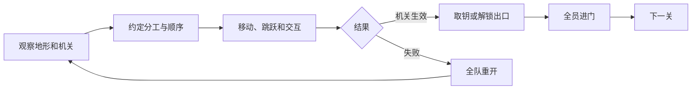
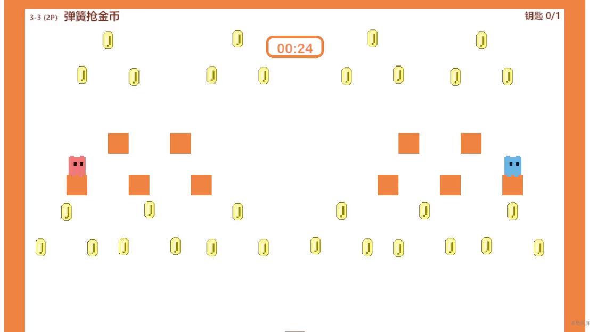
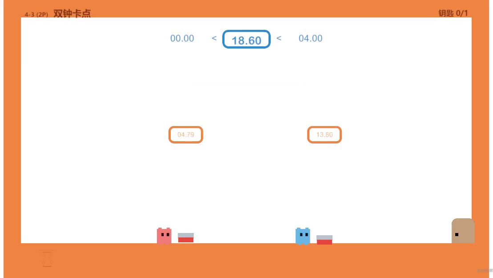
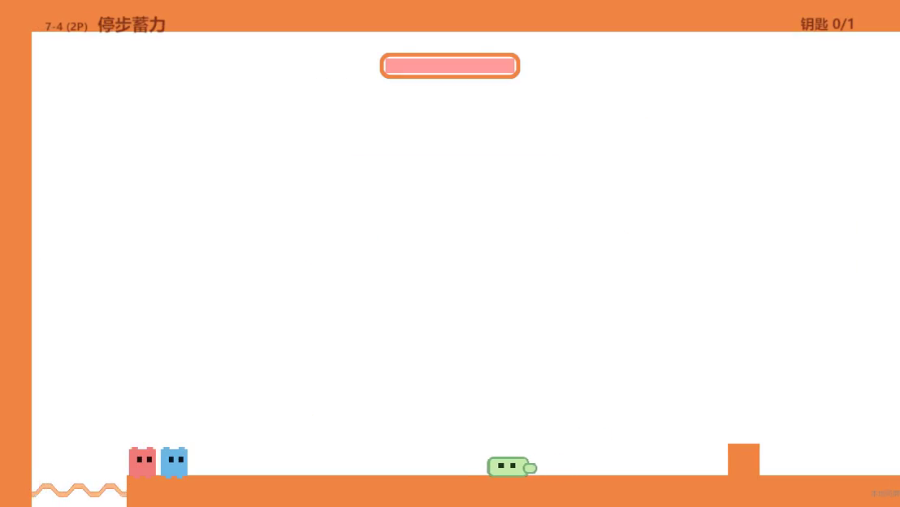
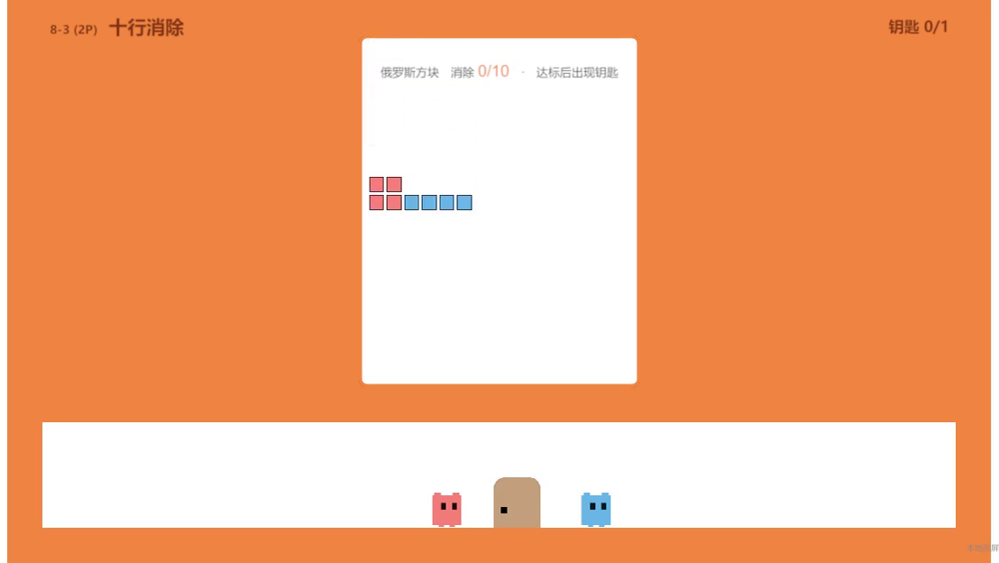
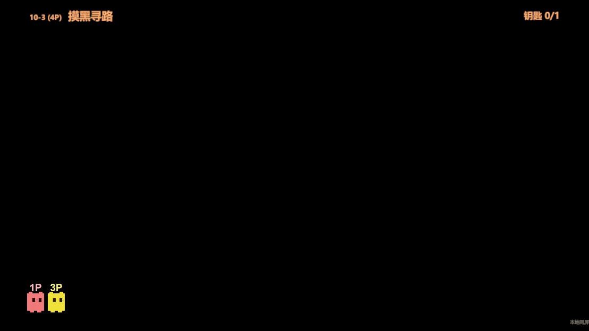

# PICO PARK 复刻项目游戏拆解书

> 分析版本为 2026 年 11 月 21 日的本地项目。关卡内容以主场景为准，共 12 章、48 关，每关配置 2–8 人共 7 个人数版本。规则分析依据运行代码，界面分析依据实机画面。文中的设计意图属于分析判断。

配套[全关卡拆解补充册](PICO%20PARK%20全关卡拆解补充册（48关·2P～8P）.md)包含48关实机画面、336个人数版本分析，以及[43类物体与机关拆解（附图标）](PICO%20PARK%20全关卡拆解补充册（48关·2P～8P）.md#object-analysis)。

## 一、产品概述

| 项目 | 内容 |
| --- | --- |
| 游戏类型 | 2D 多人合作平台解谜 |
| 运行平台 | PC，项目使用团结引擎 1.8.5 |
| 游玩方式 | 本地同屏、Steam 好友联机 |
| 本地入口 | 1 人、2 人、4 人、8 人 |
| 内容结构 | 12 个主题章节，每章 4 关，当前选关全部开放 |
| 核心操作 | 移动、跳跃、下方向、动作键 |
| 单关目标 | 完成机关或规则要求，打开出口，让场上需要通关的角色全部进门 |
| 内容驱动 | 机关变化、多人配合方式变化与队伍熟练度提升 |

游戏让玩家在共享空间中组织行动。个人需要判断移动、跳跃和落点，队伍还要约定谁压板、谁取钥匙、谁先通过、何时起跳。关卡中的队友既能提供落脚点、牵引和运送，也会占据通道、改变机关状态并消耗共享资源。

**核心体验是通过沟通，把分散的个人操作组织成一次共同完成的解题过程。** 从规则可以推断，队伍的成就感主要来自分工生效、时机对齐和全员抵达。玩家是否持续感到有趣，还取决于实际游玩中的等待、失败归因和重试成本。

## 二、目标玩家与游玩场景

目标玩家可从玩法结构推定为愿意沟通的好友群体，以及愿意通过尝试理解机关的平台解谜玩家。本地同屏适合共同观察画面和即时口头配合，好友联机把同样的任务组织延伸到多台设备。

| 游玩场景 | 玩家诉求 | 对应设计 | 体验取舍 |
| --- | --- | --- | --- |
| 双人合作 | 两人都能参与解题 | 压板与通过、踩头与起跳、牵引与被牵引 | 分工容易说清，单个队友的失误影响明显 |
| 多人聚会 | 大家同时参与、快速产生互动 | 多色角色、全员集合、绳索联动、多人接球 | 参与人数增加后，站位与口令更难统一 |
| 固定队伍挑战 | 熟悉机制后优化执行 | 限时、接力、共同资源、精确停钟 | 配合效率提高会带来进步感，重复失败也会积累挫败 |
| 单人进入 | 练习操作、观察关卡 | 主菜单提供单人入口 | 部分内容具有合作依赖，单人可通范围需要逐关判断 |

上述玩家划分依据任务需求推定。当前资料尚不能给出玩家年龄、游玩时长、留存或付费偏好等统计结论。

## 三、核心玩法循环

### 3.1 操作循环与解题循环

单次操作由观察落点、输入动作、得到反馈、修正下一次动作构成。一次关卡尝试则包含完整的团队解题过程。

队伍的短期投入包括操作、注意力、站位以及等待队友的时间。直接反馈来自机关状态改变、钥匙交付、危险触发和过关演出。重试时保留下来的是玩家对路线与分工的理解，场内状态随重开复位。

### 3.2 胜负条件与状态变化

| 状态或条件 | 触发方式 | 后续结果 | 对玩家行为的影响 |
| --- | --- | --- | --- |
| 普通钥匙交付 | 携带者接近门的交付范围 | 钥匙记为送达并离开场景 | 取到钥匙后还需要安排回到出口的路线 |
| 普通门解锁 | 已交付钥匙达到本关总数 | 门开启 | 队员可以分担取钥和等待任务 |
| 受控门解锁 | 对应机关满足供电条件 | 门按机关状态开关 | 最后离开压板的角色也需要有通行办法 |
| 无钥匙普通门 | 没有受控门条件且钥匙总数为零 | 门直接开启 | 难点集中在抵达出口的过程 |
| 全员通关 | 场上需要通关的模拟角色全部进门 | 进入成功状态 | 跑在前面的玩家仍要考虑队友的路线 |
| 角色死亡 | 落出地图、碰危险等 | 全队失败 | 个人操作承担团队后果 |
| 规则失败 | 倒计时耗尽、能力条耗尽等 | 全队失败 | 队伍必须管理规则资源 |
| 自动推进 | 成功状态持续超过约 2.1 秒 | 加载下一关 | 成功反馈之后迅速恢复游玩 |
| 自动重试 | 失败状态持续超过约 1.2 秒 | 重开本关 | 缩短两次尝试之间的间隔 |

“全员”以当前模式实际生成的角色数为口径。普通模式通常一人一角色，共同操纵模式可能只有一个角色，双角色接力模式则由多人轮流操作两个角色。

### 3.3 反馈与动力

成功的机关操作让路线逐步可行，形成局部反馈。完成整关后，新的机关组合提供下一个学习目标。全员失败则会把注意力拉回错误发生的位置，队伍据此调整分工。

一人失误导致全队重来，使协作具有共同责任。它同时会放大技术差异，熟练玩家反复等待同伴时可能失去参与感。因此，判断该规则是否适合某关，需要结合单次失败损失的进度、错误是否容易看懂，以及其他队员能否帮助失误者。

## 四、操作与基础数值

### 4.1 动作与手感

| 参数 | 默认值 | 在关卡中的作用 |
| --- | --- | --- |
| 角色碰撞尺寸 | 宽 0.8 格、高 0.8 格 | 影响窄道通过、平台容纳人数与踩头站位 |
| 跑速上限 | 7.4 格/秒 | 决定赶路效率和水平跨越能力 |
| 起跳速度 | 17.8 格/秒 | 与重力共同决定基础跳高 |
| 重力 | 64 格/秒² | 影响滞空时间和落地节奏 |
| 松开跳跃后的上升速度倍率 | 0.42 | 短按更早收住上升，长按保留跳高 |
| 离地宽限 | 0.085 秒 | 离开边缘后的短时间仍可起跳 |
| 跳跃输入缓冲 | 0.10 秒 | 稍早按下跳跃也有机会在落地后触发 |
| 踩头跳额外速度 | 3.3 格/秒 | 扩展借队友起跳的高度 |
| 默认绳长 | 3.6 格 | 约束相邻队员的间距，具体关卡可覆盖 |

按默认常量计算，普通跳跃的理想竖直抬升为 (17.8^2 ÷ (2 × 64) ≈ 2.48) 格。忽略加速、收跳、障碍和碰撞，理想滞空时间约为 0.56 秒，满速水平位移约为 4.12 格。这些是连续公式估算，关卡中的安全落点还受离散步进和碰撞体尺寸影响。

踩头跳的理想抬升按 ((17.8 + 3.3)^2 ÷ (2 × 64)) 估算约为 3.48 格，相对于队友头顶的起跳面计算。它让队友成为可移动的跳台，叠加底座高度后能够接近普通跳跃难以触及的位置。

### 4.2 数值如何支持合作

起跳缓冲和离地宽限减少细微按键误差，给多人配合留出操作余量。踩头跳增加的高度则把“队友站在哪里”转化为路线条件。

角色、箱子和平台共同占据空间。平台容纳人数、窄道宽度与角色尺寸之间的关系，会决定队伍是否需要排队、分批通过或叠高。人数增加既增加可用劳动力，也增加空间冲突。

## 五、主要系统拆解

### 5.1 踩头、箱子与机关

| 机制 | 规则要点 | 玩家决策 | 推测的设计作用 |
| --- | --- | --- | --- |
| 踩头与叠高 | 下落可落在队友头上，底座移动可带动上方角色 | 谁当底座、上方角色何时起跳 | 让队友直接参与路线搭建 |
| 普通箱子 | 可被推动并作为落脚或施压对象 | 推到哪里、何时借箱起跳 | 把空间操作转化为准备工作 |
| 受限箱子 | 箱子配置允许操作的玩家 | 对应玩家如何到位 | 形成明确的个人责任 |
| 数字箱 | 可配置重量、协作推动等属性 | 需要几人推、其余人先做什么 | 通过人数要求组织集体行动 |
| 踏板与通道 | 压板状态控制门、平台或其他目标 | 谁保持触发、谁先通过 | 建立角色之间的任务依赖 |
| 载人平台 | 可配置所需乘客数并搬运站立者 | 何时集合、何时离台 | 把集合与等待纳入解题流程 |

机关的存在只说明可发生的交互。某块箱子是否必须使用、是否存在替代路线，需要结合完整通关过程判断。

### 5.2 共同动作、接力与两角色分组

共同操纵模式对参与者按键取交集。两个人都按向右时才能形成共同的右移输入，其中一人松开后该方向不再通过。因此队伍需要共享口令和动作节奏。

轮流模式将控制权交给当前玩家，通过触发器完成交接。交接改变的是操作责任，玩家还要继续处理角色所处的位置、速度和下一落点。

双角色分组模式把参与者分为两组，各组轮流控制对应角色。以四人开局为例，两只角色初始分别由 1P 和 3P 操作，换手后可以变为 2P 和 4P。头顶的席位编号使队伍能够识别当前操作者。

| 控制形式 | 主要协调内容 | 可能的体验问题 |
| --- | --- | --- |
| 一人一角色 | 位置与时机 | 队员互相挡路或遗漏集合 |
| 多人同键操纵 | 按键一致与同时松开 | 成功输入被谁打断可能难以判断 |
| 单角色接力 | 换手时机与动作衔接 | 等待者需要理解接下来的任务 |
| 双角色分组接力 | 组内换手与组间配合 | 席位、角色和责任关系较复杂 |

第 5 章沿用“all for one（仅单人）”的章节标题。该章包含多人共同操纵一只角色的内容，标题文字与玩家人数之间存在理解歧义。

### 5.3 时间、停步与共享资源

限时关以“剩余时间”压缩解题和操作余量。卡点时间关同时要求多只时钟被停下，并校验剩余时间总和，队伍需要控制各自的停钟时机。

红绿灯模式根据角色实际速度判定是否违反停步要求。切换后有约 0.22 秒宽限，之后横向或纵向速度绝对值大于 0.65 时会触发死亡。跳跃中的角色也有速度，因此“看到红灯再停”与“提前落地”会产生不同结果。

能力条模式按实际发生位移的角色数扣除资源，全员静止时恢复。平台搬运等造成的位置变化也可能计入消耗，队伍需要关注真实位移。

以 7-4 双人配置为例，初始能力为 10，每名移动角色每秒消耗 4，全员不动时每秒恢复 4。若持续移动人数为 (n)，忽略初始采样与离散误差，能力可维持约 (10 ÷ (4n)) 秒。单人连续移动约 2.5 秒，双人同时移动约 1.25 秒。该关系促使队伍在“一起走”和“分批走”之间安排节奏。

### 5.4 方块消行与打砖块

方块模式把玩家的直接操作对象转为对应颜色的下落方块。达到目标消行数后出现钥匙，随后回到取钥、开门和进门的流程。玩家需要在共享棋盘上处理自己的落点，同时考虑队友后续的可用空间。

打砖块模式要求玩家用角色顶球破砖。不同关卡的砖块和球数量改变覆盖范围与补位压力，钥匙可配置为清砖后出现或开局常驻。规则同时需要判断球全部丢失后的失败条件。

两类玩法保留了队伍共同达标的结构，改变了玩家观察和操作的对象。从平台落点转到棋盘空隙或球的轨迹，可以形成章节间的节奏变化。

### 5.5 吸取、牵引与运送

吸人枪通过吸入和发射搬运目标，队友可以成为被运送对象。吸盘则通过持续输入牵引并吸附目标。两者将伙伴的位置转化为可主动调整的条件。

窄道、深坑和激光为运送行为提供约束。操作者需要考虑吸取方向和目标落点，被运送者需要配合释放后的动作。其合作价值在于队员能直接帮助伙伴跨越障碍，同时也要求被运送者能够预判控制权与位置的变化。

## 六、关卡结构与难度组织

### 6.1 十二章的机制分布

| 章节 | 内容重心 | 主要能力要求 | 结构上的作用 |
| --- | --- | --- | --- |
| 1.hello pico park | 踏板、箱子、载人平台 | 理解机关与路线关系 | 建立基础操作和任务分工 |
| 2.go together | 绳索、玻璃、激光 | 控制间距、落点与通过时机 | 增加行动之间的约束 |
| 3.time limit | 金币、踏板、弹簧与倒计时 | 分区、路线效率和快速执行 | 将已知动作放入时间压力 |
| 4.gimmick gimmick | 护盾、飞机、停钟、体型 | 识别并学习特殊规则 | 提供明显的新鲜感 |
| 5.all for one（仅单人） | 共同操纵与接力 | 输入一致、换手衔接 | 改变团队控制关系 |
| 6.push or jump | 箱子与全员平台 | 搬运、搭路、集合 | 强调空间准备与先后顺序 |
| 7.move and stop | 警戒、红绿灯、幽灵、能力条 | 停步、观察、资源节奏 | 将克制行动变成有效操作 |
| 8.retro game | 消行与顶球破砖 | 落点安排、轨迹判断与补位 | 改变操作对象，形成玩法变化 |
| 9.ball park | 炮弹、弹珠与配重 | 球路、重量和时机 | 进一步强调物体运动关系 |
| 10.two players | 两角色机关与黑夜探索 | 组间协作、接力与探路 | 对合作组织提出复合要求 |
| 11.hand gimmick | 吸入、发射与牵引 | 运送、落点准备与角色配合 | 增加伙伴之间的主动干预 |
| 12.last park | 护盾、风扇、飞行与复合危险 | 综合使用已学能力 | 形成内容收束 |

章节序号体现内容顺序，实际难度还取决于地形、规则参数和人数版本。当前选关全部开放，玩家可以跨章游玩，因此新机制在首次接触时能否被理解，具有独立的设计价值。

### 6.2 难度来自哪些约束

| 难度维度 | 本项目中的表现 | 对体验的影响 |
| --- | --- | --- |
| 操作精度 | 跳台、激光缝隙、顶球接球 | 要求判断落点和输入时机 |
| 机关理解 | 踏板连锁、受控门、停钟 | 要求识别因果关系 |
| 协作同步 | 绳索、红绿灯、共同按键 | 队伍中最晚或最早的动作可能影响所有人 |
| 分工与顺序 | 取钥、压板、推箱、分区收集 | 要求安排角色与任务的对应关系 |
| 资源压力 | 倒计时、能力条、球数量 | 减少可用尝试空间或行动余量 |
| 信息获取 | 黑夜揭示、幽灵朝向、灯的预告 | 要求先观察再决定行动 |
| 失败损失 | 一人死亡、全队复位 | 已完成的步骤越多，失误代价越明显 |

多人版本的难度变化包含双向作用。更多玩家可以分担收集和站位任务，也可能加大集合、输入一致与共享资源管理的难度。因此，2P、4P、8P 的体验需要分别讨论。

## 七、典型关卡分析

### 7.1 3-3「弹簧抢金币」

*图 1　3-3 双人局。顶部显示关卡名、倒计时与钥匙进度，弹簧和金币分布在不同高度。*

双人场景配置 25 秒、30 枚金币与 24 个弹簧。玩家利用弹簧反复弹跳，改变水平位置并清理不同高度的收集目标。

**分析判断**是弹簧承担高频纵向移动，玩家将主要注意力用于横向修正、金币覆盖和队友分区。双人从不同区域开始清理，可以减少重复路线。剩余金币越少，搜索遗漏目标和回到出口所占的时间可能越突出。

该关的解题顺序可以概括为判断金币分布、划定各自区域、完成往返收集，再确认目标和出口状态。这个顺序是从布局推导的策略，实际最优路线仍取决于移动轨迹与弹簧落点。

### 7.2 4-3「双钟卡点」

*图 2　4-3 双人局。两名玩家各自靠近一块按钮，场内两只时钟分别显示剩余时间，顶部显示总剩余时间和目标区间。*

场景配置两只时钟和两个按钮。每只时钟在对应机关供电时停住，全部时钟停止后校验总剩余时间。代码按上下限构成的闭区间判断，并容纳微小浮点误差。

**分析判断**是队伍需要同时处理个人时机和公共结果。一个人停得过早，会改变另一人的可用时间。沟通内容由“什么时候走”变成“各自留多少时间”，形成可计算的分工。

这类关卡的成败信息应让玩家分辨三种情况，即仍有时钟未停止、总时间已耗尽、全部停钟但总和超出区间。只有清楚知道失败属于哪种原因，下一次尝试才容易形成有效修正。

### 7.3 7-4「停步蓄力」

*图 3　7-4 双人局。顶部能力条显示全队共享资源，角色前方的毛毛虫和场内激光限制了行动与等待的位置。*

共享能力条将全队实际位移汇总为消耗，全员不动才恢复。双人场景同时布置了毛毛虫、激光、弹簧与数字箱。

**分析判断**是该关把移动拆成有计划的短段，安全位置同时承担等待和恢复功能。队员需要约定恢复窗口，避免一人认为已经休息、另一人仍在消耗资源。危险物又限制了原地等待的位置，形成空间安全和资源恢复之间的协调。

它与普通倒计时关的区别体现在玩家可主动恢复资源。正确的停顿能延长后续行动空间，队伍的计划包含走、停以及谁先走。

### 7.4 8-3「十行消除」

*图 4　8-3 双人局。共享棋盘中的颜色对应玩家，消行进度与钥匙阶段构成目标反馈。*

所有人数版本均配置消除 10 行。方块阶段锁定角色，达标后揭示钥匙。合作任务由共享棋盘的空间安排构成，个人放下的方块会改变其他玩家的后续选择。

**分析判断**是队伍需要共同维护可用空隙，决定谁补缺口、谁为下一块预留位置。目标总行数提供明确进度，完成后再进入常规出口流程，让特殊玩法与全局通关规则衔接。

### 7.5 10-3「摸黑寻路」

*图 5　10-3 四人局。两只角色对应两组操作者，黑暗限制路线信息，头顶席位标识当前控制者。*

场景规则为黑夜，布置揭示触发器、弹簧、载人平台与箱子。3–8 人版本增加双角色分组接力，四人开局实际操作两个角色。

**分析判断**是该关同时要求空间探索和责任交接。玩家先获得局部路线信息，再将其通过沟通传递给队友。换手者需要知道角色当前位置和下一步落点，等待者也能通过观察参与。

局内标题和钥匙数字在黑夜中采用浅橙色，避免深色文字与背景混合。头顶席位继续提供操作归属信息。

## 八、视听表现与界面反馈

### 8.1 视觉信息层级

白色背景、橙色地形与多色角色构成主要视觉关系。角色颜色支持席位识别，钥匙的黄色突出目标位置，危险物通过轮廓、运动和颜色提示风险。黑夜关通过遮蔽地形改变信息获取节奏。

| 信息 | 表现形式 | 玩家需要完成的判断 |
| --- | --- | --- |
| 当前关卡 | 左上编号、人数与关卡名 | 身处哪一关、当前多少人 |
| 钥匙进度 | 右上已交付数量与总数 | 是否还需继续取钥 |
| 时间压力 | 顶部中央倒计时，临近结束变色与提示音 | 还能执行多少动作 |
| 共同资源 | 能力条 | 是否需要停步恢复 |
| 规则进度 | 消行数、剩余砖块等 | 距离规则目标还有多少 |
| 操作归属 | 角色头顶席位，角色颜色 | 当前由谁控制 |
| 机关状态 | 灯、按钮、门和运动反馈 | 操作是否生效、能否通行 |
| 结果反馈 | 成功或失败文字、音效与特效 | 本次尝试如何结束 |

局内关卡提示语已隐藏，玩家更多依靠场景布局、机关反馈和共同尝试理解路线。这增加了目标与交互物可辨识性的要求。选关界面仍保留关卡说明，其文本需要与当前场景一致。

### 8.2 音效与动作反馈

起跳、落地、捡取、按钮变化和开门均有对应音效。临近倒计时结束的提示音为时间压力提供额外提醒，过关与失败通过独立音效确认结果。成功时的粒子与震动进一步突出整队达成目标的时刻。

这些反馈的作用在于让操作后果尽快被感知。多人同时行动时，过强或过密的声音也可能互相掩盖，反馈效果需要结合真实多人游玩判断。

## 九、内容推进与重玩价值

关卡全部开放，玩家可以按章节顺序学习，也能直接选择想玩的机制。每章四关便于把一种合作主题组织成可辨认的内容单元，具体机关在章节内产生变化。

当前内容的重玩动力主要来自三个方面。一是熟悉布局后缩短尝试次数，二是更换队友或人数后重新安排站位和分工，三是在共同操纵、接球、停钟等任务中提高默契。

可确认的数值主要服务于单关动作、机关和规则。金币在收集关中承担局内目标进度，当前资料中尚未建立跨关养成或消费循环。因而不能从金币数量推导付费经济、长期成长或玩家留存结果。

## 十、设计评价

| 观察到的结构 | 设计价值判断 | 对体验的要求 |
| --- | --- | --- |
| 基础动作较少，机关组合丰富 | 玩家可将精力投入配合与路线 | 新规则必须能被识别和反馈 |
| 队友可成为落脚、运送或牵引对象 | 伙伴直接参与解题，互动具有实际作用 | 帮助与干扰的结果要容易理解 |
| 全员成功与全队失败 | 强化共同目标和责任 | 失败归因清楚，重试损失可接受 |
| 同一套出口规则连接不同玩法 | 特殊章节仍有一致的完成目标 | 规则达标、取钥和进门阶段衔接清晰 |
| 2–8 人版本覆盖 | 支持不同规模的队伍 | 空间、同步要求与资源消耗适配人数 |
| 持续引入新控制关系 | 形成内容变化，拓宽合作方式 | 控制权、等待任务与换手时机可辨认 |

该项目最值得提炼的设计关系是，**关卡通过共同约束制造沟通需求，再让配合产生可见的路线进展。** 判断单关是否成立，应关注每位玩家在其中的有效任务、等待期间的参与感，以及失败后能否理解如何改进。

以上体验判断来自规则与布局分析。通关时间、成功率、玩家满意度和各人数版本的实际难度，尚需完整游玩数据支撑。

## 附录　48 关内容索引

以下机关数量与时间参数以双人场景为样本，另有说明的除外。

### 1.hello pico park

| 关卡 | 关卡名 | 场景依据 |
| --- | --- | --- |
| 1-1 | 踏板搭桥 | 通过踏板、闸门和载人平台完成入门协作。 |
| 1-2 | 数字箱取钥 | 数字箱、编号障碍和钥匙。双人场景没有踏板。 |
| 1-3 | 踏板连锁 | 多块踏板与多道闸门形成连锁，场内还布置了数字箱。 |
| 1-4 | 搭台越障 | 移动障碍与载人平台决定过关时机。 |

### 2.go together

| 关卡 | 关卡名 | 场景依据 |
| --- | --- | --- |
| 2-1 | 同绳跳台 | 绳索限制队伍间距，队员要协调跨越落脚点。 |
| 2-2 | 玻璃窄桥 | 窄桥配置玻璃段与激光，场景主规则未开启绳索。 |
| 2-3 | 绳索越光 | 绳索联动叠加激光，队伍要协调整体移动。 |
| 2-4 | 玻璃桥与弹簧 | 弹簧、玻璃、激光与载人平台组合，场景主规则未开启绳索。 |

### 3.time limit

| 关卡 | 关卡名 | 场景依据 |
| --- | --- | --- |
| 3-1 | 限时搜金币 | 2 人配置 60 秒，散布 47 枚金币。 |
| 3-2 | 抢时踩踏板 | 2 人配置 3 秒起始时间，场内有 7 块踏板、2 个弹簧。 |
| 3-3 | 弹簧抢金币 | 2 人配置 25 秒，利用 24 个弹簧收集 30 枚金币。 |
| 3-4 | 推箱踩双板 | 2 人配置 7 秒，数字箱配合两块踏板。 |

### 4.gimmick gimmick

| 关卡 | 关卡名 | 场景依据 |
| --- | --- | --- |
| 4-1 | 举盾挡激光 | 用盾牌应对激光，掩护队伍穿越。 |
| 4-2 | 飞机穿障 | 飞机模式自动前进，手动调整飞行路径。 |
| 4-3 | 双钟卡点 | 两块踏板控制两只时钟，全部停钟后校验总剩余时间。 |
| 4-4 | 变身钻窄道 | 踩体型按钮改变角色体型，利用不同体型通过地形。 |

### 5.all for one（仅单人）

| 关卡 | 关卡名 | 场景依据 |
| --- | --- | --- |
| 5-1 | 同键过障 | 全员按键取交集，协力操纵同一角色通过移动障碍。 |
| 5-2 | 跳台接力 | 触发交接点轮换操作权，接力通过跳台。 |
| 5-3 | 同键躲激光 | 同键操纵一只角色，同时处理移动障碍与激光。 |
| 5-4 | 接力穿光阵 | 接力操控叠加三道激光。 |

### 6.push or jump

| 关卡 | 关卡名 | 场景依据 |
| --- | --- | --- |
| 6-1 | 同色箱搭梯 | 受限箱子需要对应玩家处理，摆出可攀爬的路线。 |
| 6-2 | 箱梯与激光 | 用箱子组织登高路线，兼顾载人平台和激光。 |
| 6-3 | 全员搭电梯 | 队伍一起登上载人平台，分段转移。 |
| 6-4 | 别踩危险踏板 | 绕开危险踏板，寻找能安全起跳、取钥的站位。 |

### 7.move and stop

| 关卡 | 关卡名 | 场景依据 |
| --- | --- | --- |
| 7-1 | 别吵醒云怪 | 根据云怪的警戒状态决定行动或停住。 |
| 7-2 | 一二三木头人 | 看灯决定走停，蓝灯可行，粉红灯停。2 人配置为走 10 秒、停 7 秒，切换前 4 秒闪烁。 |
| 7-3 | 回头定幽灵 | 用角色朝向制止害羞幽灵，再取钥前进。 |
| 7-4 | 停步蓄力 | 共享能力条，移动消耗、全员静止恢复。场内还布置了毛毛虫与激光。 |

### 8.retro game

| 关卡 | 关卡名 | 场景依据 |
| --- | --- | --- |
| 8-1 | 多人拼方块 | 各自控制对应颜色的下落方块，合作消行取钥。 |
| 8-2 | 弹球破砖 | 打砖块规则。2 人配置为 30 块砖和 4 个球。 |
| 8-3 | 十行消除 | 所有人数版本都配置为消除 10 行，达标后出现钥匙。 |
| 8-4 | 接球清砖墙 | 多人接球和顶球清砖，2 人配置为 40 块砖和 4 个球。 |

### 9.ball park

| 关卡 | 关卡名 | 场景依据 |
| --- | --- | --- |
| 9-1 | 借炮破钥匙瓶 | 炮台与钥匙瓶组合，注意炮弹轨迹。 |
| 9-2 | 配重送弹珠 | 通过天秤、跷跷板与弹珠发射器控制弹珠路线。 |
| 9-3 | 弹球攻砖阵 | 打砖块规则。2 人配置为 88 块砖和 8 个球。 |
| 9-4 | 弹珠破钥匙瓶 | 弹珠发射器与钥匙瓶组合。 |

### 10.two players

| 关卡 | 关卡名 | 场景依据 |
| --- | --- | --- |
| 10-1 | 双人开闸 | 两角色配合踏板与闸门。3–8 人变体增加分组轮流控制。 |
| 10-2 | 滚动平台接力 | 滚动平台、弹簧和闸门交错。3–8 人变体增加分组轮流控制。 |
| 10-3 | 摸黑寻路 | 黑暗中依靠揭示触发器找路。3–8 人变体增加分组轮流控制。 |
| 10-4 | 摸黑搭平台 | 黑夜、载人平台与揭示触发器组合。5–8 人变体增加分组轮流控制。 |

### 11.hand gimmick

| 关卡 | 关卡名 | 场景依据 |
| --- | --- | --- |
| 11-1 | 吸人枪渡口 | 用吸人枪把队友吸入，再发射到目标位置。 |
| 11-2 | 吸盘运队友 | 吸盘牵引与吸附队友，兼顾激光路线。 |
| 11-3 | 吸取过窄道 | 吸人枪、可吸入箱子、玻璃和激光组合。 |
| 11-4 | 吸盘穿光阵 | 吸盘配合踏板和闸门，穿过激光区域。 |

### 12.last park

| 关卡 | 关卡名 | 场景依据 |
| --- | --- | --- |
| 12-1 | 推箱举盾 | 护盾、数字箱、踏板和激光组合。 |
| 12-2 | 借风飞跃 | 利用风扇气流、弹簧和载人平台调整落点。 |
| 12-3 | 飞行冲刺 | 以飞机模式调整前进路线。 |
| 12-4 | 激光与虫阵 | 终关 2 人场景布置了毛毛虫、激光、踏板与弹簧。 |
